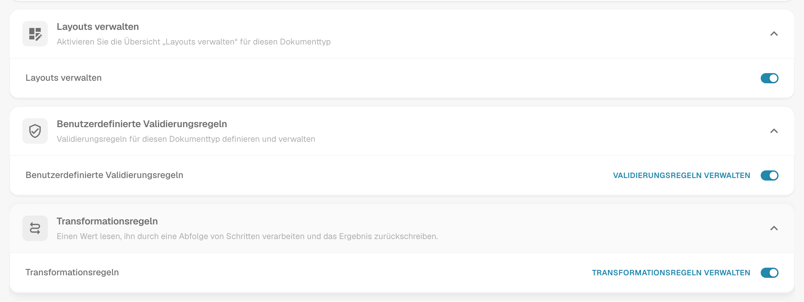
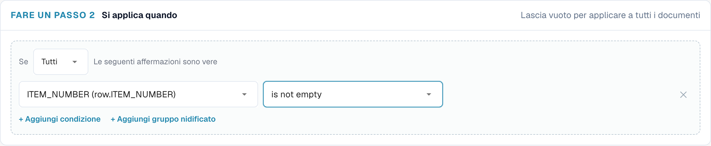
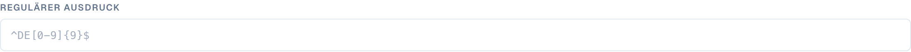
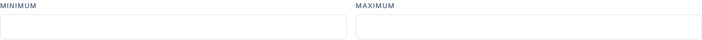
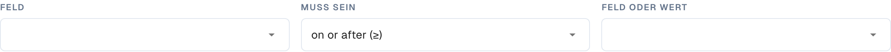
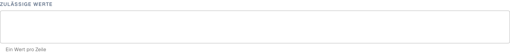
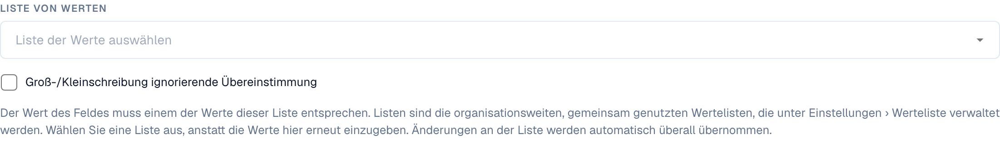
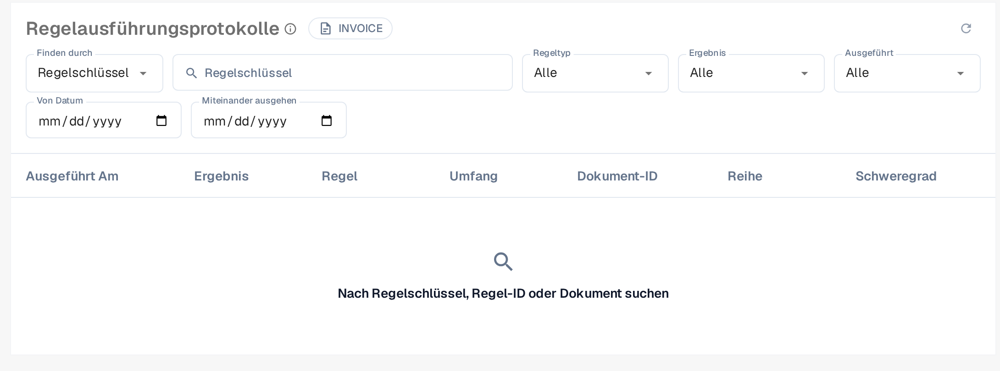

# Benutzerdefinierte Validierungsregeln



## Überblick

Mit benutzerdefinierten Validierungsregeln können Administratoren **eigene Prüfungen** für die Daten definieren, die DocBits aus einem Dokument extrahiert, ohne ein Skript zu schreiben und ohne auf eine Produktänderung zu warten.

Eine Regel beantwortet drei Fragen:

1. **Wo** wird das Problem angezeigt? An einem Kopffeld oder an einer Zelle einer Tabellenzeile.
2. **Wann** gilt die Regel? Immer oder nur für Dokumente (oder Zeilen), die eine Bedingung erfüllen, siehe [Rule Conditions (Applies when)](rule-conditions-applies-when.md).
3. **Was** muss zutreffen? Ein Feld muss gefüllt sein, einem Format entsprechen, in einem Bereich liegen, in einer Liste vorkommen, sich korrekt mit einem anderen Feld vergleichen lassen oder sich aufsummieren.

Schlägt die Prüfung fehl, markiert DocBits das Feld oder die Zelle auf dem **Validierungsbildschirm** und zeigt Ihre Meldung an, genau wie bei einer integrierten Prüfung. Bei der Schwere **FEHLER** kann das Dokument erst validiert werden, wenn das Problem behoben ist; bei **Warnung** sieht der Benutzer lediglich einen Hinweis.

Regeln werden pro **Dokumenttyp** definiert und laufen für jedes Dokument dieses Typs: bei der Verarbeitung und bei jedem Speichern des Dokuments.

### Probleme, die sie lösen

| Geschäftliche Anforderung | Ohne benutzerdefinierte Regeln | Mit einer benutzerdefinierten Regel |
| --- | --- | --- |
| Deutsche Rechnungen über 250 EUR müssen die Steuernummer des Lieferanten enthalten | ein Skript, oder Benutzer müssen daran denken | **Pflichtfeld** für Supplier Tax ID, *applies when* Herkunft ist DE und Gesamtbetrag ist größer als 250 |
| Die Rechnungsnummern eines Lieferanten sehen immer aus wie `INV-123456` | Tippfehler gelangen ins ERP | **Muster** `^INV-\d{6}$` für Invoice Number bei diesem Lieferanten |
| Jede Artikelzeile braucht eine Menge größer als null | Zeilen mit Menge 0 werden exportiert | **Reichweite** (Minimum 0.01) für die Spalte Quantity |
| Das Fälligkeitsdatum darf nicht vor dem Rechnungsdatum liegen | falsche Zahlläufe | **Vergleichsfelder**: Due Date am oder nach Invoice Date |
| Die Zeilen müssen sich zum Nettobetrag aufsummieren | nur die feste integrierte Prüfung | **Formel** `sum(row.NET_AMOUNT) == header.total_net_amount` mit eigener Toleranz |
| Nur Währungen, die Ihr ERP kennt, sind erlaubt | Exportfehler im ERP | **Wertelisten** für Currency |
| Benutzer auf ungewöhnliche Werte hinweisen, ohne sie zu blockieren | nicht möglich | jede Regel mit der Schwere **Warnung** |

## Benutzerdefinierte Validierungsregeln aktivieren

Benutzerdefinierte Validierungsregeln werden **pro Dokumenttyp** eingeschaltet. Es gibt keinen organisationsweiten Schalter.

1. Gehen Sie zu **Einstellungen → Globale Einstellungen → Dokumenttypen**.
2. Klicken Sie auf der Karte des Dokumenttyps auf das **Einstellungen**-Symbol (Zahnrad).
3. Öffnen Sie den Abschnitt **Benutzerdefinierte Validierungsregeln** und schalten Sie den Schalter ein.
4. Klicken Sie auf **Validierungsregeln verwalten**, um die Regelliste zu öffnen.

<figure><figcaption>
Die Schalter für Manage Layouts, Custom Validation Rules und Transformation Rules
</figcaption></figure>

Ab sofort zeigt die Karte des Dokumenttyps zusätzlich einen Link **Validierungsregeln**.

<figure><figcaption>
Die Links auf der Dokumenttyp-Karte
</figcaption></figure>


**Der Schalter ersetzt die integrierten Betragsprüfungen.** Solange benutzerdefinierte Validierungsregeln für einen Dokumenttyp aktiviert sind, werden die fest codierten Prüfungen „Gesamtbetrag = Nettobetrag + Steuerbetrag“ sowie die Prüfungen von Zeilenbetrag und Rabatt für ihn **nicht** ausgeführt; die konfigurierbaren Regeln treten an ihre Stelle. Bilden Sie die Prüfungen, auf die Sie sich verlassen, als Regeln nach (siehe die [Rezepte](#rezepte)), bevor Sie den Schalter einschalten. Wenn Sie den Schalter ausschalten, werden die integrierten Prüfungen wiederhergestellt. Alle übrigen Feldvalidierungen (Pflichtfelder, Formate, Stammdaten) laufen weiterhin.


## Die Regelliste

**Dokumenttypen → (Dokumenttyp) → Validierungsregeln** listet jede Regel des Dokumenttyps auf.

<figure><figcaption>
Verwaltung benutzerdefinierter Validierungsregeln mit ausgeblendeten Konfigurationsnamen.
</figcaption></figure>

Jede Karte zeigt Namen und Beschreibung der Regel sowie die Badges für ihre **Ebene** (Header / Line / Table), **Schwere** (Error / Warning), das **Feld**, an dem der Fehler angezeigt wird, und ihre **Quelle**. Mit dem Schalter rechts aktivieren oder deaktivieren Sie eine Regel, über das Menü **⋮** duplizieren oder löschen Sie sie. Filtern Sie die Liste nach Ebene (**All / Header / Line / Table**) und Status (**All / Active / Inactive**) oder durchsuchen Sie sie.

### System-Standardregeln, angepasste und benutzerdefinierte Regeln

| Quelle | Was es ist | Was Sie tun können |
| --- | --- | --- |
| **Systemstandard** | Eine Regel, die mit DocBits für alle Organisationen ausgeliefert wird. | Sie kann nicht direkt bearbeitet werden, der Builder zeigt „This is a system default rule and cannot be edited.“ Klicken Sie auf **Anpassen**, um eine eigene bearbeitbare Kopie zu erstellen, oder schalten Sie sie aus, um sie für Ihre Organisation zu deaktivieren. |
| **Maßgeschneidert** | Eine System-Standardregel, die Ihre Organisation geändert oder ausgeschaltet hat. | Bearbeiten Sie sie wie Ihre eigene Regel. **Auf Standard zurücksetzen** löscht Ihre Kopie und stellt das Original wieder her. |
| **BENUTZERDEFINIERT** | Eine Regel, die Ihre Organisation erstellt hat. | Bearbeiten, **Duplizieren**, **Löschen**. |

Änderungen an System-Standardregeln wirken sich nie auf andere Organisationen aus.

## Eine Regel erstellen

Klicken Sie auf **Neue Regel**. Der Builder besteht aus drei Schritten. **Testregel** und **Speichern** befinden sich oben rechts.

### Schritt 1: Name & Geltungsbereich

<figure><figcaption>
Schritt 1 für eine Kopffeld-Regel
</figcaption></figure>

| Einstellung | Was sie bewirkt |
| --- | --- |
| **Regelebene** | Worauf die Regel schaut und wo der Fehler angezeigt wird, siehe [Regelebenen](#regelebenen). |
| **Schwere** | **FEHLER** markiert das Feld als ungültig und blockiert die Validierung. **Warnung** zeigt die Meldung an, blockiert aber nie. |
| **Regelname** | Wird in der Liste und für Administratoren angezeigt. Beschreiben Sie darin die Regel („Steuernummer des Lieferanten für deutsche Rechnungen erforderlich“). |
| **Regelschlüssel** | Ein technischer Schlüssel, der aus dem Namen erzeugt wird. Er bleibt gleich, wenn Sie die Regel später umbenennen. Klicken Sie auf den Stift, um vor dem ersten Speichern einen eigenen Schlüssel zu wählen; danach ist er fest. |
| **Beschreibung** | Optionale Erläuterung für andere Administratoren. |
| **Name der Tabelle** | *Nur Tabellenzeile.* Die Tabelle, deren Zeilen geprüft werden, zum Beispiel `INVOICE_TABLE`. |
| **Attach error to field / column** | Das Feld (bei Tabellenzeilen die Spalte), das den Fehler auf dem Validierungsbildschirm anzeigt. |

#### Regelebenen

| Ebene | Läuft | Fehler wird angezeigt an | Kann lesen | Typische Regel |
| --- | --- | --- | --- | --- |
| **Kopffeld** | einmal pro Dokument | einem Kopffeld | `header.*`, `doc.*` | „Die Steuernummer des Lieferanten ist für deutsche Rechnungen erforderlich“ |
| **Tabellenzeile** | einmal für jede Zeile der gewählten Tabelle | der Zelle der fehlerhaften Zeile | `row.*` (die aktuelle Zeile), `header.*`, `doc.*` | „Die Menge muss größer als null sein“ |
| **Gesamte Tabelle** | einmal pro Dokument, über alle Zeilen zusammen | einem Kopffeld | Summen über die Zeilen (`sum()`, `count()`, `min()`, `max()`), `header.*`, `doc.*` | „Die Zeilennettobeträge müssen sich zum Nettobetrag aufsummieren“ |

<figure><figcaption>
Eine Tabellenzeilen-Regel: die Tabelle und die Spalte, die den Fehler anzeigt
</figcaption></figure>

### Schritt 2: Applies when

Legen Sie fest, ob die Regel für jedes Dokument oder nur für einige gilt. Lassen Sie das Feld leer, um jedes Dokument zu prüfen. Andernfalls fügen Sie Bedingungszeilen hinzu, zum Beispiel „Document Origin is Deutsch“ und „Total Amount greater than 250“, und kombinieren Sie diese mit **Alle** / **ANY** und verschachtelten Gruppen.

<figure><figcaption>
Die Prüfung läuft nur für deutsche Dokumente über 250 mit EUR oder ohne Währung
</figcaption></figure>

Bei Tabellenzeilen-Regeln kann die Bedingung auch die Spalten der aktuellen Zeile verwenden und wird **Zeile für Zeile** ausgewertet: Zeilen, die nicht zutreffen, werden einfach nicht geprüft.

<figure><figcaption>
Es werden nur Artikelzeilen (Zeilen mit einer Artikelnummer) geprüft
</figcaption></figure>

Bedingungen werden ausführlich, mit jedem Feld, jedem Operator und jeder Vergleichsregel sowie vielen Beispielen, auf der Seite [Rule Conditions (Applies when)](rule-conditions-applies-when.md) erklärt.

### Schritt 3: Prüfung, was zutreffen muss

Wählen Sie eine Prüfung. Die Einstellungen unterhalb der Karten ändern sich je nach gewählter Prüfung.

<figure><figcaption>
Die sieben Prüfungen. Required benötigt keine weiteren Einstellungen
</figcaption></figure>

#### Required: Feld muss einen Wert haben

Schlägt fehl, wenn das Feld leer ist (fehlt oder nur Leerzeichen enthält). Keine weiteren Einstellungen.

Verwenden Sie die Prüfung zusammen mit **Gilt, wenn**, um ein Feld **bedingt** zum Pflichtfeld zu machen. Ein Feld, das immer gefüllt sein muss, konfigurieren Sie besser als Pflichtfeld in den Feldeinstellungen.

<figure><figcaption>
Eine Required-Prüfung: keine weiteren Einstellungen
</figcaption></figure>

> *Supplier Tax ID ist erforderlich*, Applies when *Document Origin is Deutsch* und *Total Amount greater than 250*.

#### Formula: Beträge müssen sich aufsummieren

Ein arithmetischer Vergleich. Der Ausdruck enthält genau **einen** Vergleich (`==`, `!=`, `>`, `>=`, `<`, `<=`); beide Seiten können `+ - * /`, Zahlen, Klammern und Feldverweise verwenden.

<figure><figcaption>
Eine Formel über die ganze Tabelle mit Toleranz und Platzhaltern in der Meldung
</figcaption></figure>

* Klicken Sie auf die Chips unter dem Ausdruck, um Funktionen und Feldpräfixe einzufügen: `sum()`, `count()`, `min()`, `max()`, `default()`, `coalesce()`, `header.`, `doc.`. Während Sie einen Feldnamen eingeben, öffnet sich eine Liste passender Felder.
* `sum(row.NET_AMOUNT)`, `count(row.ITEM_NUMBER)`, `min(...)`, `max(...)` arbeiten über alle Zeilen und stehen nur auf der Ebene **Gesamte Tabelle** zur Verfügung. `count()` zählt die Zeilen, in denen die Spalte gefüllt ist.
* `default(header.discount, 0)` verwendet `0`, wenn das Feld leer ist; `coalesce(header.a, header.b, 0)` verwendet den ersten gefüllten Wert.
* **Toleranz**: Bei `==` und `!=` gelten Abweichungen bis zu diesem Betrag als gleich. Verwenden Sie `0.01` oder `0.05`, um Rundungsdifferenzen aufzufangen. Bei `<`, `>`, `<=` und `>=` hat sie keine Wirkung.
* Leere oder nicht lesbare Beträge zählen als `0`. Eine Division durch null überspringt die Regel, anstatt einen Fehler auszulösen.
* In der Fehlermeldung wird `{actual}` durch das Ergebnis der linken Seite und `{expected}` durch das Ergebnis der rechten Seite ersetzt.

Beispiele:

| Zweck | Ebene | Ausdruck | Toleranz |
| --- | --- | --- | --- |
| Kopfsummen sind konsistent | Header field | `header.total_amount == header.total_net_amount + header.total_tax_amount` | 0.01 |
| Zeilen ergeben den Nettobetrag | Whole table | `sum(row.NET_AMOUNT) == header.total_net_amount` | 0.05 |
| Zeilenbetrag = Menge × Einzelpreis | Table line | `row.NET_AMOUNT == row.QUANTITY * row.UNIT_PRICE` | 0.01 |
| Steuer nicht höher als 19 % des Nettobetrags | Header field | `header.total_tax_amount <= header.total_net_amount * 0.19` | – |
| Mindestens eine Zeile | Whole table | `count(row.ITEM_NUMBER) >= 1` | 0 |

#### Pattern: einem Format / regulären Ausdruck entsprechen

Der Wert muss einem **regulären Ausdruck** entsprechen. Der Ausdruck durchsucht den Wert; verankern Sie ihn daher mit `^` (Anfang) und `$` (Ende), wenn der gesamte Wert passen muss. Aktivieren Sie **Groß-/Kleinschreibung ignorierende Übereinstimmung**, wenn die Groß- und Kleinschreibung keine Rolle spielt.

| Format | Regulärer Ausdruck |
| --- | --- |
| `INV-` gefolgt von sechs Ziffern | `^INV-\d{6}$` |
| Deutsche USt-IdNr. | `^DE\d{9}$` |
| Bestellung, die mit 45 beginnt und 10 Ziffern lang ist | `^45\d{8}$` |
| Nur Ziffern | `^\d+$` |
| IBAN (grobe Prüfung) | `^[A-Z]{2}\d{2}[A-Z0-9]{11,30}$` |

<figure><figcaption>
Eine Pattern-Prüfung mit einem regulären Ausdruck
</figcaption></figure>

#### Range: zwischen Minimum und Maximum

Der Wert muss eine Zahl zwischen **Minimum** und **Maximum** sein (beide eingeschlossen). Füllen Sie eines oder beide aus. Ein Wert, der keine Zahl ist, schlägt fehl. Formatierte Beträge wie `1.234,56` werden verstanden.

<figure><figcaption>
Range nur mit Minimum: Mengen müssen mindestens 0.01 betragen
</figcaption></figure>

#### Compare fields: z. B. Fälligkeitsdatum ≥ Rechnungsdatum

Vergleicht den Wert eines Feldes mit einem anderen Feld, mit **heute** oder mit einem festen Wert, mithilfe von *equal to*, *not equal to*, *greater than*, *less than*, *on or after (≥)* oder *on or before (≤)*. Zahlen werden als Zahlen und Datumswerte als Datumswerte verglichen.

* Due Date **on or after (≥)** Invoice Date
* Invoice Date **on or before (≤)** heute: keine Rechnungen mit Datum in der Zukunft
* Discount **weniger als** 100

<figure><figcaption>
Compare fields: ein Feld mit einem anderen Feld, mit heute oder einem festen Wert vergleichen
</figcaption></figure>

#### Allowed values: aus einer festen Liste

Der Wert muss einer der Werte sein, die Sie eingeben, **ein Wert pro Zeile**. Optional ohne Beachtung der Groß- und Kleinschreibung. Geeignet für kurze, stabile Listen (`EUR`, `CHF`, `USD`).

<figure><figcaption>
Allowed values: ein Wert pro Zeile, optional ohne Beachtung der Groß- und Kleinschreibung
</figcaption></figure>

#### List of Values: aus einer benannten LOV

Wie *Allowed values*, aber die Werte stammen aus einer gemeinsamen **Wertelisten**, die unter **Settings › List of Values** verwaltet wird. Wählen Sie die Liste aus, anstatt sie erneut einzutippen; ändert sich die Liste, verwendet die Regel die neuen Werte (nach einer kurzen Verzögerung durch das Caching). Es zählen nur die Werte der Listeneinträge, nicht ihre Bezeichnungen.

<figure><figcaption>
List of Values: die Werte kommen aus einer benannten Liste aus den Einstellungen
</figcaption></figure>


Mit Ausnahme von **Pflichtfeld** **bestehen** alle Prüfungen, **wenn der Wert leer ist**. Eine Pattern-Regel für die Bestellung beanstandet keine Rechnungen ohne Bestellung. Wenn auch ein leerer Wert ein Problem darstellt, fügen Sie eine Required-Regel hinzu oder beschränken Sie die Regel mit *Applies when … is not empty*.


#### Fehlermeldung und Fehlercode

* **Dem verarbeitenden Benutzer wird eine Fehlermeldung angezeigt.**: der Text auf dem Validierungsbildschirm. Sagen Sie, was falsch ist **und** was zu tun ist: „Die Steuernummer des Lieferanten fehlt. Deutsche Rechnungen über 250 EUR müssen sie enthalten.“
* **Fehlercode**: ein kurzer technischer Code, zum Beispiel `REQUIRED_CONDITIONAL`, `FORMAT_MISMATCH`, `OUT_OF_RANGE`, `DATE_ORDER`, `LINES_HEADER_MISMATCH`, `VALUE_NOT_ALLOWED`. Er erscheint in Exporten und ermöglicht es, Fehler zu gruppieren.

## Regel testen

Klicken Sie auf **Testregel**, um die aktuelle Version der Regel, ob gespeichert oder nicht, an einem Dokument auszuführen. Geben Sie eine **Dokument-ID** ein oder wechseln Sie zu **Nach Dokument-JSON** und fügen Sie extrahierte Daten ein. **Es wird nichts gespeichert**, und das Dokument wird nicht verändert.

<figure><figcaption>
Test rule: die Regel an einem echten Dokument oder an eingefügten JSON-Daten prüfen
</figcaption></figure>

Das Ergebnis ist eines von drei Resultaten:

| Ergebnis | Bedeutung |
| --- | --- |
| **Regel fehlgeschlagen – Fehler aufgetreten** | Die Bedingung traf zu und die Prüfung schlug fehl. Die Meldung wird genau so angezeigt, wie der Benutzer sie sehen würde. |
| **Regelung verabschiedet** | Die Bedingung traf zu und die Prüfung wurde bestanden. Tabellenzeilen-Regeln zeigen das Ergebnis pro Zeile („4 of 4 checked rows passed“). |
| **Regel übersprungen – Geltungsbereich nicht erfüllt** | Die Bedingung *Applies when* war für dieses Dokument falsch, daher wurde nichts geprüft und kein Fehler ausgelöst. |

<figure><figcaption>
Die deutsche Rechnung hat keine Steuernummer des Lieferanten: Die Regel schlägt mit der konfigurierten Meldung fehl
</figcaption></figure>

<figure><figcaption>
Dieselbe Regel mit auf 1000 erhöhtem Schwellenwert: Die Rechnung (469.18) liegt nicht im Geltungsbereich, daher wird die Regel übersprungen
</figcaption></figure>

<figure><figcaption>
Eine Tabellenzeilen-Regel meldet jede geprüfte Zeile
</figcaption></figure>

Testen Sie jede neue Regel an mindestens einem Dokument, das fehlschlagen soll, einem, das bestehen soll, und einem, das übersprungen werden soll.

## Wann Regeln laufen

* **Bei der Verarbeitung**, zusammen mit den anderen Validierungen, nach der Extraktion und den Transformationsregeln.
* **Bei jedem Speichern** des Dokuments auf dem Validierungsbildschirm.
* **Nach einer Regeländerung** werden bestehende Dokumente **nicht** alle auf einmal erneut geprüft. Jedes Dokument wird beim nächsten Speichern oder bei der nächsten erneuten Verarbeitung mit den neuen Regeln geprüft. Bereits exportierte Dokumente sind nicht betroffen.
* Regeln laufen in der Reihenfolge ihrer Priorität (danach nach Schlüssel). Ein Feld zeigt **einen** Fehler: Schlagen zwei Regeln für dasselbe Feld fehl, gewinnt die erste; spätere Regeln überschreiben sie nicht.
* Warnungen werden separat gesammelt und verdecken nie einen Fehler.
* Kann eine Regel nicht ausgewertet werden, zum Beispiel wegen einer Division durch null in einer Formel, wird sie übersprungen. Eine defekte Regel markiert ein Dokument nie fälschlicherweise als ungültig.

## Protokolle 

Jede Regel kann ihre Auswertungen protokollieren lassen. Öffnen Sie dazu beim Dokumenttyp die Seite **Regelausführungsprotokolle**: Der Seitenkopf nennt den Dokumenttyp, das Aktualisieren-Symbol oben rechts lädt die Liste neu.

Mit **Finden durch** legen Sie fest, wonach gesucht wird; voreingestellt ist **Regelschlüssel**, den Wert tragen Sie in das Suchfeld daneben ein. Beim Suchen nach einem Dokument ist **Regeltyp** erforderlich. Mit **Ergebnis**, **Ausgeführt**, **Von Datum** und **Miteinander ausgehen** grenzen Sie die Treffer weiter ein — das Bis-Datum trägt in der Oberfläche die Beschriftung **Miteinander ausgehen**.

<figure><figcaption>
Die Seite Regelausführungsprotokolle: oben die Filter, darunter eine Zeile pro Auswertung. Solange nicht gesucht wurde, nennt die Tabelle den Suchweg.
</figcaption></figure>

Öffnen Sie einen Eintrag, um seine Details zu sehen, darunter die **Bedingungsverfolgung**: jede Zeile von *Applies when* mit dem erwarteten Wert, dem tatsächlichen Wert des Dokuments und ob sie erfüllt wurde. Siehe [Bedingungen im Detail](rule-conditions-applies-when.md).

Dieselbe Seite zeigt auch die Protokolle der Transformations- und Layout-Auswahlregeln.

## Rezepte

Kopieren Sie diese Regeln als Ausgangspunkt. Feld- und Spaltenschlüssel stammen vom Standard-Dokumenttyp **Rechnung**; passen Sie sie an Ihre Dokumenttypen an.

**1. Steuernummer des Lieferanten bei deutschen Rechnungen über 250 EUR**
Header field · Error · an *Supplier Tax ID* anhängen · Applies when **Alle**: *Document Origin* ist *Deutsch*, *Total Amount* greater than *250* · Prüfung **Pflichtfeld** · Meldung „Die Steuernummer des Lieferanten fehlt. Deutsche Rechnungen über 250 EUR müssen sie enthalten.“ · Code `REQUIRED_CONDITIONAL`.

**2. Kopfsummen ergeben die Gesamtsumme** (ersetzt die integrierte Prüfung)
Header field · Error · an *Total Amount* anhängen · immer · **Formel** `header.total_amount == header.total_net_amount + header.total_tax_amount`, Toleranz `0.01` · Meldung „Die Summe {actual} entspricht nicht Netto plus Steuer ({expected}).“

**3. Zeilen ergeben den Nettobetrag** (ersetzt die integrierte Prüfung)
Whole table · Error · an *Total Net Amount* anhängen · immer · **Formel** `sum(row.NET_AMOUNT) == header.total_net_amount`, Toleranz `0.05` · Meldung „Die Zeilennettobeträge ergeben {actual}, der Nettobetrag der Rechnung beträgt jedoch {expected}.“ · Code `LINES_HEADER_MISMATCH`.

**4. Menge muss bei Artikelzeilen positiv sein**
Table line · Error · Tabelle `INVOICE_TABLE`, Spalte `QUANTITY` · Applies when *row.ITEM_NUMBER* is not empty · **Reichweite** Minimum `0.01` · Code `OUT_OF_RANGE`.

**5. Zeilenbetrag = Menge × Einzelpreis**
Table line · Warning · Spalte `NET_AMOUNT` · immer · **Formel** `row.NET_AMOUNT == row.QUANTITY * row.UNIT_PRICE`, Toleranz `0.01`.

**6. Rechnungsnummernformat eines Lieferanten**
Header field · Error · *Invoice Number* · Applies when *Supplier ID* is *20723* · **Muster** `^INV-\d{6}$`.

**7. Fälligkeitsdatum nicht vor dem Rechnungsdatum**
Header field · Error · *Due Date* · immer · **Vergleichsfelder** Due Date *on or after (≥)* Invoice Date · Code `DATE_ORDER`.

**8. Keine Rechnungen mit Datum in der Zukunft**
Header field · Error · *Invoice Date* · immer · **Vergleichsfelder** Invoice Date *on or before (≤)* heute.

**9. Nur genehmigte Währungen (nur Hinweis)**
Header field · **Warnung** · *Currency* · immer · **Wertelisten** *approved_currencies* · Code `VALUE_NOT_ALLOWED`.

**10. Bestellung erforderlich ab 5.000**
Header field · Error · *Purchase Order* · Applies when *Total Amount* greater than *5000* · **Pflichtfeld**.

## Bewährte Vorgehensweisen

* **Beginnen Sie mit einer Warnung.** Speichern Sie eine neue Regel zunächst mit der Schwere **Warnung**, beobachten Sie sie einige Tage (Test rule) und stellen Sie sie dann auf **FEHLER** um.
* **Eine Regel, eine Meldung.** Mehrere kleine Regeln mit klaren Meldungen sind leichter zu verstehen als eine große Formel.
* **Verwenden Sie Applies when statt Kopien.** Eine Regel mit einer Bedingung ist besser als fünf Kopien für fünf Lieferanten.
* **Seien Sie bei Geldbeträgen tolerant.** Geben Sie Betragsformeln immer eine Toleranz.
* **Benennen Sie Regeln nach der Geschäftsregel**, nicht nach der Technik („Fälligkeitsdatum nicht vor Rechnungsdatum“, nicht „Vergleichsregel 3“).

## Fehlerbehebung

| Symptom | Was zu prüfen ist |
| --- | --- |
| Die Regel löst nie einen Fehler aus | Ist die Funktion für den Dokumenttyp aktiviert und die Regel **aktiv**? Führen Sie **Testregel** am Dokument aus: „skipped“ bedeutet, dass *Applies when* falsch war. |
| Ein leeres Feld wird nicht gemeldet | Nur **Pflichtfeld** meldet leere Werte. Fügen Sie eine Required-Regel hinzu. |
| Die integrierten Summenprüfungen sind verschwunden | Erwartetes Verhalten, solange benutzerdefinierte Regeln aktiv sind. Bilden Sie sie als Formula-Regeln nach (Rezepte 2 und 3). |
| Eine geänderte Regel hat keine Wirkung auf ein Dokument | Dokumente werden beim nächsten Speichern erneut geprüft. Speichern Sie das Dokument oder verarbeiten Sie es erneut. |
| Ein Pattern trifft auf Werte zu, auf die es nicht zutreffen sollte | Patterns durchsuchen den Wert. Verankern Sie sie mit `^` und `$`. |
| An einem Feld wird nur einer von zwei Fehlern angezeigt | Ein Feld zeigt nur die erste fehlgeschlagene Regel. Passen Sie die Prioritäten an oder hängen Sie eine der Regeln an ein anderes Feld an. |
| Tabellenspalten fehlen in *Applies when* | Sie stehen nur auf der Ebene **Tabellenzeile** zur Verfügung. |
| Die System-Standardregel kann nicht geändert werden | Klicken Sie auf **Anpassen**, um eine eigene Kopie zu erstellen. |

## Verwandte Themen

* [Rule Conditions (Applies when)](rule-conditions-applies-when.md): Bedingungen im Detail
* [Transformationsregeln](transformation-rules.md): Werte korrigieren, bevor sie validiert werden
* [Layout Selection Rules](layout-manager/layout-selection-rules.md): das Layout wählen, das ein Dokument verwendet
* [Setting Validation and Match Score](fields/setting-validation-and-match-score.md): Validierungseinstellungen pro Feld
