# Regole di convalida personalizzate



## Panoramica

Le regole di convalida personalizzate permettono a un amministratore di definire **controlli propri** sui dati che DocBits estrae da un documento, senza scrivere uno script e senza attendere una modifica del prodotto.

Una regola risponde a tre domande:

1. **Dove** viene mostrato il problema? Su un campo di testata o su una cella di una riga di tabella.
2. **Quando** si applica la regola? Sempre, oppure solo per i documenti (o le righe) che soddisfano una condizione: vedi [Condizioni delle regole (Applies when)](rule-conditions-applies-when.md).
3. **Cosa** deve essere vero? Un campo deve essere compilato, rispettare un formato, rientrare in un intervallo, corrispondere a un elenco, confrontarsi correttamente con un altro campo oppure tornare nei totali.

Quando il controllo fallisce, DocBits contrassegna il campo o la cella nella **schermata di convalida** e mostra il tuo messaggio, esattamente come per un controllo integrato. Con la gravità **Errore** il documento non può essere convalidato finché il problema non viene risolto; con **Avvertimento** l'utente vede solo un avviso.

Le regole sono definite per **tipo di documento** e vengono eseguite su ogni documento di quel tipo: durante l'elaborazione e a ogni salvataggio del documento.

### Problemi che risolvono

| Requisito aziendale | Senza regole personalizzate | Con una regola personalizzata |
| --- | --- | --- |
| Le fatture tedesche superiori a 250 EUR devono riportare la partita IVA del fornitore | uno script, oppure gli utenti devono ricordarselo | **Obbligatorio** su Supplier Tax ID, *applies when* l'origine è DE e l'importo totale è maggiore di 250 |
| I numeri di fattura di un fornitore hanno sempre un aspetto come `INV-123456` | i refusi arrivano all'ERP | **Modello** `^INV-\d{6}$` su Invoice Number per quel fornitore |
| Ogni riga articolo deve avere una quantità maggiore di zero | le righe con quantità 0 vengono esportate | **Intervallo** (minimo 0,01) sulla colonna Quantity |
| La data di scadenza non deve precedere la data della fattura | pagamenti errati | **Confronta i campi**: Due Date uguale o successiva a Invoice Date |
| Le righe devono tornare con l'importo netto | solo il controllo integrato fisso | **Formula** `sum(row.NET_AMOUNT) == header.total_net_amount` con una tolleranza a tua scelta |
| Sono ammesse solo le valute note al tuo ERP | errori di esportazione nell'ERP | **Elenco dei valori** su Currency |
| Segnalare agli utenti valori insoliti senza bloccarli | non possibile | qualsiasi regola con la gravità **Avvertimento** |

## Attivare le regole di convalida personalizzate

Le regole di convalida personalizzate si attivano **per tipo di documento**. Non esiste un interruttore valido per l'intera organizzazione.

1. Vai su **Impostazioni → Impostazioni generali → Tipi di documento**.
2. Sulla scheda del tipo di documento, clicca sull'icona delle **impostazioni** (ingranaggio).
3. Apri la sezione **Regole di convalida personalizzate** e attiva l'interruttore.
4. Clicca su **Gestisci le regole di convalida** per aprire l'elenco delle regole.

<figure>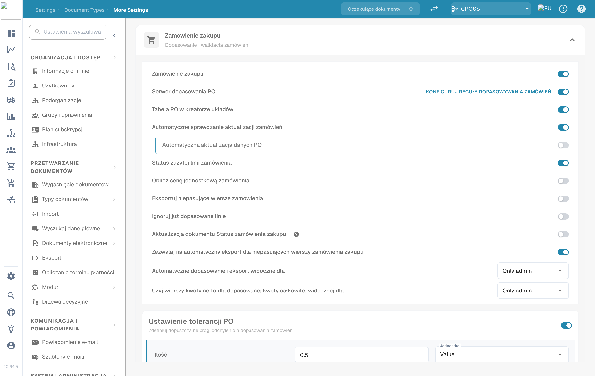<figcaption>
Gli interruttori per Manage Layouts, Custom Validation Rules e Transformation Rules
</figcaption></figure>

Da questo momento la scheda del tipo di documento mostra anche un link **Regole di convalida**.

<figure>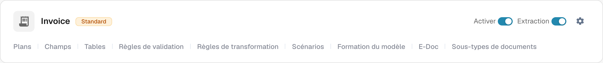<figcaption>
I link sulla scheda del tipo di documento
</figcaption></figure>


**L'interruttore sostituisce i controlli integrati sugli importi.** Finché le regole di convalida personalizzate sono attive per un tipo di documento, i controlli fissi "importo totale = importo netto + imposta" e i controlli su importo di riga / sconto **non** vengono eseguiti per quel tipo; al loro posto subentrano le regole configurabili. Ricrea come regole i controlli di cui hai bisogno (vedi gli [esempi pratici](#esempi-pratici)) prima di attivare l'interruttore. Disattivandolo, i controlli integrati vengono ripristinati. Tutte le altre convalide dei campi (campi obbligatori, formati, dati anagrafici) continuano a essere eseguite.


## L'elenco delle regole

**Tipi di documento → (tipo di documento) → Regole di convalida** elenca tutte le regole del tipo di documento.

<figure>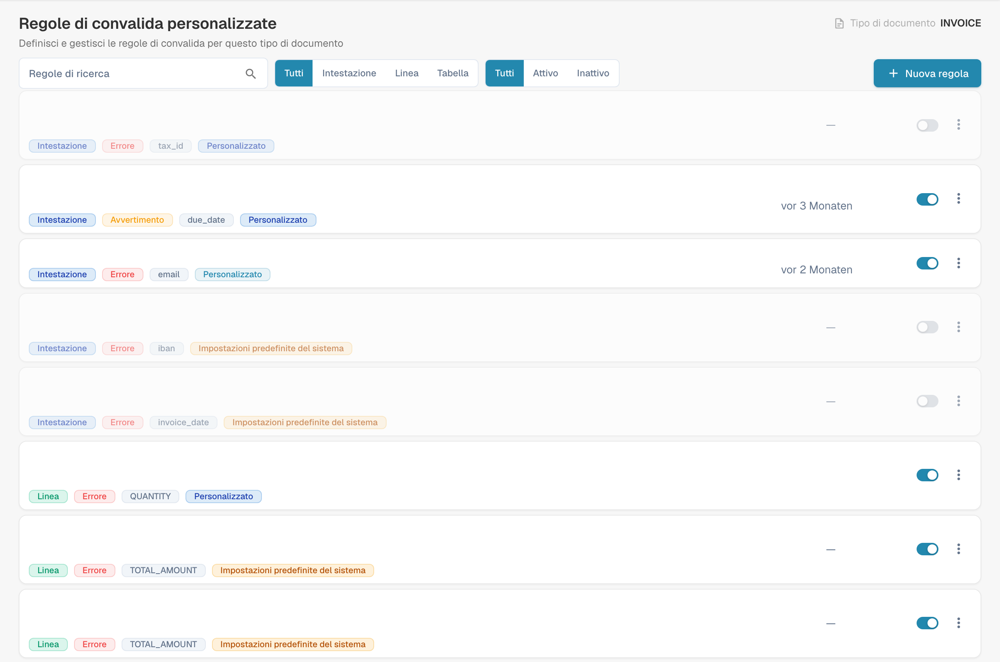<figcaption>
Gestione delle regole di convalida con i nomi configurati nascosti. Le date relative restano in tedesco nel prodotto.
</figcaption></figure>

Ogni scheda mostra il nome e la descrizione della regola e i badge del suo **livello** (Header / Line / Table), della **gravità** (Error / Warning), del **campo** a cui è associato l'errore e della sua **origine**. Usa l'interruttore a destra per attivare o disattivare una regola e il menu **⋮** per duplicarla o eliminarla. Filtra l'elenco per livello (**All / Header / Line / Table**) e per stato (**All / Active / Inactive**), oppure cercalo.

### Regole System default, Customized e Custom

| Origine | Di cosa si tratta | Cosa puoi fare |
| --- | --- | --- |
| **Impostazioni predefinite del sistema** | Una regola fornita con DocBits per tutte le organizzazioni. | Non può essere modificata direttamente: il builder mostra "This is a system default rule and cannot be edited." Clicca su **Personalizzazione** per creare una tua copia modificabile, oppure disattivala per fermarla nella tua organizzazione. |
| **Personalizzato** | Una regola predefinita di sistema che la tua organizzazione ha modificato o disattivato. | Modificala come una regola tua. **Ripristina impostazioni predefinite** elimina la tua copia e ripristina l'originale. |
| **Personalizzato** | Una regola creata dalla tua organizzazione. | Modifica, **Duplica**, **Cancellare**. |

Le modifiche alle regole predefinite di sistema non influiscono mai sulle altre organizzazioni.

## Creare una regola

Clicca su **Nuova regola**. Il builder ha tre passaggi. **Regola di prova** e **Salva** si trovano in alto a destra.

### Passaggio 1 — Name & scope

<figure><figcaption>
Passaggio 1 per una regola su un campo di testata
</figcaption></figure>

| Impostazione | Cosa fa |
| --- | --- |
| **Livello di regola** | Cosa guarda la regola e dove viene mostrato l'errore: vedi [Livelli delle regole](#livelli-delle-regole). |
| **Gravità** | **Errore** contrassegna il campo come non valido e blocca la convalida. **Avvertimento** mostra il messaggio ma non blocca mai. |
| **Nome della regola** | Mostrato nell'elenco e agli amministratori. Scegli un nome che descriva la regola ("Partita IVA del fornitore obbligatoria per le fatture tedesche"). |
| **Chiave della regola** | Una chiave tecnica generata dal nome. Resta invariata se in seguito rinomini la regola. Clicca sulla matita per scegliere una chiave tua prima del primo salvataggio; dopo non è più modificabile. |
| **Descrizione** | Spiegazione facoltativa per gli altri amministratori. |
| **Nome della tabella** | *Solo per Table line.* La tabella di cui vengono controllate le righe, ad esempio `INVOICE_TABLE`. |
| **Attach error to field / column** | Il campo (o, per le righe di tabella, la colonna) che mostra l'errore nella schermata di convalida. |

#### Livelli delle regole

| Livello | Viene eseguita | L'errore viene mostrato su | Può leggere | Regola tipica |
| --- | --- | --- | --- | --- |
| **Campo di intestazione** | una volta per documento | un campo di testata | `header.*`, `doc.*` | "La partita IVA del fornitore è obbligatoria per le fatture tedesche" |
| **Riga della tabella** | una volta per ogni riga della tabella selezionata | la cella della riga che non supera il controllo | `row.*` (la riga corrente), `header.*`, `doc.*` | "La quantità deve essere maggiore di zero" |
| **Intera tabella** | una volta per documento, considerando tutte le righe insieme | un campo di testata | totali sulle righe (`sum()`, `count()`, `min()`, `max()`), `header.*`, `doc.*` | "Gli importi netti di riga devono tornare con l'importo netto" |

<figure>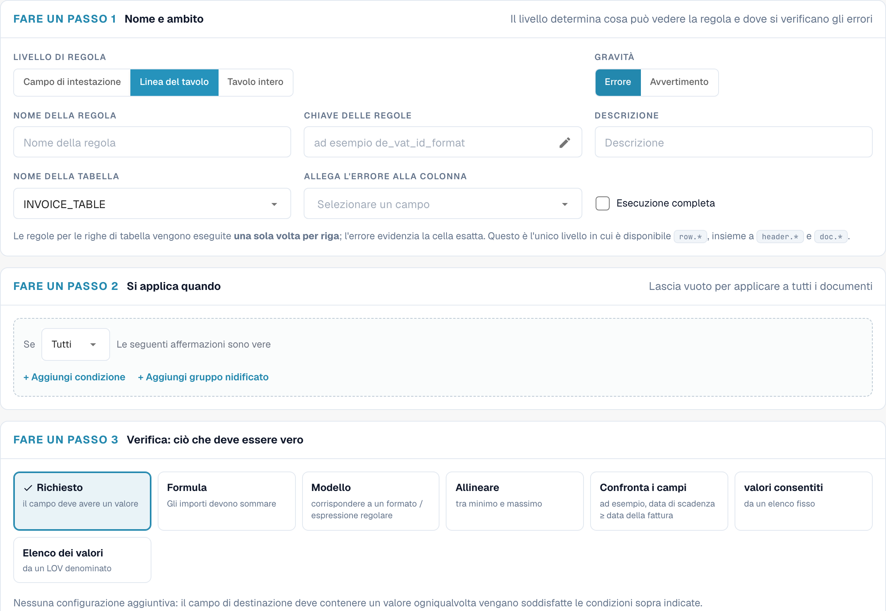<figcaption>
Una regola su riga di tabella: la tabella e la colonna che mostra l'errore
</figcaption></figure>

### Passaggio 2 — Applies when

Decidi se la regola viene eseguita per ogni documento o solo per alcuni. Lascia il campo vuoto per controllare ogni documento. Altrimenti aggiungi righe di condizione, ad esempio "Document Origin is Deutsch" e "Total Amount greater than 250", e combinale con **Tutti** / **ANY** e gruppi annidati.

<figure><figcaption>
Il controllo viene eseguito solo per i documenti tedeschi superiori a 250 con EUR o senza valuta
</figcaption></figure>

Per le regole su riga di tabella, la condizione può usare anche le colonne della riga corrente e viene valutata **riga per riga**: le righe che non corrispondono semplicemente non vengono controllate.

<figure><figcaption>
Vengono controllate solo le righe articolo (righe con un numero articolo)
</figcaption></figure>

Le condizioni sono spiegate in dettaglio, con ogni campo, operatore e regola di confronto e molti esempi, nella pagina [Condizioni delle regole (Applies when)](rule-conditions-applies-when.md).

### Passaggio 3 — Check: cosa deve essere vero

Scegli un controllo. Le impostazioni sotto le schede cambiano in base al controllo scelto.

<figure>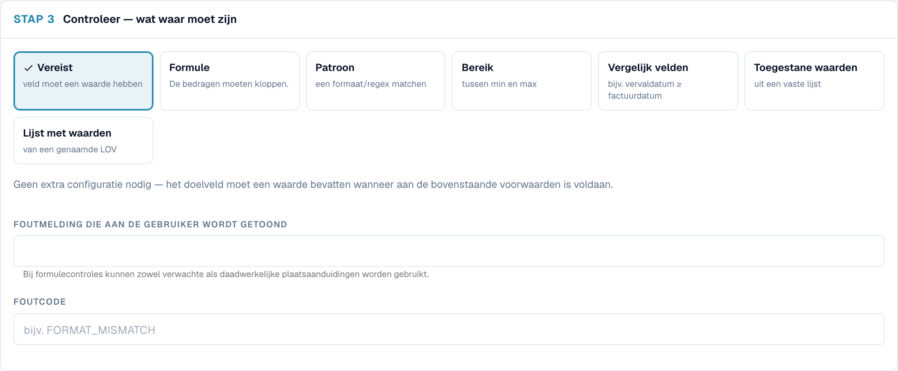<figcaption>
I sette controlli. Required non richiede ulteriori impostazioni
</figcaption></figure>

#### Obbligatorio — il campo deve avere un valore

<figure><figcaption>
Una verifica Required: nessuna configurazione aggiuntiva
</figcaption></figure>

Fallisce quando il campo è vuoto (mancante o con soli spazi). Nessuna ulteriore impostazione.

Usalo insieme a **Si applica quando** per rendere un campo obbligatorio **in modo condizionale**. Un campo che deve essere sempre compilato è meglio configurarlo come campo obbligatorio nelle impostazioni del campo.

> *Supplier Tax ID è obbligatorio* — si applica quando *Document Origin is Deutsch* e *Total Amount greater than 250*.

#### Formula — gli importi devono tornare

Un confronto aritmetico. L'espressione contiene esattamente **un** confronto (`==`, `!=`, `>`, `>=`, `<`, `<=`); entrambi i lati possono usare `+ - * /`, numeri, parentesi e riferimenti ai campi.

<figure>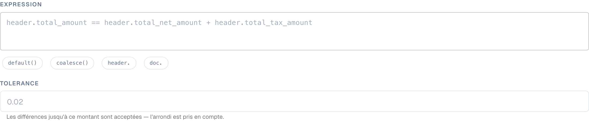<figcaption>
Una formula su tabella intera con tolleranza e segnaposto nel messaggio
</figcaption></figure>

* Clicca sui chip sotto l'espressione per inserire funzioni e prefissi dei campi: `sum()`, `count()`, `min()`, `max()`, `default()`, `coalesce()`, `header.`, `doc.`. Mentre digiti il nome di un campo si apre un elenco dei campi corrispondenti.
* `sum(row.NET_AMOUNT)`, `count(row.ITEM_NUMBER)`, `min(...)`, `max(...)` operano su tutte le righe e sono disponibili solo al livello **Intera tabella**. `count()` conta le righe in cui la colonna è compilata.
* `default(header.discount, 0)` usa `0` quando il campo è vuoto; `coalesce(header.a, header.b, 0)` usa il primo valore compilato.
* **Tolleranza**: per `==` e `!=`, le differenze fino a questo importo sono considerate uguali. Usa `0.01` o `0.05` per assorbire gli arrotondamenti. Non ha effetto su `<`, `>`, `<=` e `>=`.
* Gli importi vuoti o illeggibili contano come `0`. Una divisione per zero salta la regola invece di generare un errore.
* Nel messaggio di errore, `{actual}` viene sostituito dal risultato del lato sinistro e `{expected}` dal risultato del lato destro.

Esempi:

| Scopo | Livello | Espressione | Tolleranza |
| --- | --- | --- | --- |
| I totali di testata sono coerenti | Header field | `header.total_amount == header.total_net_amount + header.total_tax_amount` | 0.01 |
| Le righe tornano con l'importo netto | Whole table | `sum(row.NET_AMOUNT) == header.total_net_amount` | 0.05 |
| Importo di riga = quantità × prezzo unitario | Table line | `row.NET_AMOUNT == row.QUANTITY * row.UNIT_PRICE` | 0.01 |
| Imposta non superiore al 19 % dell'importo netto | Header field | `header.total_tax_amount <= header.total_net_amount * 0.19` | – |
| Almeno una riga | Whole table | `count(row.ITEM_NUMBER) >= 1` | 0 |

#### Pattern — corrispondenza a un formato / regex

<figure>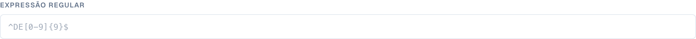<figcaption>
Una verifica Pattern con un espressione regolare
</figcaption></figure>

Il valore deve corrispondere a un'**espressione regolare**. L'espressione cerca all'interno del valore, quindi ancorala con `^` (inizio) e `$` (fine) quando deve corrispondere l'intero valore. Spunta **corrispondenza senza distinzione tra maiuscole e minuscole** se maiuscole e minuscole non contano.

| Formato | Espressione regolare |
| --- | --- |
| `INV-` seguito da sei cifre | `^INV-\d{6}$` |
| Partita IVA tedesca | `^DE\d{9}$` |
| Ordine di acquisto che inizia con 45 e lungo 10 cifre | `^45\d{8}$` |
| Solo cifre | `^\d+$` |
| IBAN (controllo approssimativo) | `^[A-Z]{2}\d{2}[A-Z0-9]{11,30}$` |

#### Range — tra un minimo e un massimo

Il valore deve essere un numero compreso tra **Minimo** e **Massimo** (entrambi inclusi). Compila uno o entrambi. Un valore che non è un numero non supera il controllo. Gli importi formattati come `1.234,56` vengono compresi.

<figure><figcaption>
Range con solo un minimo: le quantità devono essere almeno 0,01
</figcaption></figure>

#### Compare fields — ad es. data di scadenza ≥ data della fattura

<figure>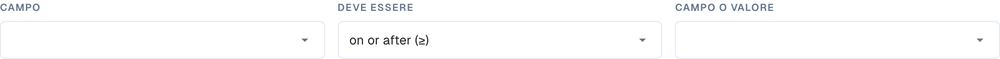<figcaption>
Compare fields: confrontare un campo con un altro campo, con oggi o con un valore fisso
</figcaption></figure>

Confronta il valore di un campo con un altro campo, con **oggi** o con un valore fisso, usando *equal to*, *not equal to*, *greater than*, *less than*, *on or after (≥)* o *on or before (≤)*. I numeri vengono confrontati come numeri e le date come date.

* Data di scadenza **il o dopo (≥)** Data fattura
* Invoice Date **on or before (≤)** oggi: nessuna fattura con data futura
* Discount **meno di** 100

#### Valori consentiti — da un elenco fisso

<figure>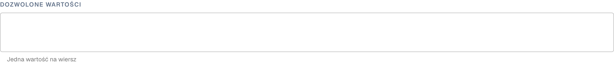<figcaption>
Allowed values: un valore per riga, eventualmente senza distinzione tra maiuscole e minuscole
</figcaption></figure>

Il valore deve essere uno di quelli che digiti, **un valore per riga**. Facoltativamente senza distinzione tra maiuscole e minuscole. Adatto a elenchi brevi e stabili (`EUR`, `CHF`, `USD`).

#### List of Values — da una LOV con nome

<figure>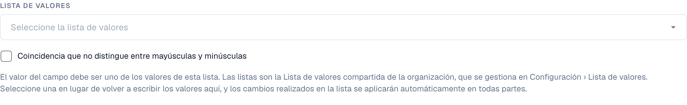<figcaption>
List of Values: i valori provengono da un elenco con nome delle impostazioni
</figcaption></figure>

Come *Allowed values*, ma i valori provengono da una **Elenco dei valori** condivisa, gestita in **Settings › List of Values**. Scegli l'elenco invece di digitarlo di nuovo; quando l'elenco cambia, la regola usa i nuovi valori (dopo un breve ritardo dovuto alla cache). Contano solo i valori delle voci dell'elenco, non le loro etichette.


Ad eccezione di **Obbligatorio**, ogni controllo **viene superato quando il valore è vuoto**. Una regola Pattern su Purchase Order non segnala le fatture senza ordine di acquisto. Se anche un valore vuoto è un problema, aggiungi una regola Required oppure limita la regola con *Applies when … is not empty*.


#### Messaggio di errore e codice di errore

* **Messaggio di errore visualizzato all'utente che effettua l'elaborazione.** — il testo mostrato nella schermata di convalida. Indica cosa non va **e** cosa fare: "La partita IVA del fornitore manca. Le fatture tedesche superiori a 250 EUR devono riportarla."
* **Codice di errore** — un breve codice tecnico, ad esempio `REQUIRED_CONDITIONAL`, `FORMAT_MISMATCH`, `OUT_OF_RANGE`, `DATE_ORDER`, `LINES_HEADER_MISMATCH`, `VALUE_NOT_ALLOWED`. Compare nelle esportazioni e permette di raggruppare gli errori.

## Testare la regola

Clicca su **Regola di prova** per eseguire la versione corrente della regola, salvata o meno, su un documento. Inserisci un **ID documento** oppure passa a **Tramite documento JSON** e incolla i dati estratti. **Non viene salvato nulla** e il documento non viene modificato.

Il risultato è uno di tre esiti:

| Esito | Significato |
| --- | --- |
| **La regola non è riuscita: è stato generato un errore.** | La condizione era soddisfatta e il controllo è fallito. Il messaggio viene mostrato esattamente come lo vedrebbe l'utente. |
| **Regola approvata** | La condizione era soddisfatta e il controllo è stato superato. Le regole su riga di tabella mostrano il risultato per riga ("4 of 4 checked rows passed"). |
| **Regola ignorata: ambito non corrispondente** | La condizione *Applies when* era falsa per questo documento, quindi non è stato controllato nulla e non è stato generato alcun errore. |

<figure><figcaption>
La fattura tedesca non ha la partita IVA del fornitore: la regola fallisce con il messaggio configurato
</figcaption></figure>

<figure><figcaption>
La stessa regola con la soglia portata a 1000: la fattura (469,18) non rientra nell'ambito, quindi la regola viene saltata
</figcaption></figure>

<figure><figcaption>
Una regola su riga di tabella riporta ogni riga controllata
</figcaption></figure>

Testa ogni nuova regola su almeno un documento che dovrebbe fallire, uno che dovrebbe superarla e uno che dovrebbe essere saltato.

## Quando vengono eseguite le regole

* **Durante l'elaborazione**, insieme alle altre convalide, dopo le regole di estrazione e trasformazione.
* **A ogni salvataggio** del documento nella schermata di convalida.
* **Dopo una modifica a una regola**, i documenti esistenti **non** vengono ricontrollati tutti in una volta. Ogni documento viene ricontrollato con le nuove regole al successivo salvataggio o rielaborazione. I documenti già esportati non vengono interessati.
* Le regole vengono eseguite in ordine di priorità (poi per chiave). Un campo mostra **un solo** errore: se due regole falliscono sullo stesso campo, vince la prima; le regole successive non la sovrascrivono.
* Gli avvisi vengono raccolti separatamente e non nascondono mai un errore.
* Se una regola non può essere valutata, ad esempio per una divisione per zero in una formula, viene saltata. Una regola difettosa non contrassegna mai un documento come non valido per errore.

## Log 

Ogni regola può registrare le proprie valutazioni. Aprire la pagina **Log di esecuzione delle regole** del tipo di documento: l'intestazione riporta il tipo di documento e l'icona di aggiornamento ricarica l'elenco.

**Trova per** stabilisce cosa cercare (il valore predefinito è **Chiave della regola**) e il valore va inserito nel campo accanto. Quando si cerca per documento, **Tipo di regola** è obbligatorio. Restringere il risultato con **Risultato**, **Eseguito**, **Da Data** e **Ad oggi**.

<figure>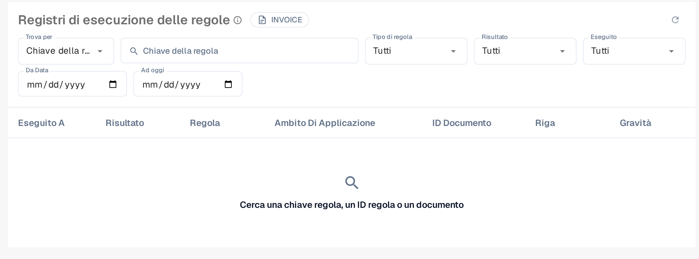<figcaption>
La pagina dei log di esecuzione: i filtri in alto, una riga per valutazione sotto. Finché non si cerca, la tabella indica cosa inserire.
</figcaption></figure>

Aprire una voce per vederne il dettaglio, compresa la **traccia della condizione**: ogni riga di *Applies when* con il valore atteso, il valore effettivo del documento e l'esito. Vedi [Leggere la traccia della condizione nei log](rule-conditions-applies-when.md#read-the-condition-trace-in-the-logs).

La stessa pagina mostra anche i log delle regole di trasformazione e di selezione del layout.

## Esempi pratici

Copia queste regole come punto di partenza. Le chiavi di campi e colonne sono quelle del tipo di documento **Fattura** standard; adattale ai tuoi tipi di documento.

**1. Partita IVA del fornitore per le fatture tedesche superiori a 250 EUR**
Header field · Error · associa a *Supplier Tax ID* · Applies when **Tutti**: *Document Origin* is *Deutsch*, *Total Amount* greater than *250* · Check **Obbligatorio** · Messaggio "La partita IVA del fornitore manca. Le fatture tedesche superiori a 250 EUR devono riportarla." · Codice `REQUIRED_CONDITIONAL`.

**2. I totali di testata tornano** (sostituisce il controllo integrato)
Header field · Error · associa a *Total Amount* · sempre · **Formula** `header.total_amount == header.total_net_amount + header.total_tax_amount`, tolleranza `0.01` · Messaggio "Il totale {actual} non corrisponde a netto più imposta ({expected})."

**3. Le righe tornano con l'importo netto** (sostituisce il controllo integrato)
Whole table · Error · associa a *Total Net Amount* · sempre · **Formula** `sum(row.NET_AMOUNT) == header.total_net_amount`, tolleranza `0.05` · Messaggio "Gli importi netti di riga danno {actual}, ma l'importo netto della fattura è {expected}." · Codice `LINES_HEADER_MISMATCH`.

**4. La quantità deve essere positiva sulle righe articolo**
Table line · Error · tabella `INVOICE_TABLE`, colonna `QUANTITY` · Applies when *row.ITEM_NUMBER* is not empty · **Intervallo** minimo `0.01` · Codice `OUT_OF_RANGE`.

**5. Importo di riga = quantità × prezzo unitario**
Table line · Warning · colonna `NET_AMOUNT` · sempre · **Formula** `row.NET_AMOUNT == row.QUANTITY * row.UNIT_PRICE`, tolleranza `0.01`.

**6. Formato del numero di fattura di un fornitore**
Campo intestazione · Errore · *Numero fattura* · Si applica quando *Fornitore ID* è *20723* · **Modello** `^INV-\d{6}$`.

**7. Data di scadenza non precedente alla data della fattura**
Campo intestazione · Errore · *Data di scadenza* · sempre · **Confronta i campi** Data di scadenza *on or after (≥)* Data fattura · Codice `DATE_ORDER`.

**8. Nessuna fattura con data futura**
Campo intestazione · Errore · *Data fattura* · sempre · **Confronta i campi** Data fattura *on or before (≤)* oggi.

**9. Solo valute approvate (solo avviso)**
Header field · **Avvertimento** · *Currency* · sempre · **Elenco dei valori** *approved_currencies* · Codice `VALUE_NOT_ALLOWED`.

**10. Ordine di acquisto obbligatorio oltre 5.000**
Campo intestazione · Errore · *Ordine d'acquisto* · Si applica quando *Importo totale* maggiore di *5000* · **Obbligatorio**.

## Buone pratiche

* **Inizia con un avviso.** Salva una nuova regola con la gravità **Avvertimento**, osservala per qualche giorno (Test rule) e poi portala a **Errore**.
* **Una regola, un messaggio.** Diverse regole piccole con messaggi chiari sono più facili da capire di un'unica formula grande.
* **Usa Applies when invece delle copie.** Una regola con una condizione è meglio di cinque copie per cinque fornitori.
* **Sii tollerante con gli importi.** Assegna sempre una tolleranza alle formule sugli importi.
* **Dai alle regole il nome della regola aziendale**, non della tecnica ("Data di scadenza non precedente alla data della fattura", non "Regola di confronto 3").

## Risoluzione dei problemi

| Sintomo | Cosa controllare |
| --- | --- |
| La regola non genera mai un errore | La funzione è attivata per il tipo di documento e la regola è **Attivo**? Esegui **Regola di prova** sul documento: "skipped" significa che *Applies when* era falsa. |
| Un campo vuoto non viene segnalato | Solo **Obbligatorio** segnala i valori vuoti. Aggiungi una regola Required. |
| I controlli integrati sui totali sono scomparsi | È previsto finché le regole personalizzate sono attive. Ricreali come regole Formula (esempi 2 e 3). |
| Una regola modificata non ha effetto su un documento | I documenti vengono ricontrollati al successivo salvataggio. Salva o rielabora il documento. |
| Un Pattern corrisponde a valori che non dovrebbe | I pattern cercano all'interno del valore. Ancorali con `^` e `$`. |
| Su un campo viene mostrato solo uno dei due errori | Un campo mostra solo la prima regola che fallisce. Modifica le priorità o associa una delle regole a un altro campo. |
| Le colonne della tabella mancano in *Applies when* | Sono disponibili solo al livello **Riga della tabella**. |
| La regola predefinita di sistema non può essere modificata | Clicca su **Personalizzazione** per creare una tua copia. |

## Vedi anche

* [Condizioni delle regole (Applies when)](rule-conditions-applies-when.md) — le condizioni in dettaglio
* [Transformation Rules](transformation-rules.md) — correggi i valori prima che vengano convalidati
* [Layout Selection Rules](layout-manager/layout-selection-rules.md) — scegli il layout usato da un documento
* [Setting Validation and Match Score](fields/setting-validation-and-match-score.md) — impostazioni di convalida per campo
