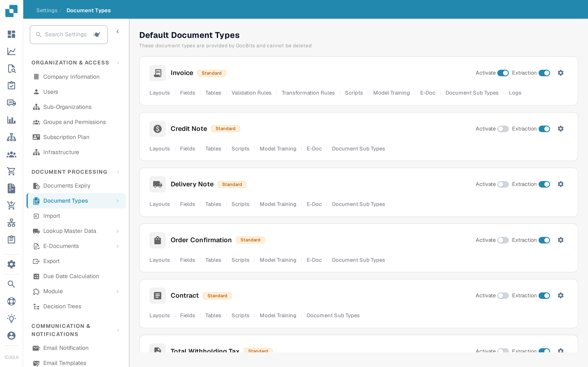
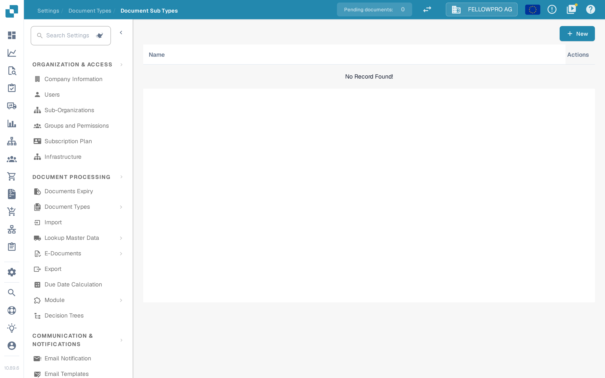
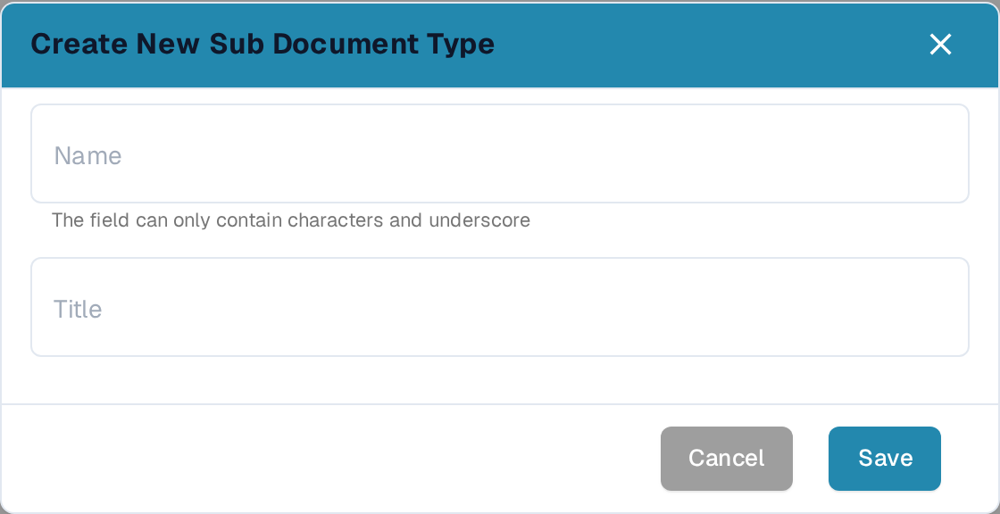

# Document Sub Types

Document sub types are specialized versions of a document type. Under the main document type **Invoice**, for example, there might be sub types such as *Standard Invoice*, *Pro-forma Invoice* and *Credit Invoice*, each with slightly different data requirements or processing rules.

## Why sub types are useful

* **Specific processing requirements** — different variations of the same document type often need different fields, approval workflows or validation rules.
* **Organizational customization** — sub types let you tailor document processing to your own processes instead of relying on a generic setup.
* **Clear structuring** — users can move between the variations of a document type and only see the information that belongs to the one they are working on.
* **Consistency and accuracy** — standardised sub types capture the same information in the same structure for every document of that variation.
* **Efficient processing** — pre-built templates and workflows for a sub type reduce manual effort and errors.

## Open the sub types of a document type

1. Go to **Settings → Document Types**.
2. On the card of the document type, select **Document Sub Types**.

<figure><figcaption>**Document Sub Types** is one of the actions on each document type card.</figcaption></figure>

The page lists the sub types of that document type with their **Name** and the **Actions** available for each one.

<figure><figcaption>The sub types of the selected document type.</figcaption></figure>

## Actions on a sub type

Each row offers the following actions:

* **Fields** — configure which data fields belong to the sub type and how they are managed.
* **Layout Builder** — open the layout of this sub type and change how the fields are arranged.
* **Scripts** — attach or edit the scripts that run when a document of this sub type is processed.
* **Copy** — duplicate the sub type as the starting point for a new one.
* **Edit** — change the name or title of the sub type.
* **Delete** — remove the sub type when it is no longer needed.

## Add a sub type

1. Select **New** above the table.
2. Enter a **Name**. It may contain letters and underscores only.
3. Enter a **Title** for the sub type.
4. Select **Save**.

<figure><figcaption>A new sub type is created in the **Create New Sub Document Type** dialog.</figcaption></figure>

After a sub type exists, it is available wherever a document of that type is processed, for example in the fields and layouts of the document type.
