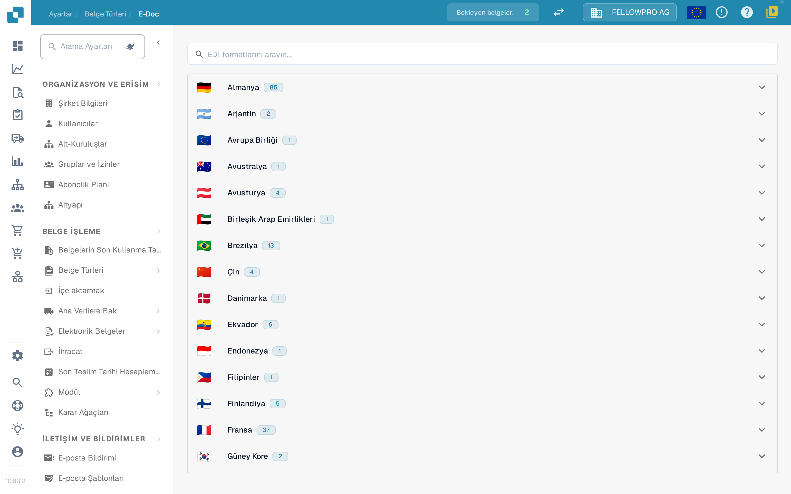
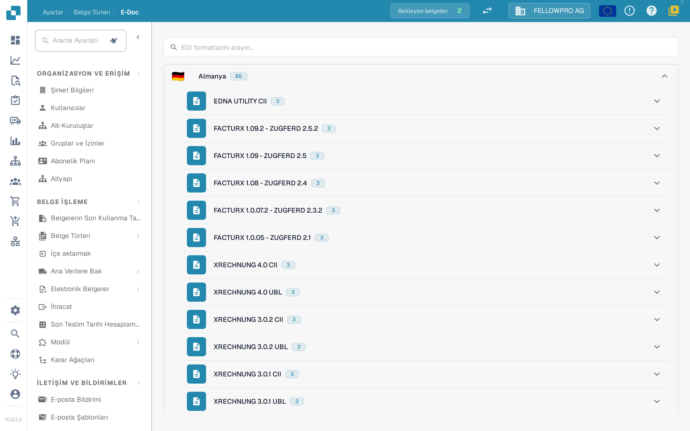
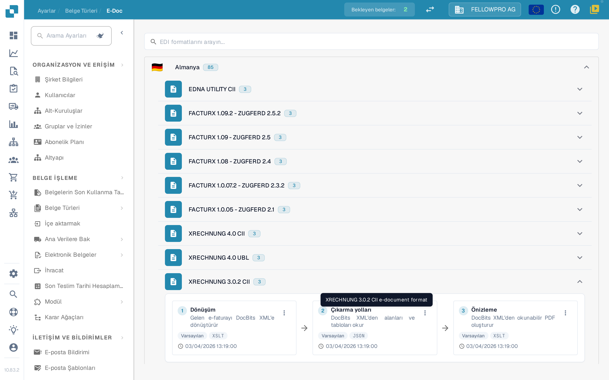
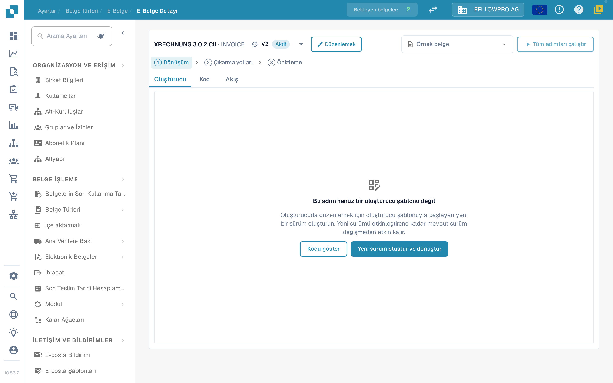
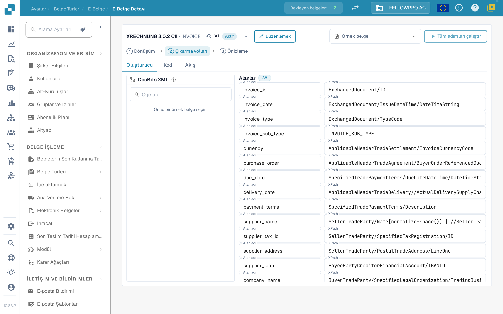

# e-belgeler

XRechnung, ZUGFeRD/Factur-X, CFDI veya FatturaPA gibi elektronik belgeler XML ya da hibrit PDF olarak gelir. DocBits dosyayı okur, fatura verilerini çıkarır ve okunabilir bir PDF oluşturur. **E-Doc** ayarlarında kuruluşunuzun kullandığı her biçimin kuralları yer alır.

## E-Doc yönetimini açma

1. **Ayarlar → Belge Türleri**'ni açın.
2. Belge türünü seçin (örneğin **Fatura**) ve **E-Doc**'u açın.

Biçimler ülkeye göre gruplanır. Her ülke bayrağını, adını ve kaç biçim içerdiğini gösterir.

<figure><figcaption>
Biçimler ülkeye göre gruplanır ve başlangıçta katlanmış durumdadır.
</figcaption></figure>

Bir ülkeyi açmak için seçin. Bir ülkenin içinde en yeni sürüm önce gelir. Factur-X / ZUGFeRD gibi birleşik biçimler Almanya altında yer alır. Arama alanı biçim ve ülke adlarını aynı anda arar.

<figure><figcaption>
Biçimlerini görmek için bir ülke açın.
</figcaption></figure>

## Biçimler ve adımları

Her biçim, adımlarını DocBits'in çalıştırdığı sırada, oklarla birleşen üç kart olarak gösterir:

| Adım | Ne yapar |
| --- | --- |
| **Dönüşüm** | Gelen XML'i DocBits XML'ine eşler. |
| **Çıkarma yolları** | DocBits'in dönüştürülmüş XML'den hangi değerleri alacağını tanımlar. |
| **Önizleme** | DocBits'in oluşturduğu okunabilir PDF'in düzenini tanımlar. |

Biçimin diğer öznitelikleri kartların altında listelenir.

<figure><figcaption>
Bir biçimin üç adımı: Dönüşüm, Çıkarma yolları ve Önizleme.
</figcaption></figure>

Bir adımı açmak için bir kart seçin.

## Adım düzenleme

Ayrıntı sayfası üç adım için de aynı yapıya sahiptir:

* Üst bilgi biçimi ve sürümlerini içeren açılır listeyi gösterir; her sürümün durumu da vardır. Açılır listeden bir sürümü etkinleştirebilir, düzenleyebilir veya silebilirsiniz.
* **Oluşturucu**, **Kod** ve **Akış** arasında geçiş yapar: görsel düzenleyici, temeldeki stil sayfası ya da JSON ve işlem hattı sonucu.
* **Örnek belge** bu biçimin en son belgelerini sunar; bir belge kimliği veya URL'si de yapıştırabilirsiniz.
* **Tüm adımları çalıştır**, örnek belge için dönüşüm, çıkarma ve önizlemeyi tek seferde çalıştırır.
* **Ctrl + S** bir taslak kaydeder.

Etkin veya zaten kullanılmış bir sürümü düzenlemek onu değiştirmez: DocBits bir taslak kopya oluşturur ve onu açar. Kullanılmamış bir taslak doğrudan düzenlenir. Elle yazılmış bir adım, oluşturucu onu değiştirmeden devralana kadar **Kod**'da kalır.

<figure><figcaption>
Ayrıntı sayfası: üst bilgide sürüm açılır listesi, Oluşturucu, Kod ve Akış sekmeleri, örnek belge ve adımın kendisi.
</figcaption></figure>

### Dönüşüm

**Oluşturucu** solda kaynak XML'i, ortada eşlemeyi, sağda ise elde edilen XML'i gösterir. Kaynak ağacından bir öğe seçip bir alanın üzerine sürükleyin ya da sabit bir metin değeri ekleyin.

Bir alan birkaç parçadan oluşabilir ve her parçanın bir koşulu olabilir: **mevcut**, **eksik**, **eşittir**, **eşit değildir** veya serbest bir XPath ifadesi; **tümü** veya **herhangi biri** ile birleştirilir. Üç panel yeniden boyutlandırılabilir ve sonuç alanında bir **Alanlar** listesi ile **XML** görünümü bulunur.

### Çıkarma yolları

Çıkarma yolları oluşturucusu solda DocBits XML'ini, ortada alanları, sağda her alanın kullandığı yolu gösterir. Bir alan seçin ve yolunu belirleyin; eski düz girdiler dahil mevcut girdiler çalışmaya devam eder.

<figure><figcaption>
Çıkarma yolları oluşturucusu: DocBits XML'i, alanlar ve yolları.
</figcaption></figure>

### Önizleme

Önizleme oluşturucusu PDF'i sürükle-bırak bloklarıyla düzenler ve sonucu yanlarında gösterir. Sayfa boyutu, kenar boşlukları, yazı boyutu, renkler ve blok aralığı bütün belge için ayarlanır ve her bloğa uygulanır.

### Akış

**Akış**, seçilen örnek belge için bütün işlem hattını gösterir: dönüşümün ne ürettiğini, çıkarma yollarının hangi değerleri bulduğunu ve önizlemenin bunları nasıl görüntülediğini. Bir değişikliği sayfadan ayrılmadan baştan sona kontrol etmek için kullanın.

## İlgili sayfalar

* [Desteklenen Elektronik Belgeler](supported-electronic-documents/README.md)

Bu sayfadaki ekran görüntüleri Türkçe arayüzü gösterir.
