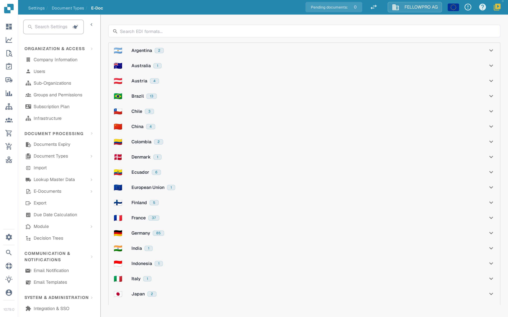
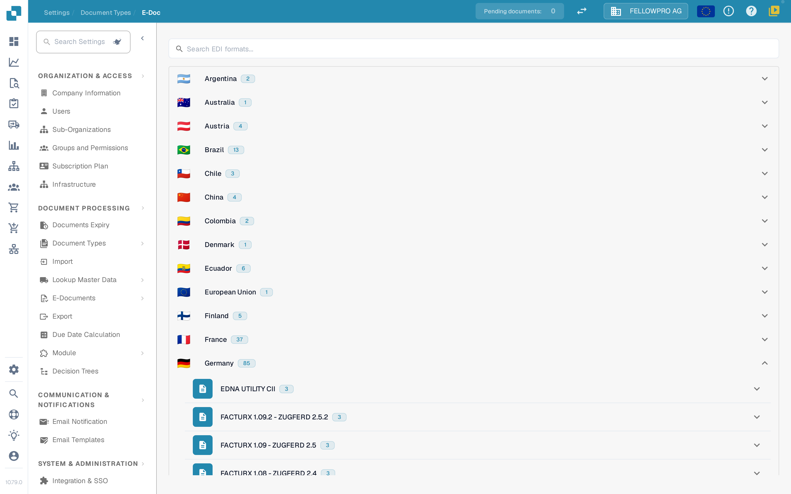
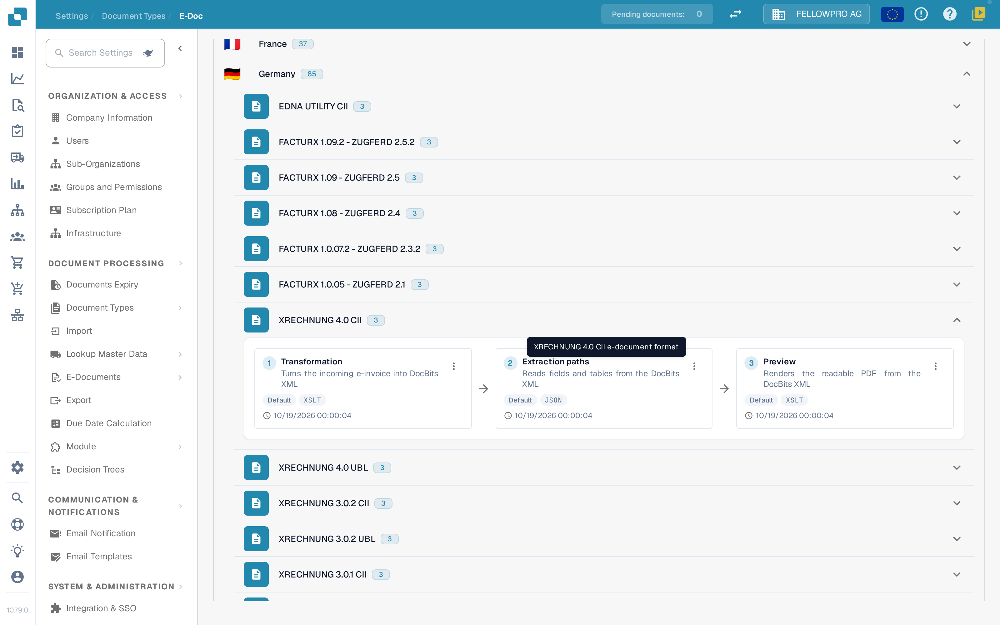
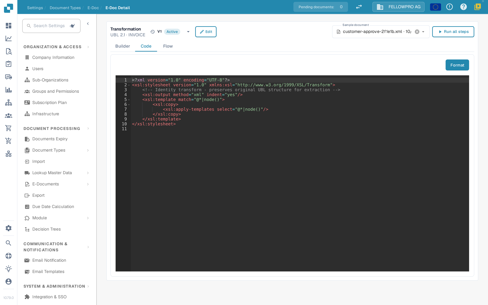
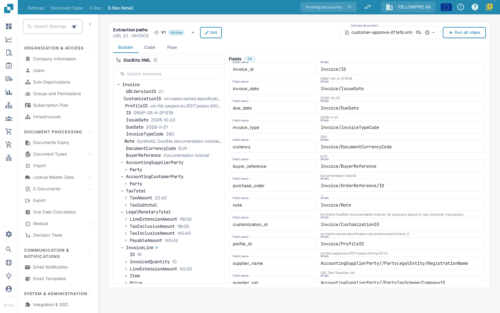

# e-docs


DocBits E-Invoice Tutorial: Process XRechnung / ZUGFeRD (Factur-X), Validate Data & Automate Workflows


Electronic documents such as XRechnung, ZUGFeRD/Factur-X, CFDI or FatturaPA arrive as XML or as a hybrid PDF. DocBits reads the file, extracts the invoice data and renders a readable PDF from it. The **E-Doc** settings hold the rules for every format your organization uses.

## Open the E-Doc administration

1. Open **Settings → Document Types**.
2. Select the document type, for example **Invoice**, and open **E-Doc**.

The formats are grouped by country. Each country shows its flag, its name and how many formats it contains.

<figure><figcaption>
Formats are grouped by country and collapsed at the start.
</figcaption></figure>

Select a country to open its formats. Inside a country the newest version comes first. Combined formats such as Factur-X / ZUGFeRD sit under Germany. The search field looks through format and country names at the same time.

<figure><figcaption>
Open a country to see its formats.
</figcaption></figure>

## Formats and their steps

Every format shows its steps as three cards with arrows, in the order DocBits runs them:

| Step | What it does |
| --- | --- |
| **Transformation** | Maps the incoming XML to the DocBits XML. |
| **Extraction paths** | Defines which values DocBits takes from the transformed XML. |
| **Preview** | Defines the layout of the readable PDF that DocBits renders. |

Other attributes of the format are listed below the cards.

<figure><figcaption>
The three steps of a format: Transformation, Extraction paths and Preview.
</figcaption></figure>

Select a card to open that step.

## Edit a step

The detail page has the same structure for all three steps:

* The header shows the format and a dropdown with its versions, including the status of each version. From the dropdown you can activate, edit or delete a version.
* **Builder**, **Code** and **Flow** switch between the visual editor, the underlying stylesheet or JSON, and the pipeline result.
* **Sample document** offers the latest documents of this format; you can also paste a document ID or URL.
* **Run all steps** runs transformation, extraction and preview for the sample document in one go.
* **Ctrl + S** saves a draft.

Editing an active or already used version does not change it: DocBits creates a draft copy and opens that. An unused draft is edited in place. A step that was written by hand stays in **Code** until the builder can take it over unchanged.

<figure><figcaption>
The detail page: version dropdown in the header, Builder, Code and Flow tabs, sample document and the step itself.
</figcaption></figure>

### Transformation

The **Builder** shows the source XML on the left, the mapping in the middle and the resulting XML on the right. Select an element in the source tree and drag it onto a field, or add a fixed text value.

A field can be built from several parts, and each part can have a condition: **exists**, **is missing**, **equals**, **does not equal** or a free XPath expression, joined with **all** or **any**. The three panels can be resized, and the result area has a **Fields** list and the **XML** view.

### Extraction paths

The extraction paths builder shows the DocBits XML on the left, the fields in the middle and the path each field uses on the right. Select a field and set its path; existing entries, including older flat entries, keep working.

<figure><figcaption>
The extraction paths builder: DocBits XML, fields and their paths.
</figcaption></figure>

### Preview

The preview builder arranges the PDF with drag-and-drop blocks and shows the result next to them. Page size, margins, font size, colours and block spacing are set for the whole document and apply to every block.

### Flow

**Flow** shows the whole pipeline for the chosen sample document: what the transformation produced, which values the extraction paths found and how the preview renders them. Use it to check a change end to end without leaving the page.

## Related pages

* [Using the XSLT Editor](edi/using-the-xslt-editor.md)
* [EDI Transformation File Guide](edi/edi-transformation-file-guide.md)
* [Supported Electronic Documents](supported-electronic-documents/README.md)
