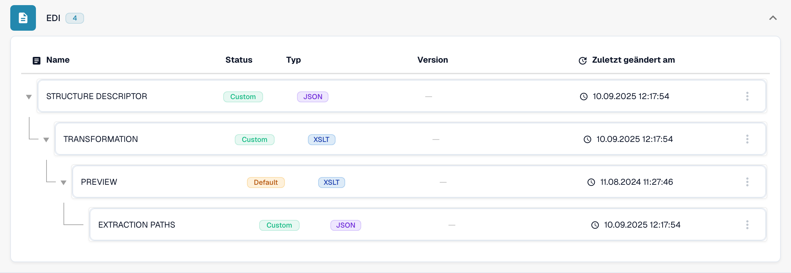
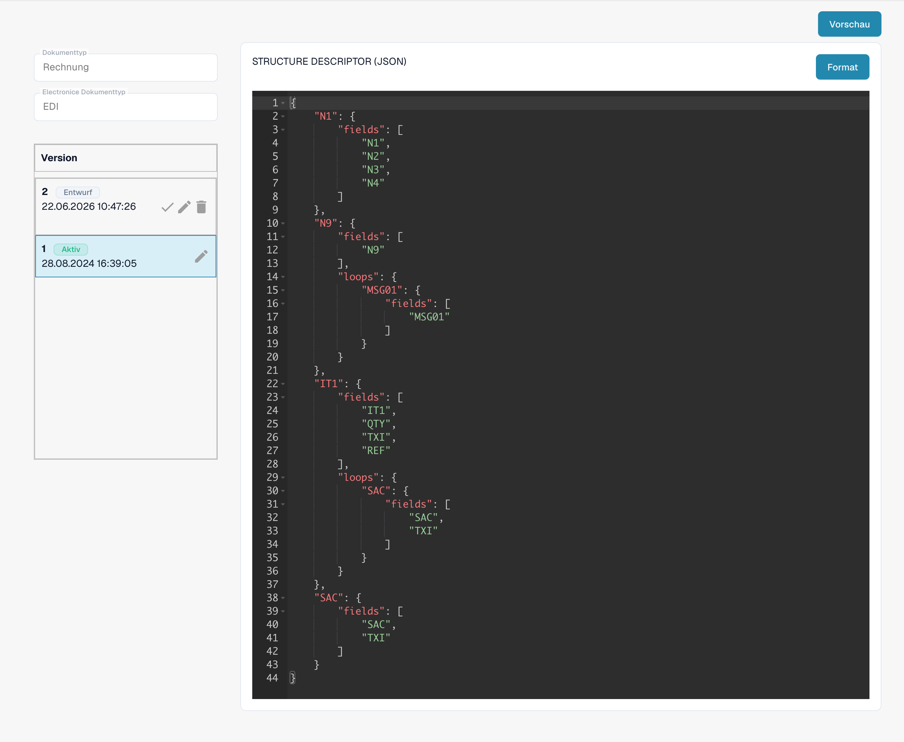

# Elektronische Dokumente und EDI-Konfiguration


DocBits-Anleitung für E-Rechnungen: XRechnung und ZUGFeRD (Factur-X) verarbeiten, Daten validieren und Workflows automatisieren


Wählen Sie in den E-Dokument-Einstellungen den Dokumenttyp und das elektronische Format. Die folgende Konfiguration verarbeitet eingehende EDI-Nachrichten; sie richtet keinen ausgehenden EDI-Versand ein.

<figure><figcaption>
Vorhandenes EDI-Format mit seinen vier konfigurierten Attributen.
</figcaption></figure>

* STRUCTUREDESCRIPTOR: Eine JSON-Strukturbeschreibung liest die EDI-Rohnachricht als JSON ein. Anschließend erzeugt DocBits ein XML-Zwischenformat.

* TRANSFORMATION: Ein XSLT-Stylesheet wandelt das XML-Zwischenformat in das Standard-XML für die weitere Verarbeitung um.

* PREVIEW: Ein XSLT-Stylesheet erzeugt aus dem transformierten XML eine lesbare Darstellung. Das Editorbild zeigt den Quelltext, keine gerenderte Dokumentvorschau.

* EXTRACTIONPATHS: Eine JSON-Konfiguration ordnet Dokumentfelder und Tabellenspalten XPath-Ausdrücken zu, die auf dem transformierten XML ausgewertet werden.

<figure><figcaption>
Aktives Attribut STRUCTUREDESCRIPTOR: JSON-Strukturbeschreibung im schreibgeschützten Editor.
</figcaption></figure>

## Verwendete Regeln und Aktivierung

Wenn eine elektronische Gutschrift als Invoice erscheint, folgen Sie der [Anleitung zur Fehlerbehebung bei der Klassifizierung](credit-note-recognized-as-invoice.md). Sie erläutert die verwendete angepasste oder standardmäßige Quelle, die Typcodes, Extraction Paths und die sichere Aktivierung.

## Länderanleitungen

Die Länderanleitungen enthalten genaue Formatbezeichnungen, Syntax, Versionsgrenzen und den geprüften Konfigurationsstand. [eDocs-Formate, Versionen und Länderanleitungen](supported-electronic-documents/README.md).

Die Ansichten zeigen eine vorhandene Konfiguration und Version. Die Einstellungen unterscheiden sich je nach Dokumenttyp und Format. Prüfen Sie Änderungen in einem Entwurf vor der Aktivierung.
