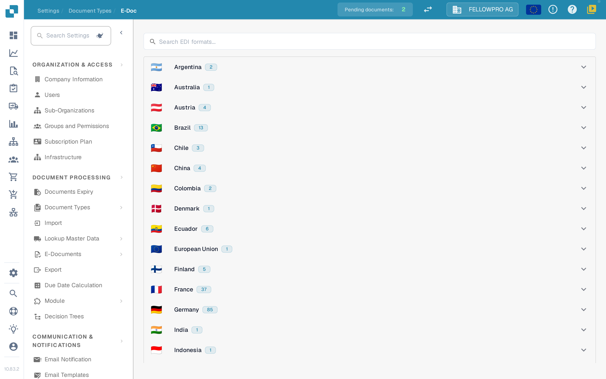
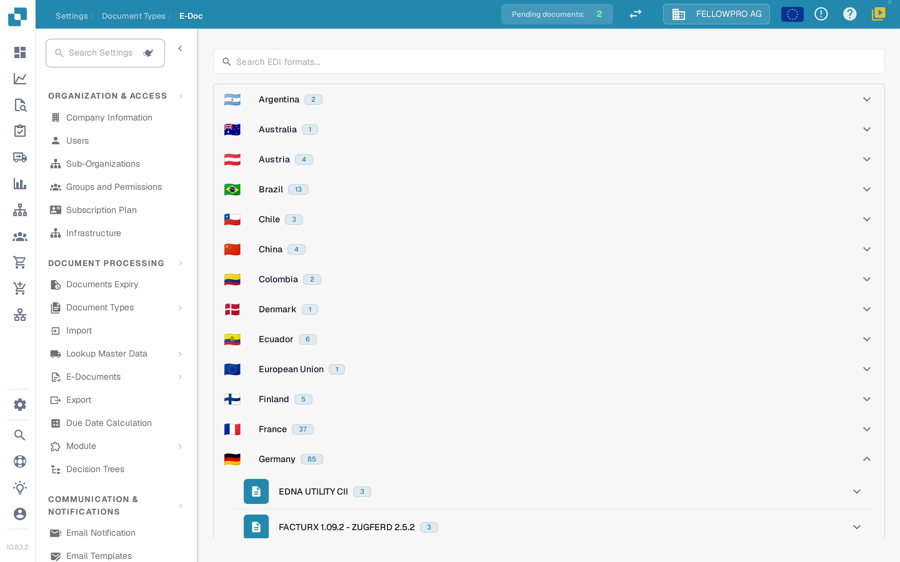
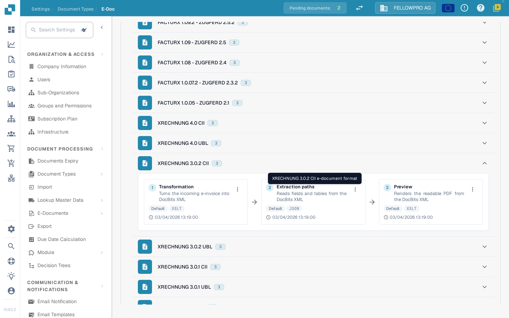
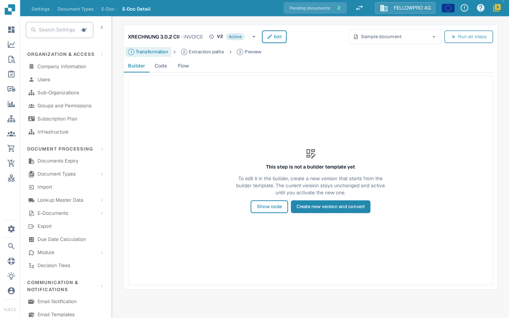
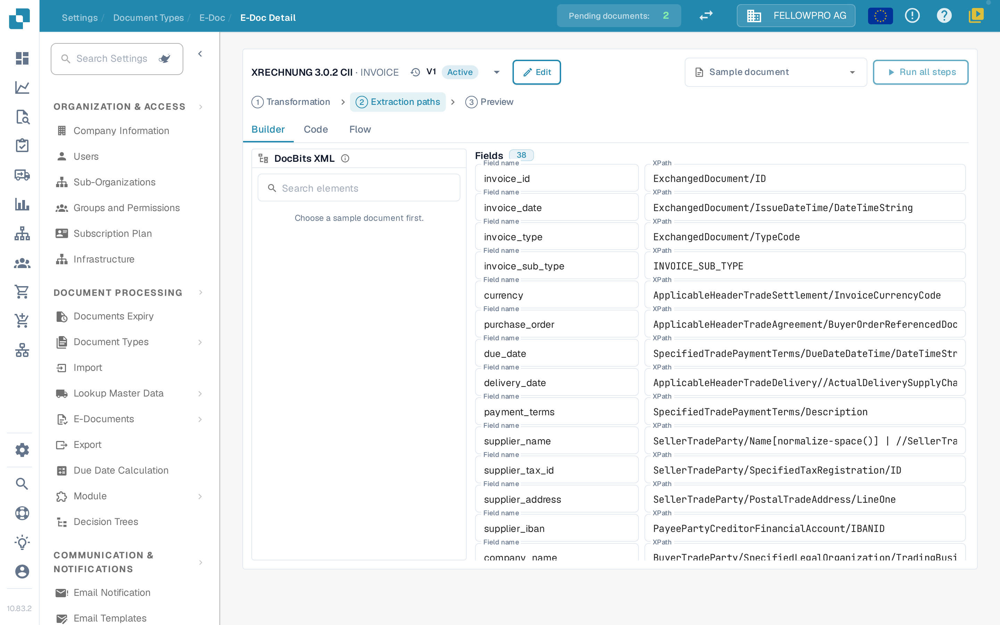

# e-dokumenti

Elektronski dokumenti poput XRechnung, ZUGFeRD/Factur-X, CFDI ili FatturaPA pristižu kao XML ili kao hibridni PDF. DocBits čita datoteku, izdvaja podatke fakture i stvara čitljiv PDF. U podešavanjima **E-Doc**-a nalaze se pravila za svaki format koji vaša organizacija koristi.

## Otvaranje administracije E-Doc

1. Otvorite **Podešavanja → Tipovi dokumenata**.
2. Izaberite tip dokumenta, na primer **Faktura**, i otvorite **E-Doc**.

Formati su grupisani po zemljama. Svaka zemlja prikazuje svoju zastavu, svoj naziv i koliko formata sadrži.

<figure><figcaption>
Formati su grupisani po zemljama i na početku su skupljeni.
</figcaption></figure>

Izaberite zemlju da biste otvorili njene formate. Unutar zemlje najnovija verzija dolazi prva. Kombinovani formati poput Factur-X / ZUGFeRD nalaze se pod Nemačkom. Polje za pretragu istovremeno pretražuje nazive formata i zemalja.

<figure><figcaption>
Otvorite zemlju da biste videli njene formate.
</figcaption></figure>

## Formati i njihovi koraci

Svaki format prikazuje svoje korake kao tri kartice povezane strelicama, redosledom kojim ih DocBits izvršava:

| Korak | Šta radi |
| --- | --- |
| **Transformacija** | Mapira dolazni XML na DocBits XML. |
| **Putanje izdvajanja** | Određuje koje vrednosti DocBits uzima iz transformisanog XML-a. |
| **Pregled** | Određuje izgled čitljivog PDF-a koji DocBits stvara. |

Ostali atributi formata navedeni su ispod kartica.

<figure><figcaption>
Tri koraka formata: Transformacija, Putanje izdvajanja i Pregled.
</figcaption></figure>

Izaberite karticu da biste otvorili taj korak.

## Izmena koraka

Stranica sa detaljima ima istu strukturu za sva tri koraka:

* Zaglavlje prikazuje format i padajući meni sa njegovim verzijama, uključujući status svake verzije. Iz padajućeg menija možete aktivirati, izmeniti ili izbrisati verziju.
* **Builder**, **Code** i **Flow** prebacuju između vizuelnog editora, osnovnog stilskog lista ili JSON-a i rezultata procesa.
* **Primer dokumenta** nudi najnovije dokumente ovog formata; možete i nalepiti ID ili URL dokumenta.
* **Pokreni sve korake** izvršava transformaciju, izdvajanje i pregled za primer dokumenta odjednom.
* **Ctrl + S** čuva radnu verziju.

Izmena aktivne ili već korišćene verzije ne menja je: DocBits stvara radnu kopiju i otvara nju. Neiskorišćena radna verzija uređuje se direktno. Korak napisan ručno ostaje u **Code**-u dok ga builder ne bude mogao preuzeti nepromenjenog.

<figure><figcaption>
Stranica sa detaljima: padajući meni verzija u zaglavlju, kartice Builder, Code i Flow, primer dokumenta i sam korak.
</figcaption></figure>

### Transformacija

**Builder** prikazuje izvorni XML levo, mapiranje u sredini i rezultujući XML desno. Izaberite element u izvornom stablu i prevucite ga na polje, ili dodajte fiksnu tekstualnu vrednost.

Polje se može sastojati iz više delova, a svaki deo može imati uslov: **postoji**, **nedostaje**, **jednako**, **nije jednako** ili slobodan XPath izraz, povezano sa **svi** ili **bilo koji**. Tri panela mogu se promeniti po veličini, a oblast rezultata ima listu **Polja** i prikaz **XML**.

### Putanje izdvajanja

Builder putanja izdvajanja prikazuje DocBits XML levo, polja u sredini i putanju koju svako polje koristi desno. Izaberite polje i postavite njegovu putanju; postojeći unosi, uključujući starije ravne unose, nastavljaju da rade.

<figure><figcaption>
Builder putanja izdvajanja: DocBits XML, polja i njihove putanje.
</figcaption></figure>

### Pregled

Builder pregleda raspoređuje PDF blokovima koji se prevlače i prikazuje rezultat pored njih. Veličina stranice, margine, veličina fonta, boje i razmak blokova podešavaju se za ceo dokument i važe za svaki blok.

### Flow

**Flow** prikazuje ceo proces za izabrani primer dokumenta: šta je transformacija proizvela, koje su vrednosti putanje izdvajanja našle i kako ih pregled prikazuje. Koristite ga da proverite promenu od početka do kraja bez napuštanja stranice.

## Povezane stranice

* [Podržani elektronski dokumenti](supported-electronic-documents/README.md)

Snimci ekrana na ovoj stranici prikazuju interfejs na engleskom, jer aplikacija ne nudi srpski interfejs.
