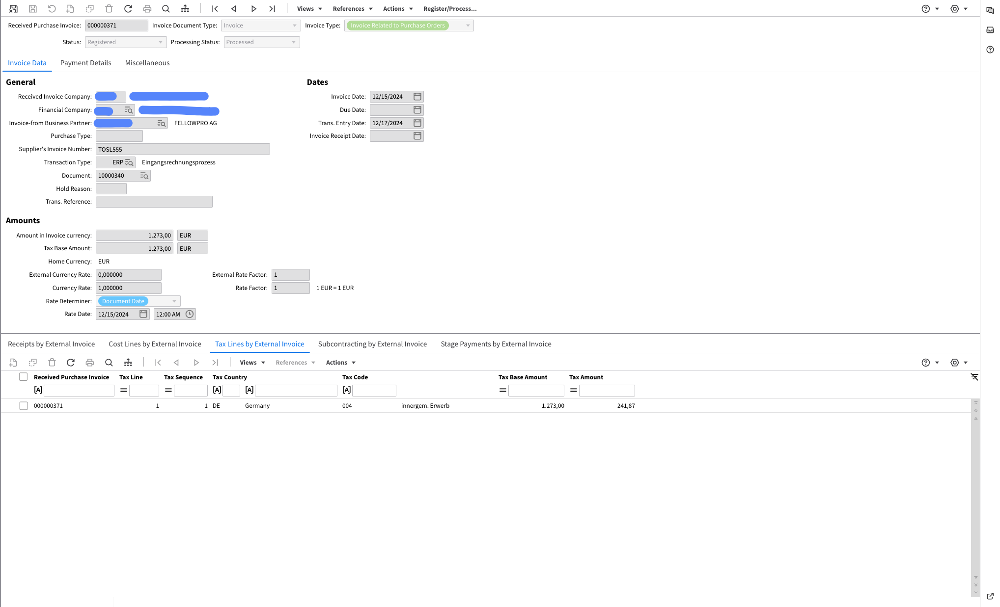

# XRechnung 2.1

Exportations vers le système de gestion de documents (IDM) :

<figure><figcaption></figcaption></figure>

Exporté vers Infor LN :

<figure><figcaption></figcaption></figure>

Exporté vers Infor M3 :

<figure><figcaption></figcaption></figure>
