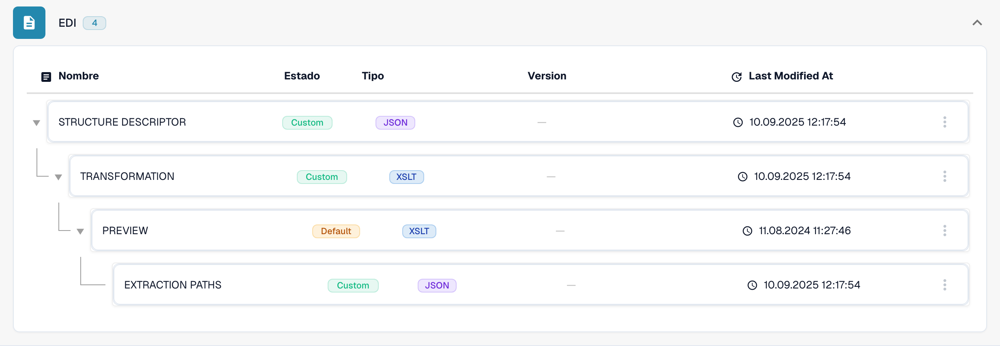

# Guía del Archivo de Descriptores de Estructura EDI

## **1. Visión general**

El **Archivo de Descriptores de Estructura** define cómo se agrupan los segmentos EDI repetidos (por ejemplo, `N1`–`N4`) en JSON estructurado. Asegura:

* **Análisis preciso** de elementos relacionados como unidades individuales.
* **Salida consistente** para sistemas posteriores.

_Para un ejemplo completo con detalles de segmentos, consulte_ [_Ejemplo de Descriptor de Estructura_](edi-structure-descriptor.md)_._

## **2. Acceso y Edición Básica**

#### **Acceso al Archivo**

1.  **Configuración** → **Tipo de Documento** → \[Su Documento (por ejemplo, _Orden de Compra_)] → **E-Doc.**

    
2. Bajo **E-Doc**, seleccione su formato (por ejemplo, _EDI_ ).
3.  Haga clic en **Descriptor de Estructura**.

    

#### **Gestión de Borradores**

* **Crear un Borrador**: Haga clic en el icono de lápiz ✏️ para comenzar a editar.
* **Eliminar Borradores**: Utilice el icono de papelera 🗑️ para eliminar borradores no utilizados.
* **Activar Cambios**: Haga clic en el icono de marca de verificación ✅ para aprobar y publicar sus cambios.
  * **Nota**: Activar una nueva versión **desactivará automáticamente** la anterior.

## 3. Función de Vista Previa (Vista Previa de XML Analizado)

La **Función de Vista Previa** le permite probar y previsualizar cómo se analiza un archivo EDI cargado utilizando el Archivo de Descriptores de Estructura actual.

#### Uso

* Cargue un archivo EDI a través del flujo de carga estándar.
* Copie el **ID del Documento** del archivo cargado.
* Navegue hasta la interfaz del **Archivo de Descriptores de Estructura**.
*   Abra la **Función de Vista Previa**.\

    

* Ingrese el **ID del Documento** en el campo y presione **Probar**.
* La **salida XML estructurada resultante** se mostrará.

Esto es especialmente útil para depurar mapeos y validar agrupaciones estructurales en tiempo real.

## 6. Video Tutorial

Una guía en video para este tipo de archivo está disponible en la [página de Videos.](https://docs.docbits.com/administration-and-setup/settings/global-settings/document-types/edi/edi/edi-videos) Úsela para seguir la configuración, edición y previsualización.

<figure><figcaption>
Formato EDI existente con sus cuatro atributos configurados.
</figcaption></figure>

<figure><figcaption>
Atributo STRUCTUREDESCRIPTOR activo: descriptor de estructura JSON en el editor de solo lectura.
</figcaption></figure>

Las vistas muestran una configuración y una versión existentes. Los ajustes varían según el tipo de documento y el formato. Valide los cambios en un borrador antes de activarlos.

Algunas etiquetas, como Custom, Default, Version y Last Modified At, siguen apareciendo en inglés en la interfaz actual del producto. Los identificadores técnicos de atributos y el código de configuración se conservan sin cambios.
