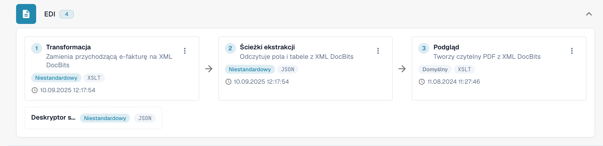

# Przewodnik pliku opisującego strukturę EDI

## **1. Przegląd**

Plik **Opisujący Strukturę** definiuje, w jaki sposób powtarzające się segmenty EDI (np. `N1`–`N4`) są grupowane w strukturalny JSON. Zapewnia:

* **Dokładny parsowanie** powiązanych elementów jako jednostek pojedynczych.
* **Spójne wyniki** dla systemów docelowych.

_Dla pełnego przykładu z szczegółami segmentów, zobacz_ [_Przykład opisu struktury_](edi-structure-descriptor.md)_._

## **2. Dostęp i podstawowa edycja**

#### **Dostęp do pliku**

1.  **Ustawienia** → **Typ Dokumentu** → \[Twój Dokument (np. _Zamówienie Zakupu_)] → **E-Dok.**

    
2. W sekcji **E-Dok**, wybierz swój format (np. _EDI_ ).
3.  Kliknij **Opis Struktury**.

    

#### **Zarządzanie wersjami roboczymi**

* **Utwórz wersję roboczą**: Kliknij ikonę ✏️ ołówka, aby rozpocząć edycję.
* **Usuń wersje robocze**: Użyj ikony 🗑️ kosza, aby usunąć nieużywane wersje robocze.
* **Aktywuj zmiany**: Kliknij ikonę ✅ znaczka zatwierdzenia, aby zatwierdzić i opublikować zmiany.
  * **Uwaga**: Aktywowanie nowej wersji **automatycznie dezaktywuje** poprzednią.

## 3. Funkcja podglądu (Podgląd sparsowanego XML)

Funkcja **Podglądu** pozwala na testowanie i podgląd, jak przesłany plik EDI jest parsowany przy użyciu bieżącego pliku opisującego strukturę.

#### Użycie

* Prześlij plik EDI za pomocą standardowego przepływu przesyłania.
* Skopiuj **ID Dokumentu** przesłanego pliku.
* Przejdź do interfejsu **Pliku Opisującego Strukturę**.
*   Otwórz **Funkcję Podglądu**.\

    

* Wprowadź **ID Dokumentu** do pola i naciśnij **Test**.
* Wynikowy **sparsowany wynik XML** zostanie wyświetlony.

Jest to szczególnie przydatne do debugowania mapowań i walidacji grup strukturalnych w czasie rzeczywistym.

## 6. Przewodnik wideo

Przewodnik wideo dla tego typu pliku jest dostępny na [stronie z filmami.](https://docs.docbits.com/administration-and-setup/settings/global-settings/document-types/edi/edi/edi-videos) Użyj go, aby śledzić konfigurację, edycję i podgląd.

<figure><figcaption>
Istniejący format EDI z czterema skonfigurowanymi atrybutami.
</figcaption></figure>

<figure><figcaption>
Aktywny atrybut STRUCTUREDESCRIPTOR: deskryptor struktury JSON w edytorze tylko do odczytu.
</figcaption></figure>

Widoki przedstawiają istniejącą konfigurację i wersję. Ustawienia różnią się w zależności od typu dokumentu i formatu. Sprawdź zmiany w wersji roboczej przed aktywacją.

Ilustracje przedstawiają polskie karty etapów oraz aktywną wersję konfiguracji w trybie tylko do odczytu. W pokazanej wersji interfejsu przycisk podglądu ma błędny podpis „Zapowiedź”; odpowiada on funkcji podglądu, oznaczonej w karcie jako „Podgląd”. Techniczne nagłówki edytora, identyfikatory atrybutów i kod konfiguracji pozostają w oryginalnej postaci.
