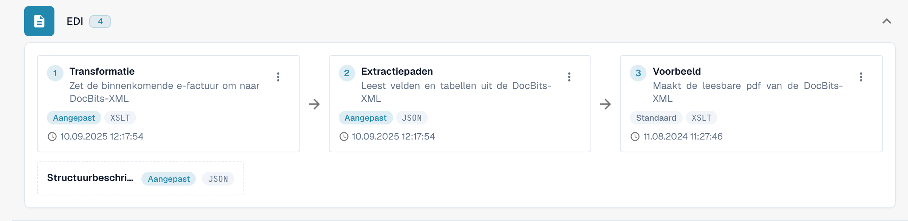

# EDI Transformatiebestand Gids

## 1. Overzicht

Het **Transformatiebestand** bepaalt hoe de gestructureerde XML—gemaakt met behulp van het **Structuur Descriptor Bestand**—wordt omgezet in een aangepast XML-formaat dat overeenkomt met de specifieke documenttype- of formuliereisen van uw organisatie.

Deze transformatie wordt uitgevoerd met behulp van **XSLT (Extensible Stylesheet Language Transformations)**, die kunnen worden gemaakt en onderhouden via de **XSLT Editor** in de DocBits-interface.

## 2. Doel en Functie

* Transformeert de **tussenliggende XML** (output van de Structuur Descriptor) naar een **definitieve XML** die overeenkomt met uw documentenschema.
* Maakt flexibiliteit mogelijk om verschillende EDI-partnerformaten en interne systeemvereisten aan te passen.
* Opgebouwd met **XSLT-regels**, waarmee u mappings, waardeopmaak, voorwaardelijke logica en structuur kunt definiëren.

## 3. Toegang & Basisbewerking

#### Toegang tot het Bestand

1.  Ga naar **Instellingen → Documenttype** → \[Uw Document (bijv., _Inkooporder_)] → **E-Doc.**

    
2. Onder het tabblad **E-Doc** selecteert u uw formaat (bijv., **EDI**).
3.  Klik op **Transformatie** om te bekijken of te bewerken.

    

#### Conceptbeheer

* **Maak een Concept**: Klik op het ✏️ potloodpictogram.
* **Concepten Verwijderen**: Gebruik het 🗑️ prullenbakpictogram om ongebruikte concepten te verwijderen.
* **Wijzigingen Activeren**: Klik op het ✅ vinkje om een versie te publiceren.
  * **Opmerking**: Het activeren van een nieuwe versie zal de vorige versie **automatisch deactiveren**.

## 4. XSLT Editor

Het Transformatiebestand wordt bewerkt met behulp van een ingebedde **XSLT Editor** die syntaxmarkering en validatie ondersteunt.

* Voeg sjablonen toe om specifieke paden van de invoer-XML naar de gewenste structuur te mappen.
* Gebruik voorwaardelijke logica (bijv., `<xsl:if>`, `<xsl:choose>`) om optionele of variabele gegevensformaten te verwerken.
* Pas opmaakfuncties toe indien nodig (bijv., stringmanipulatie, datumopmaak).

## 5. Voorbeeldfunctie (Voorbeeld Getransformeerde XML)

De **Voorbeeldfunctie** stelt u in staat om te testen en te bekijken hoe een geüpload EDI-bestand wordt verwerkt met behulp van het huidige **Transformatiebestand**.

#### Gebruik

* Upload een EDI-bestand via de standaard uploadstroom.
* Kopieer de **Document-ID** van het geüploade bestand.
* Navigeer naar de interface van het **Transformatiebestand**.
*   Open de **Voorbeeldfunctie**.\

    

* Voer de **Document-ID** in het veld in en druk op **Test**.
* De resulterende **getransformeerde XML-uitvoer** wordt weergegeven.

Dit is vooral handig voor het debuggen van XSLT-mappings en om ervoor te zorgen dat de uiteindelijke XML-structuur voldoet aan uw opmaakeisen.

## 6. Video Doorloop

Een videogids voor dit bestandstype is beschikbaar op de [Videopagina.](https://docs.docbits.com/administration-and-setup/settings/global-settings/document-types/edi/edi/edi-videos) Gebruik het om de installatie, bewerking en voorbeeldweergave te volgen.

## Effectieve regels en activering

Organisatiespecifieke regels hebben voorrang op de standaardregels voor het gedetecteerde eDoc-formaat. Controleer de actieve TRANSFORMATION en controleer welke node invoice_type levert in de getransformeerde XML; het pad hangt af van het formaat. Save slaat een concept op; gebruik na het testen het vinkje om het te activeren. Een weergegeven Preview bewijst niet wat het opgeslagen documenttype is. Raadpleeg de [handleiding voor het oplossen van classificatieproblemen](../credit-note-recognized-as-invoice.md) voor codes 381/261, latere scripts en voorzorgsmaatregelen bij opnieuw verwerken.

<figure><figcaption>
Bestaand EDI-formaat met de vier geconfigureerde attributen.
</figcaption></figure>

<figure><figcaption>
Actief attribuut TRANSFORMATION: XSLT-broncode voor het transformeren van de tussenliggende XML.
</figcaption></figure>

De weergaven tonen een bestaande configuratie en versie. De instellingen verschillen per documenttype en formaat. Valideer wijzigingen in een concept voordat u ze activeert.

De afbeeldingen tonen de Nederlandstalige proceskaarten en de actieve, alleen-lezen configuratieversie. De tabnaam Builder, technische attribuutnamen en configuratiecode zijn overgenomen uit de geïllustreerde productversie.
