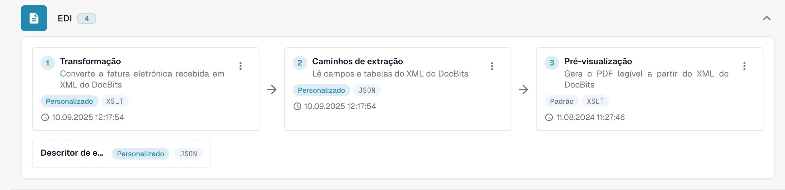
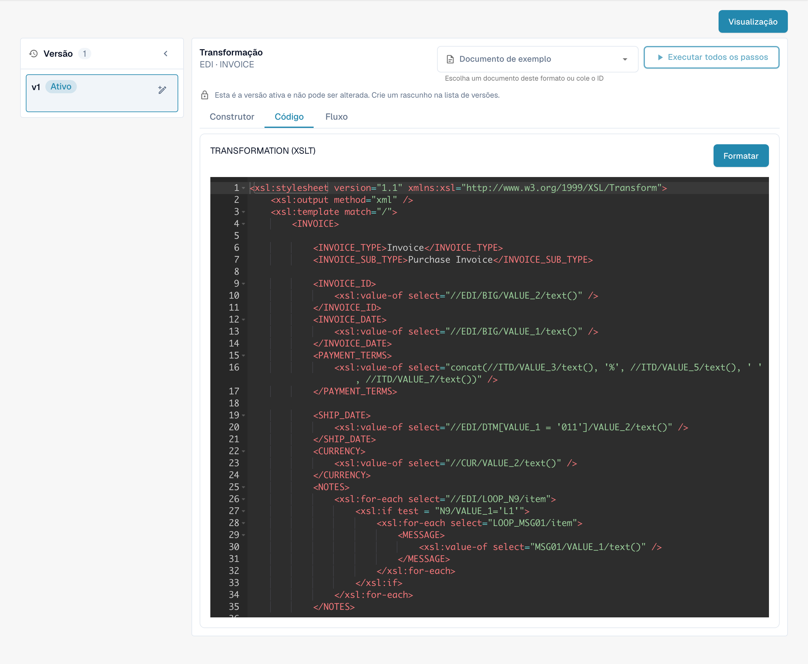

# Guia do Arquivo de Transformação EDI

## 1. Visão Geral

O **Arquivo de Transformação** define como o XML estruturado—criado usando o **Arquivo de Descritor de Estrutura**—é convertido em um formato XML personalizado que corresponde aos requisitos específicos de tipo de documento ou formulário da sua organização.

Essa transformação é realizada usando **XSLT (Extensible Stylesheet Language Transformations)**, que pode ser criado e mantido por meio do **Editor XSLT** na interface do DocBits.

## 2. Propósito e Função

* Transforma o **XML intermediário** (saída do Descritor de Estrutura) em um **XML final** alinhado com o esquema do seu documento.
* Permite flexibilidade para acomodar formatos de parceiros EDI variados e requisitos internos do sistema.
* Construído usando **regras XSLT**, que permitem definir mapeamentos, formatação de valores, lógica condicional e estrutura.

## 3. Acesso e Edição Básica

#### Acessando o Arquivo

1.  Vá para **Configurações → Tipo de Documento** → \[Seu Documento (por exemplo, _Ordem de Compra_)] → **E-Doc.**

    
2. Na aba **E-Doc**, selecione o seu formato (por exemplo, **EDI**).
3.  Clique em **Transformação** para visualizar ou editar.

    

#### Gerenciamento de Rascunhos

* **Criar um Rascunho**: Clique no ícone de ✏️ lápis.
* **Excluir Rascunhos**: Use o ícone de 🗑️ lixeira para remover rascunhos não utilizados.
* **Ativar Alterações**: Clique no ✅ marca de seleção para publicar uma versão.
  * **Nota**: Ativar uma nova versão irá **desativar automaticamente** a anterior.

## 4. Editor XSLT

O Arquivo de Transformação é editado usando um **Editor XSLT** incorporado que suporta destaque de sintaxe e validação.

* Adicione modelos para mapear caminhos específicos do XML de entrada para a estrutura desejada.
* Use lógica condicional (por exemplo, `<xsl:if>`, `<xsl:choose>`) para lidar com formatos de dados opcionais ou variados.
* Aplique funções de formatação conforme necessário (por exemplo, manipulação de strings, formatação de datas).

## 5. Função de Visualização (Visualizar XML Transformado)

A **Função de Visualização** permite testar e visualizar como um arquivo EDI enviado é processado usando o **Arquivo de Transformação** atual.

#### Uso

* Envie um arquivo EDI via o fluxo de upload padrão.
* Copie o **ID do Documento** do arquivo enviado.
* Navegue até a interface do **Arquivo de Transformação**.
*   Abra a **Função de Visualização**.\

    

* Insira o **ID do Documento** no campo e pressione **Testar**.
* A saída do **XML transformado resultante** será exibida.

Isso é especialmente útil para depurar mapeamentos XSLT e garantir que a estrutura final do XML atenda aos requisitos do seu formato.

## 6. Tutorial em Vídeo

Um guia em vídeo para este tipo de arquivo está disponível na [página de Vídeos.](https://docs.docbits.com/administration-and-setup/settings/global-settings/document-types/edi/edi/edi-videos) Use-o para acompanhar a configuração, edição e visualização.

## Regras efetivas e ativação

As regras específicas da organização têm prioridade sobre as predefinições do formato eDoc detetado. Verifique a TRANSFORMATION ativa e verifique qual o nó que fornece invoice_type no XML transformado; o caminho depende do formato. Save guarda um rascunho; utilize a marca de verificação para o ativar após os testes. Uma Preview renderizada não comprova o tipo de documento guardado. Consulte o [guia de resolução de problemas de classificação](../credit-note-recognized-as-invoice.md) para obter informações sobre os códigos 381/261, os scripts posteriores e as precauções de reprocessamento.

<figure><figcaption>
Formato EDI existente com os seus quatro atributos configurados.
</figcaption></figure>

<figure><figcaption>
Atributo TRANSFORMATION ativo: código-fonte XSLT para transformar o XML intermédio.
</figcaption></figure>

As vistas mostram uma configuração e uma versão existentes. As definições variam consoante o tipo de documento e o formato. Valide as alterações num rascunho antes da ativação.

As imagens mostram as etapas em português e a versão ativa da configuração em modo só de leitura. Os nomes técnicos dos editores, os identificadores de atributos e o código de configuração mantêm-se como na versão ilustrada.
