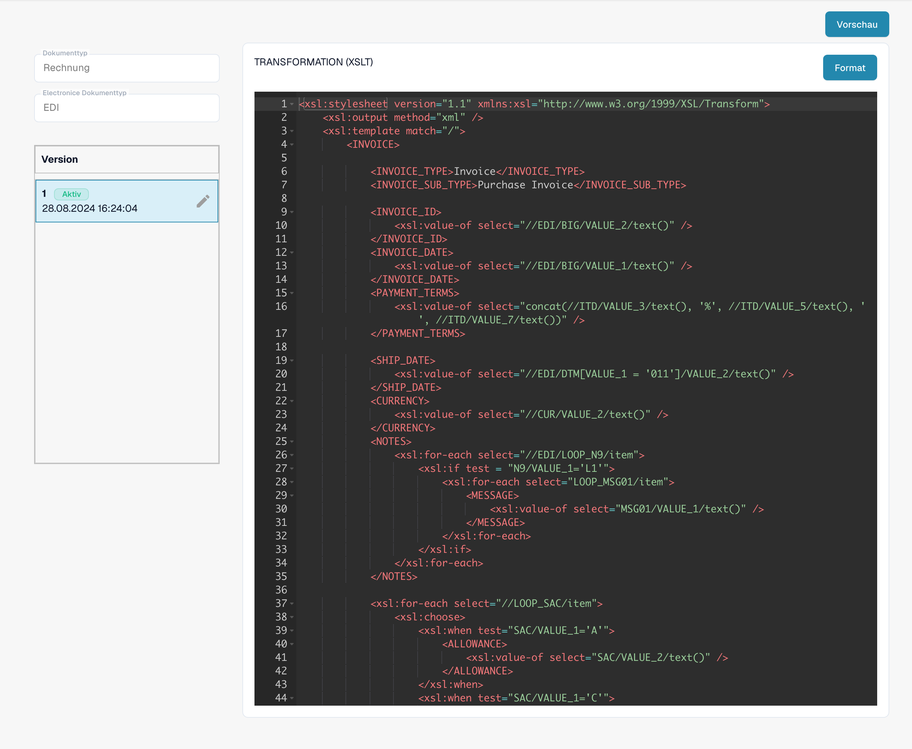

# EDI-Transformationsdatei-Anleitung

## 1. Überblick

Die **Transformationsdatei** definiert, wie das strukturierte XML, das mit der **Strukturdeskriptordatei** erstellt wurde, in ein benutzerdefiniertes XML-Format umgewandelt wird, das den spezifischen Dokumententypen oder Formularanforderungen Ihrer Organisation entspricht.

Diese Transformation wird mithilfe von **XSLT (Extensible Stylesheet Language Transformations)** durchgeführt, die im DocBits-Interface mit dem **XSLT-Editor** erstellt und gewartet werden können.

## 2. Zweck und Funktion

* Wandelt das **Zwischen-XML** (Ausgabe des Strukturdeskriptors) in ein **endgültiges XML** um, das mit Ihrem Dokumentschema übereinstimmt.
* Ermöglicht die Flexibilität, um verschiedene EDI-Partnerformate und interne Systemanforderungen anzupassen.
* Wird mit **XSLT-Regeln** erstellt, die es Ihnen ermöglichen, Zuordnungen, Wertformatierungen, bedingte Logik und Struktur zu definieren.

## 3. Zugriff und grundlegende Bearbeitung

#### Dateizugriff

1.  Gehen Sie zu **Einstellungen → Dokumententyp** → \[Ihr Dokument (z. B. _Bestellung_)] → **E-Dok.**

    
2. Wählen Sie unter dem **E-Dok**-Tab Ihr Format aus (z. B. **EDI**).
3.  Klicken Sie auf **Transformation**, um anzuzeigen oder zu bearbeiten.

    

#### Entwurfsverwaltung

* **Entwurf erstellen**: Klicken Sie auf das ✏️ Stiftsymbol.
* **Entwürfe löschen**: Verwenden Sie das 🗑️ Papierkorb-Symbol, um nicht verwendete Entwürfe zu entfernen.
* **Änderungen aktivieren**: Klicken Sie auf das ✅ Häkchen, um eine Version zu veröffentlichen.
  * **Hinweis**: Das Aktivieren einer neuen Version deaktiviert die vorherige **automatisch**.

## 4. XSLT-Editor

Die Transformationsdatei wird mithilfe eines integrierten **XSLT-Editors** bearbeitet, der Syntaxhervorhebung und Validierung unterstützt.

* Fügen Sie Vorlagen hinzu, um spezifische Pfade aus dem Eingabe-XML auf die gewünschte Struktur abzubilden.
* Verwenden Sie bedingte Logik (z. B. `<xsl:if>`, `<xsl:choose>`) zur Behandlung optionaler oder variabler Datenformate.
* Wenden Sie Formatierungsfunktionen bei Bedarf an (z. B. Zeichenkettenmanipulation, Datumsformatierung).

## 5. Vorschau-Funktion (Vorschau des transformierten XML)

Die **Vorschau-Funktion** ermöglicht es Ihnen, zu testen und zu überprüfen, wie eine hochgeladene EDI-Datei mithilfe der aktuellen **Transformationsdatei** verarbeitet wird.

#### Verwendung

* Laden Sie eine EDI-Datei über den Standard-Upload-Flow hoch.
* Kopieren Sie die **Dokumenten-ID** der hochgeladenen Datei.
* Navigieren Sie zur **Transformationsdatei**-Schnittstelle.
*   Öffnen Sie die **Vorschau-Funktion**.\

    

* Geben Sie die **Dokumenten-ID** in das Feld ein und drücken Sie **Test**.
* Die resultierende **transformierte XML-Ausgabe** wird angezeigt.

Dies ist besonders nützlich zum Debuggen von XSLT-Zuordnungen und zur Sicherstellung, dass die endgültige XML-Struktur Ihren Formatanforderungen entspricht.

## 6. Video-Anleitung

Eine Videoanleitung für diesen Dateityp finden Sie auf der [Videos-Seite.](https://docs.docbits.com/administration-and-setup/settings/global-settings/document-types/edi/edi/edi-videos) Verwenden Sie sie, um die Einrichtung, Bearbeitung und Vorschau zu verfolgen.

## Verwendete Regeln und Aktivierung

Organisationsspezifische Regeln haben Vorrang vor den Standardregeln für das erkannte eDoc-Format. Prüfen Sie die aktive TRANSFORMATION und prüfen Sie, welcher Knoten im transformierten XML invoice_type liefert; der Pfad hängt vom Format ab. Speichern sichert einen Entwurf; aktivieren Sie ihn nach dem Testen über das Häkchen. Eine gerenderte Preview belegt nicht den gespeicherten Dokumenttyp. Die [Anleitung zur Fehlerbehebung bei der Klassifizierung](../credit-note-recognized-as-invoice.md) erläutert die Codes 381/261, spätere Skripte und Vorsichtsmaßnahmen bei der erneuten Verarbeitung.

<figure><figcaption>
Vorhandenes EDI-Format mit seinen vier konfigurierten Attributen.
</figcaption></figure>

<figure><figcaption>
Aktives Attribut TRANSFORMATION: XSLT-Quelltext zur Transformation des XML-Zwischenformats.
</figcaption></figure>

Die Ansichten zeigen eine vorhandene Konfiguration und Version. Die Einstellungen unterscheiden sich je nach Dokumenttyp und Format. Prüfen Sie Änderungen in einem Entwurf vor der Aktivierung.

Einzelne Bezeichnungen wie Custom, Default und Electronice im Feldnamen entsprechen der derzeitigen Produktoberfläche. Die technischen Attributnamen und der Konfigurationscode bleiben unverändert.
