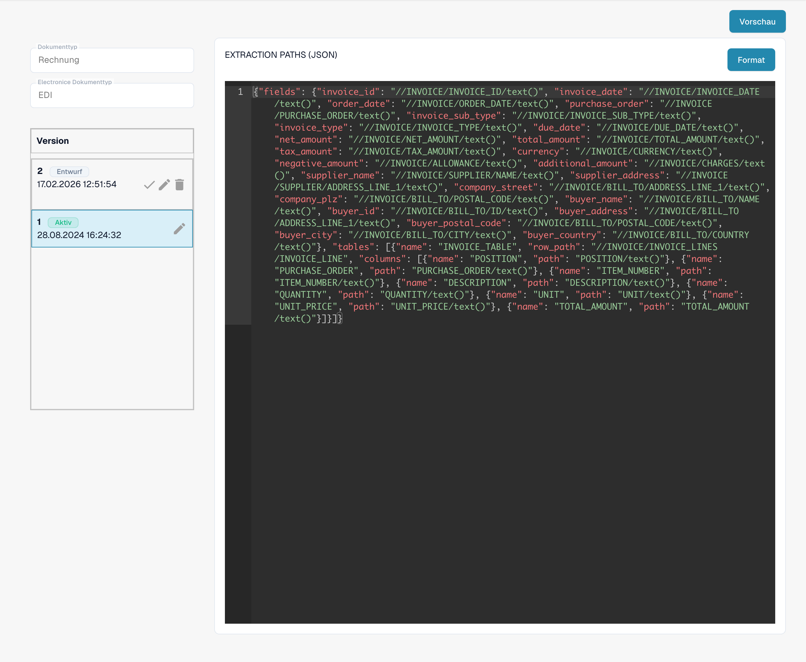

# EDI-Attribute konfigurieren

Wählen Sie das tatsächliche Nachrichtenformat und den Dokumenttyp. Prüfen Sie die vorhandenen Attribute und aktiven Versionen, bevor Sie die Konfiguration ändern.

<figure><figcaption>
Vorhandenes EDI-Format mit seinen vier konfigurierten Attributen.
</figcaption></figure>

Definieren Sie Segmente, Elemente und Schleifen in einer JSON-Strukturbeschreibung. Testen Sie repräsentative Nachrichten und prüfen Sie das erzeugte XML-Zwischenformat.

<figure><figcaption>
Aktives Attribut STRUCTUREDESCRIPTOR: JSON-Strukturbeschreibung im schreibgeschützten Editor.
</figcaption></figure>

Ordnen Sie mit TRANSFORMATION-XSLT das XML-Zwischenformat dem benötigten Standard-XML zu. Konfigurieren Sie PREVIEW getrennt für die Darstellung; XSLT verarbeitet dabei nicht unmittelbar JSON.

<figure><figcaption>
Aktives Attribut TRANSFORMATION: XSLT-Quelltext zur Transformation des XML-Zwischenformats.
</figcaption></figure>

Konfigurieren Sie EXTRACTIONPATHS als JSON mit XPath-Ausdrücken für das resultierende XML. Prüfen Sie Felder, Zeilen und Beträge anhand echter Beispiele. Validieren Sie einen Entwurf vor der Aktivierung; die Bilder zeigen eine vorhandene aktive Konfiguration.

<figure><figcaption>
Aktives Attribut EXTRACTIONPATHS: JSON-Konfiguration mit XPath-Ausdrücken für die Extraktion.
</figcaption></figure>
