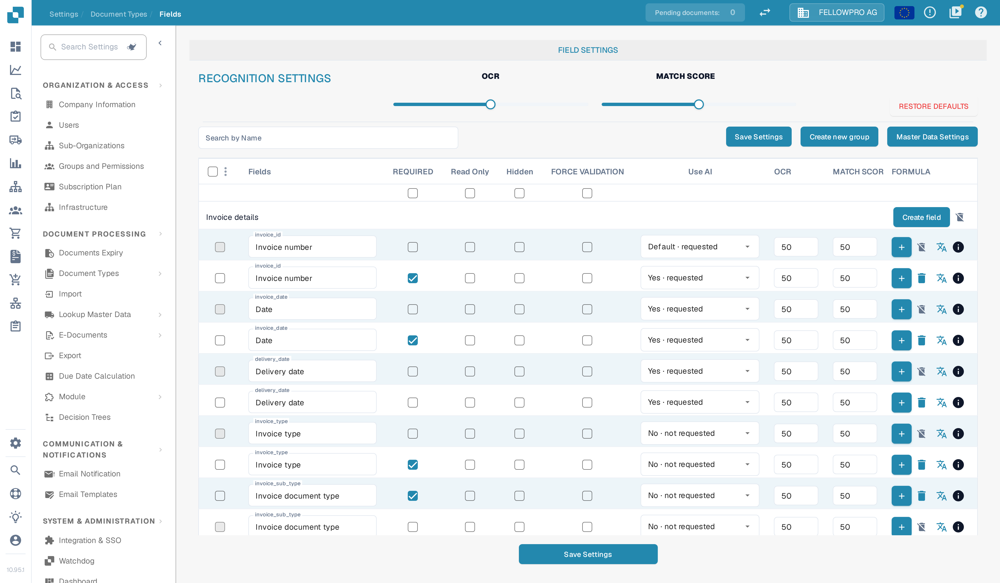

# Fields

The **Field Settings** page of a document type lists every field DocBits extracts or stores for that type. Here you decide which fields validation needs, how much recognition confidence each one requires, and which formula calculates a field that is not extracted. Open the page from the card of the document type: **Settings → Document Types**, then **Fields** on the card.

<figure><figcaption>The <strong>Field Settings</strong> page of the Invoice document type. The switches and thresholds in a row apply to that one field.</figcaption></figure>

## Overview

Each field can be adjusted to optimize the accuracy and efficiency of data capture and validation. A change on this page applies to the document type only; other document types keep their own field settings.

## What the page controls

* **Recognition settings**: the **OCR** and **MATCH SCORE** sliders at the top are the default for every field of the document type. A field can override both values in its own row. **Restore defaults** puts the two sliders back to the values DocBits ships with.
* **Field groups**: the fields are grouped by area of the document, such as *Invoice details*, *Payment details* and *Purchase order*. **Create field** in a group header adds a field to that group, **Create new group** adds a group of your own.
* **Search by Name**: filters the list while you type.
* **Save Settings**: writes the changes of the whole page. Nothing on the page is applied before you click it.
* **Master Data Settings**: opens the lookup master data of the document type.

## The columns of a field row

* **Fields**: the technical name of the field in small print, with the name users see underneath. Click the field to open its **Document field details**.
* **REQUIRED**: the document cannot finish validation while the field is empty.
* **Read Only**: the value is shown but cannot be edited during validation.
* **Hidden**: the field is not displayed in the interface.
* **FORCE VALIDATION**: the value must pass the validation rules of the field before the document can be validated.
* **Use AI**: whether the AI extraction fills the field. **Default** follows the setting of your organisation, **Yes** and **No** force the behaviour for this field. The end of each option (**requested** / **not requested**) says what the extraction currently does with the field.
* **OCR** and **MATCH SCORE**: thresholds for this one field. Leave them empty to use the recognition settings at the top of the page.
* **FORMULA**: for a calculated field, the **+** button opens the formula.

The checkbox in a column header switches that column on or off for every field of the document type at once.

## Editing a field

1. Click the field name. The **Document field details** dialog opens.
2. Change the title, the switches or the advanced options. The name and the data type of an existing field cannot be changed.
3. Click **Save** in the dialog, then **Save Settings** on the page.

To move fields to another group, tick them in the first column and choose **Reassign field group** from the ⋮ menu in the table header.


Adding a field, including a field that carries a charge, is described step by step on [New Fields with Charges](new-fields-with-charges.md). The dialog itself is covered on [Adding and Editing Fields](adding-and-editing-fields.md).

