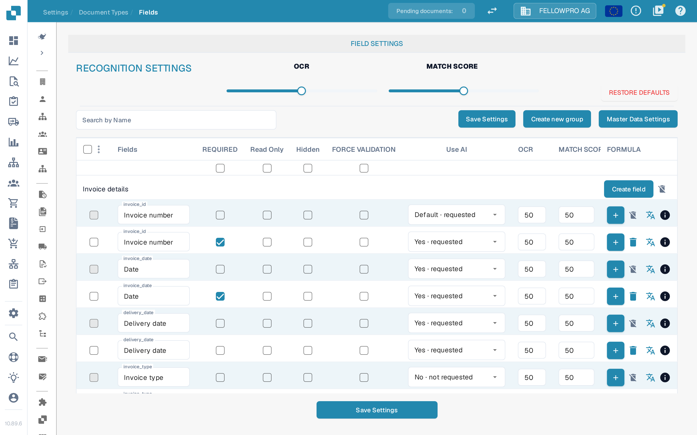
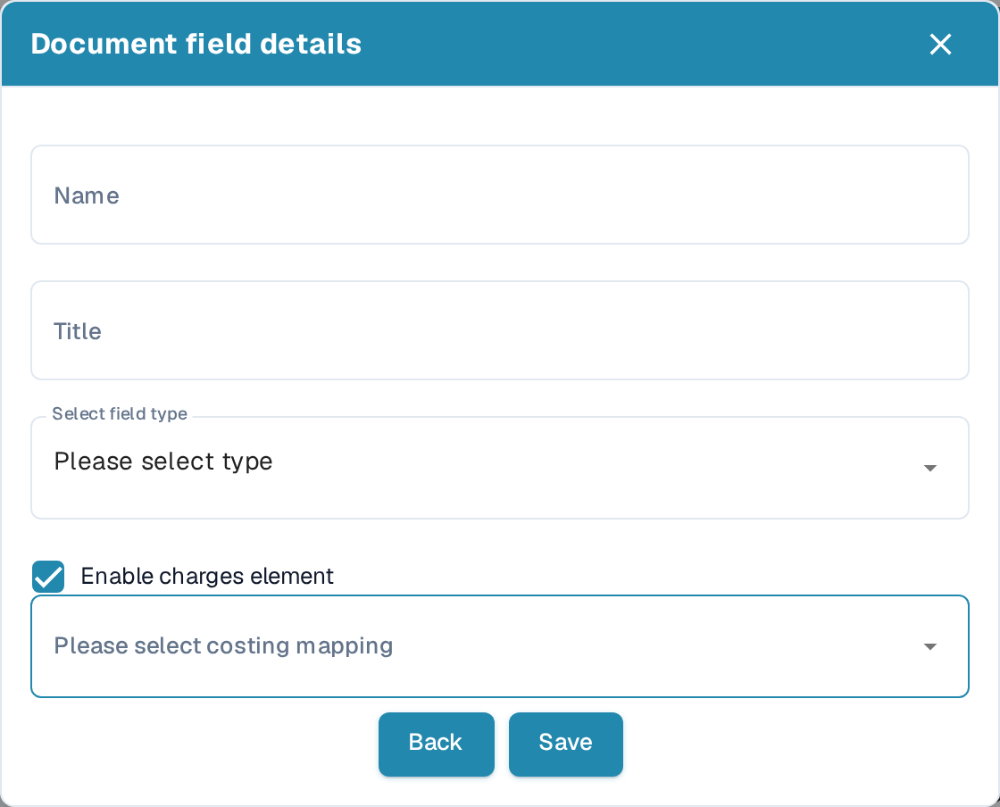

# New Fields with Charges

Some amounts on a document are not ordinary line items — freight, a fuel surcharge, an add-on fee. DocBits can capture them in a **field of their own** and map that field to a **costing element**, so the amount reaches your ERP as the correct charge instead of as a generic line.

This page shows how to add such a field to a document type. Fields in general are described under [Fields](README.md) and [Adding and Editing Fields](adding-and-editing-fields.md).

## Step 1 — Open the field settings of the document type

1. Go to **Settings → Document Types**.
2. On the card of the document type, click **Fields**.

The **Field Settings** page of that document type opens. At the top are the recognition defaults — the **OCR** and **MATCH SCORE** sliders and **Restore defaults** — and below them the fields, grouped by area of the document: *Invoice details*, *Payment details*, *Purchase order* and so on. Every group has its own **Create field** button.

<figure><figcaption>
The field groups of a document type, each with its own Create field button
</figcaption></figure>

Each row is one field. Next to the field name you find the **REQUIRED**, **Read Only**, **Hidden** and **FORCE VALIDATION** switches, the **Use AI** choice, the **OCR** and **MATCH SCORE** thresholds, and — where the field is calculated — the formula behind the **+** button.

## Step 2 — Create the field and enable the charge

1. Click **Create field** in the group the new field belongs to, for example *Invoice details*.
2. In the **Document field details** dialog, enter the **Name** — the technical name of the field. It must be unique and cannot be changed later.
3. Enter the **Title** — the name users see in the interface.
4. Pick the data type under **Select field type**. It also cannot be changed after the field is created.
5. Tick **Enable charges element**. The **Please select costing mapping** dropdown appears.
6. Choose the charge type the amount belongs to.

<figure><figcaption>
Ticking Enable charges element opens the costing mapping dropdown
</figcaption></figure>


The list of costing elements is not part of the field settings — it comes from your master data. The charges you want to map must be configured before you create the field: see [Table Extraction for Costing Element](../../../../../infor-integration-and-configuration/importing-customer-master-data/m3/table-extraction-for-costing-element.md).


## Step 3 — Save

1. Click **Save** in the dialog. The new field appears in its group; **Back** closes the dialog without creating it.
2. Click **Save Settings** at the bottom of the page to apply the change.

From now on the field is extracted with the document and carries its charge type.

## Working with the field list

* **Edit a field** — click its name. The same dialog opens; save with **Save**.
* **Group fields** — **Create new group** adds a group of your own. To move fields between groups, tick them in the first column and choose **Reassign Field Group** from the **⋮** menu in the table header.
* **Find a field** — type into **Search by Name**.
* **Recognition per field** — set **OCR** and **MATCH SCORE** per field. They override the defaults from the top of the page for that field.
* **Master data** — **Master Data Settings** opens the master data configuration for the document type.
