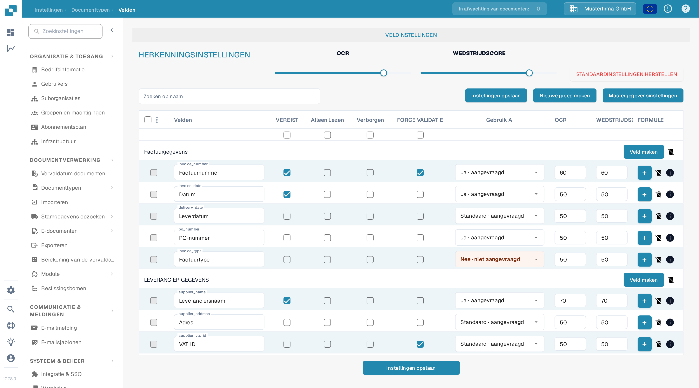
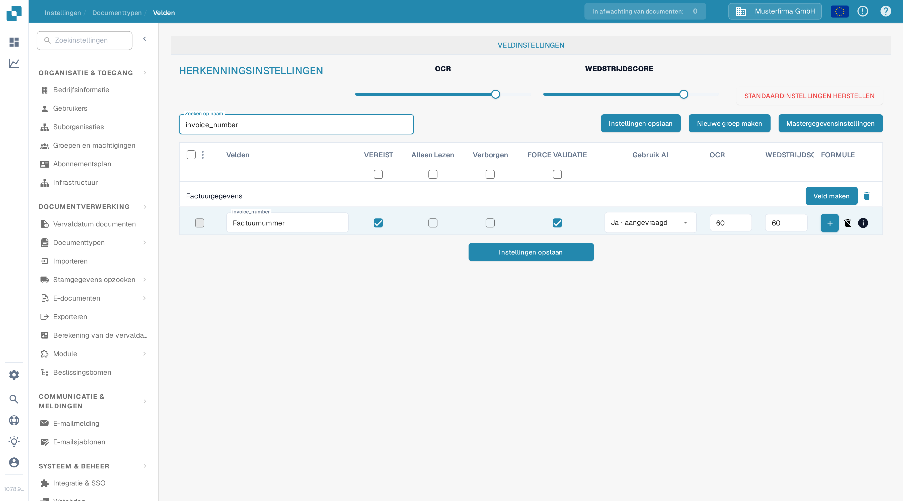

# Instelling Validatie forceren en Wedstrijdscore

In **Velden** kunt u de validatie- en herkenningsdrempels voor een documenttype instellen. Deze pagina gebruikt **Factuur** in een testorganisatie van de documentatie. Ze legt het huidige selectievakje **FORCE VALIDATIE** en de besturingselementen voor de **WEDSTRIJDSCORE** uit.

## De veldinstellingen openen

1. Ga naar **Instellingen → Documenttypen → Factuur → Velden**.
2. Gebruik **Zoeken op naam** om een veld te vinden, bijvoorbeeld `invoice_number` (weergegeven als **Factuurnummer**).
3. Controleer de veldrij voordat u een instelling wijzigt. **VEREIST**, **Alleen Lezen**, **Verborgen** en **FORCE VALIDATIE** zijn afzonderlijke selectievakjes.

<figure><figcaption>
De herkenningsbesturingselementen staan boven de veldenlijst.
</figcaption></figure>

## Force Validatie

Vink **FORCE VALIDATIE** aan in de veldrij om voor dat veld een strengere validatie toe te passen. Het selectievakje staat los van **VEREIST**: een veld als vereist markeren vinkt Force Validatie niet automatisch aan. Het selectievakje kan niet beschikbaar zijn wanneer een veld verborgen of alleen-lezen is. Klik op **Instellingen opslaan** nadat u de veldconfiguratie hebt gewijzigd.

De oude instructies stelden voor om hier numerieke grenzen of reguliere expressies in te voeren. De huidige Velden-tabel toont geen regeleditor in de cel FORCE VALIDATIE. Voor veldspecifieke regels zie [Veldeigenschaften configureren](configuring-field-properties-1.md).

## Wedstrijdscore

**WEDSTRIJDSCORE** is een numerieke drempelwaarde, geen vaste referentiewaarde. De schuifregelaar **WEDSTRIJDSCORE** onder **HERKENNINGSINSTELLINGEN** past zijn waarde toe op de veldrijen van het documenttype; gebruik het veld **WEDSTRIJDSCORE** van een veldrij voor een afzonderlijke waarde. In de testorganisatie tonen de schuifregelaar en `invoice_number` beide **80**. Controleer de betrokken velden en klik vervolgens op **Instellingen opslaan**.

<figure><figcaption>
Zoek een veld om het selectievakje FORCE VALIDATIE en de wedstrijdscorewaarde te controleren.
</figcaption></figure>

**OCR** is een afzonderlijke herkenningsdrempel naast de Wedstrijdscore. **STANDAARDINSTELLINGEN HERSTELLEN** zet de instellingen terug; gebruik het alleen wanneer u uw eigen drempelwaarden wilt verwijderen. Voor andere veldopties zie het [Velden-overzicht](README.md).
