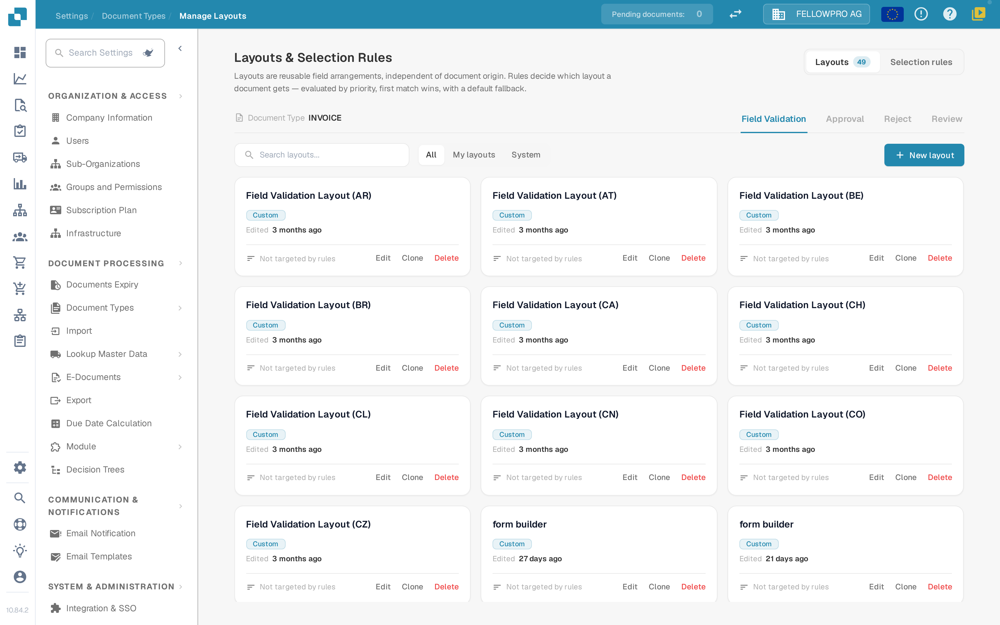

# Layout Manager

<figure><figcaption>The Layout Manager for the Invoice document type.</figcaption></figure>

The **Layout Manager** decides how a document type looks to the people who validate, approve, reject and review documents: which fields and groups appear on the screen, in which order, and how each field behaves. Every document type has its own layouts.

The page opens as **Layouts & Selection Rules**: layouts are reusable field arrangements, independent of the document origin, and rules decide which layout a document gets.

#### Screens and layout types

Validation, approval, reject and review are separate screens, and each of them has its own layouts, its own rules and its own default layout — an approval rule never changes the validation screen. Switch the screen with the **Field Validation**, **Approval**, **Reject** and **Review** tabs.

#### Layout cards

On the **Layouts** tab every layout of the selected screen is a card. A card shows the layout name, whether it belongs to your organisation (**Custom**) or is the **System default**, when it was last edited, and whether a selection rule targets it. **Edit** opens the layout in the Layout Builder, **Clone** copies it under a name you choose and **Delete** removes it — the system default can only be viewed, not changed or deleted. **New layout** asks for a name and opens the Layout Builder on the new, empty layout. The filter above the cards switches between **All**, **My layouts** and **System** layouts.

#### The Layout Builder

**Edit** opens the [Layout Builder](navigating-the-layout-manager.md):

* **Structure**, **Fields** and **Elements** on the left — the layout as a tree, every field of the document type with a counter of the fields already placed, and the groups and form elements you can drag onto the canvas.
* The **canvas** in the middle shows the layout as the user sees it. **Main layout** and **Table** switch between the page and a line-item table, **Document** opens the sample document beside it.
* The **Properties** panel on the right follows the selected element, with its settings grouped into **Display**, **Behaviour**, **Values & lists**, **Automation** and **Borders & spacing**.

**Save** in the header stores the layout. See [Save and Apply Changes](save-and-apply-changes.md) for the other header actions.

#### Which layout a document gets

The **Selection rules** tab of each screen holds the rules that pick the layout, and the **FALLBACK** row is the default layout used when no rule matches. See [Layout Selection Rules](layout-selection-rules.md).

#### Related pages

* [Purpose and Use](purpose-and-use.md)
* [Navigating the Layout Builder](navigating-the-layout-manager.md)
* [Configuring Field Properties](configuring-field-properties.md)
* [Using the Template Preview](using-the-template-preview.md)
* [Save and Apply Changes](save-and-apply-changes.md)
* [Layout Selection Rules](layout-selection-rules.md)
* [Best practices](best-practices.md)
* [Troubleshooting](troubleshooting.md)


