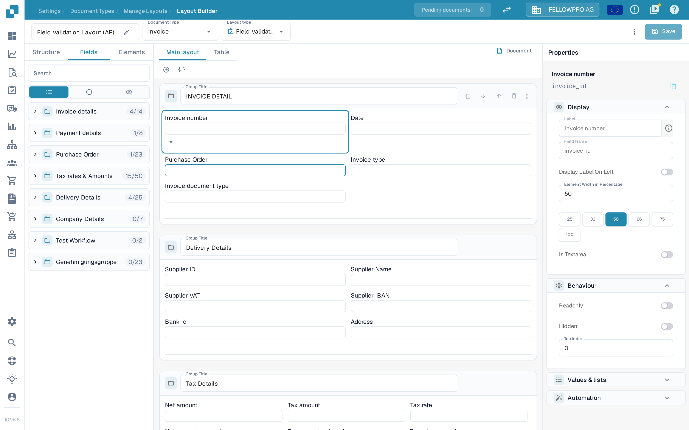
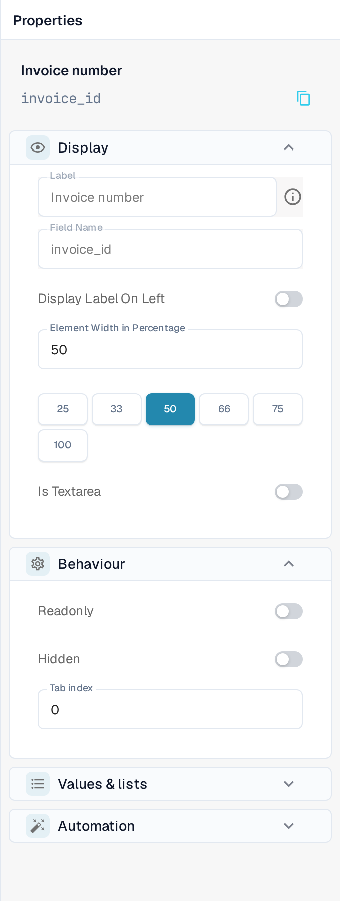
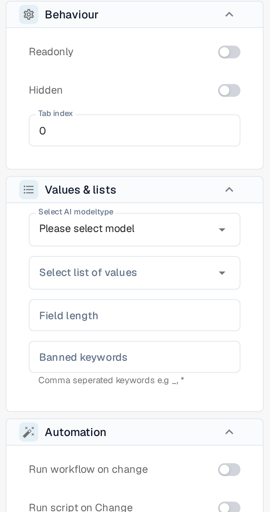

# Configuring Field Properties in the Layout Builder

The **Layout Builder** controls how a field appears on a document layout: its label, how wide it is and how it behaves while someone edits a document. It is separate from the document type's [Fields settings](../fields/configuring-field-properties-1.md), where you configure required values, validation, OCR and matching.

The **Properties** panel on the right of the builder is always open and follows whatever you select, so you can work through the layout and adjust one field after another without leaving the screen.

## Select the field you want to change

1. Go to **Settings → Document Types** and select **Layouts** on a document type card.
2. Select **Edit** on the layout you want to change. The Layout Builder opens on the **Fields** tab.
3. Select the field on the canvas, or a row in the **Structure** or **Fields** tab. The field is highlighted on the canvas and the **Properties** panel shows it: the label, and directly below the heading the technical field name with a copy icon.

<figure><figcaption>The Properties panel shows the selected field, here **Invoice number** with the technical name `invoice_id`.</figcaption></figure>

Read the technical field name before you change an option. Two fields can carry the same label, for example two fields named **Delivery date**, and only the technical name tells them apart.

## The sections of the Properties panel

The panel groups its options into collapsible sections. Only the sections that apply to the selected element are shown — a text element, for instance, has no **Behaviour** section. Select a section heading to open or close it.

<figure><figcaption>**Display** and **Behaviour** of the selected field.</figcaption></figure>

| Section | Options | What it changes |
| --- | --- | --- |
| **Display** | **Label**, **Field Name**, **Display Label On Left**, **Element Width in Percentage**, **Is Textarea** | The text shown for the field, the name the app stores for it, the place of the label, the width inside its row and whether the input takes several lines. |
| **Behaviour** | **Readonly**, **Hidden**, **Tab index** | Whether the field can be edited, whether it is hidden in this layout, and its position when someone moves through the form with the Tab key. |
| **Values & lists** | **Select AI modeltype**, **Select list of values**, **Field length**, **Banned keywords** | Which AI model and which list of values the field may use, the maximum number of characters and the words the field must not accept. |
| **Automation** | **Run workflow on change**, **Run script on Change** | Start a workflow or a script as soon as the value of the field changes. Configure the workflow or script first. |

**Element Width in Percentage** takes a number; the presets **25**, **33**, **50**, **66**, **75** and **100** next to it set it with one click. A field at **50** fills half of its row, so two fields at **25** fit side by side in the same row.

<figure><figcaption>**Values & lists** and **Automation** for the same field.</figcaption></figure>

**Banned keywords** accepts a comma-separated list, for example `_, *`. **Field length** limits how many characters the field accepts.

## Save the change

Every change shows on the canvas immediately and stays unsaved until you select **Save** in the header of the builder. See [Save and Apply Changes](save-and-apply-changes.md) for the other header actions, including template generation and default templates.

Validation, OCR, matching and required values are not part of this panel. Configure them in the document type's Fields settings, described in [Configuring Field Properties](../fields/configuring-field-properties-1.md). For a tour of the whole screen, see [Navigating the Layout Builder](navigating-the-layout-manager.md).
