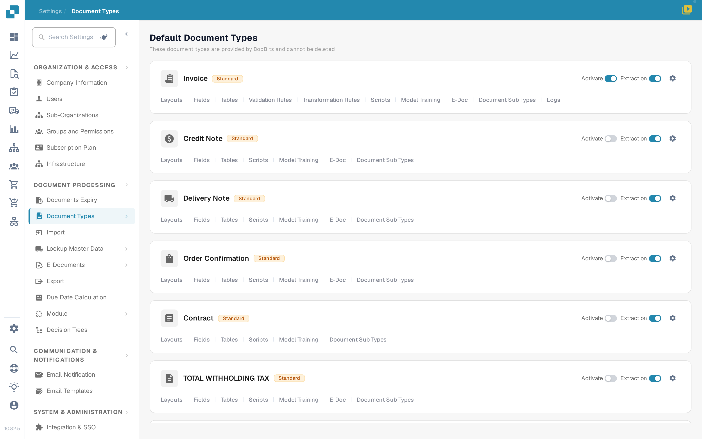
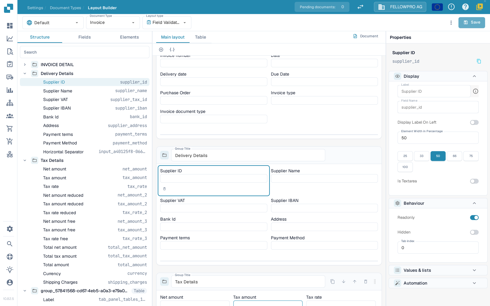
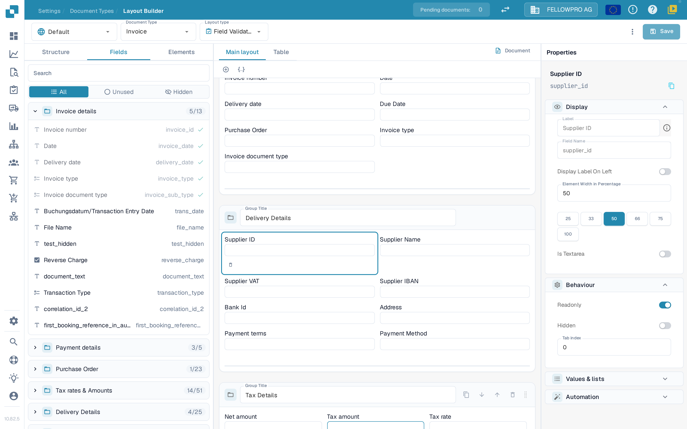
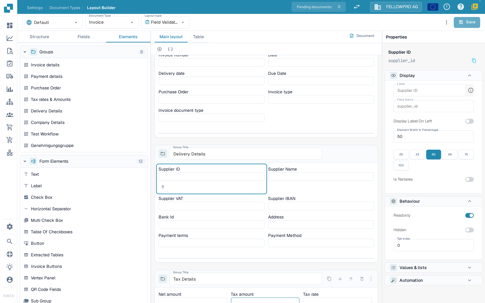

# Navigating the Layout Builder

Use the **Layout Builder** to arrange the groups and fields that people see on a document. This guide uses the English **Invoice** layout in a sandbox organization.

## Open the Invoice layout

1. Go to **Settings → Document Types**.
2. Find **Invoice** and select **Layouts** under its name. The Layout Builder opens for that document type.
3. The header shows the origin selector (here **Default**), the **Document Type** and the **Layout type**. Use **Layout type** to switch to another layout of the same document type.

<figure><figcaption>Open **Layouts** from the Invoice card.</figcaption></figure>

## Work with the three panel tabs

The panel on the left has three tabs: **Structure**, **Fields** and **Elements**. The builder opens on **Fields**.

**Structure** shows the layout as a tree, in the same order as the groups and fields appear on the document. Expand a group with its chevron to see the fields it contains; the grey text on the right is the technical field name. The search box filters the tree, and selecting a row selects the same element on the canvas.

<figure><figcaption>The Structure tree, the canvas and the Properties panel.</figcaption></figure>

**Fields** lists every field the document type offers, grouped by its groups. The counter next to a group name tells you how many of its fields are already placed, for example **5/13**. The three buttons below the search box switch between **All** fields, only the **Unused** ones and only the **Hidden** ones. Each row shows the field label on the left and its technical name on the right, and a check mark marks the fields that are already in the layout.

<figure><figcaption>Filter the fields and read the technical name under each label.</figcaption></figure>

**Elements** holds the blocks you drag onto the canvas: **Groups** with the groups of this layout, and **Form Elements** with Text, Label, Check Box, Horizontal Separator, Multi Check Box, Table Of Checkboxes, Button, Extracted Tables, Invoice Buttons, Vertex Panel, QR Code Fields and Sub Group.

<figure><figcaption>The Groups and Form Elements palettes.</figcaption></figure>

## Place and arrange elements

- Drag a field from **Fields**, or an element from **Elements**, into the group where it should appear. Fields that are already placed carry a check mark in the **Fields** tab.
- Drag a field within or between groups to reorder it.
- The **+** above the canvas adds an empty group; the JSON icon next to it creates a group from a JSON definition.
- In a group header you can rename the group in **Group Title**, copy its JSON, move the group down or up, or delete it. Use the drag handle on the right of the header to move the group.
- Select a field on the canvas to open its properties on the right. The small toolbar that appears under the selected field removes it from the layout.

## The Properties panel

The panel on the right is always open and follows the element you selected. Its settings are grouped into **Display**, **Behaviour**, **Values & lists**, **Automation** and **Borders & spacing**. **Display** holds the label, the field type and the **Element width**, which you choose from the presets 25, 33, 50, 66, 75 and 100 percent. See [Configuring Field Properties](configuring-field-properties.md) for the individual options.

Validation, OCR and matching settings belong to the field itself, not to the layout: configure them in the separate [Fields settings](../fields/configuring-field-properties-1.md).

## Preview and save

The canvas shows the layout as it will look on the document. Use the **Main layout** and **Table** tabs to switch between the page and a line-item table, and **Document** to open the sample document beside the canvas. See [Using the Template Preview](using-the-template-preview.md).

Select **Save** in the header when you are done. See [Save and Apply Changes](save-and-apply-changes.md) for the other header actions, including template generation, default templates and applying a layout to origins.
