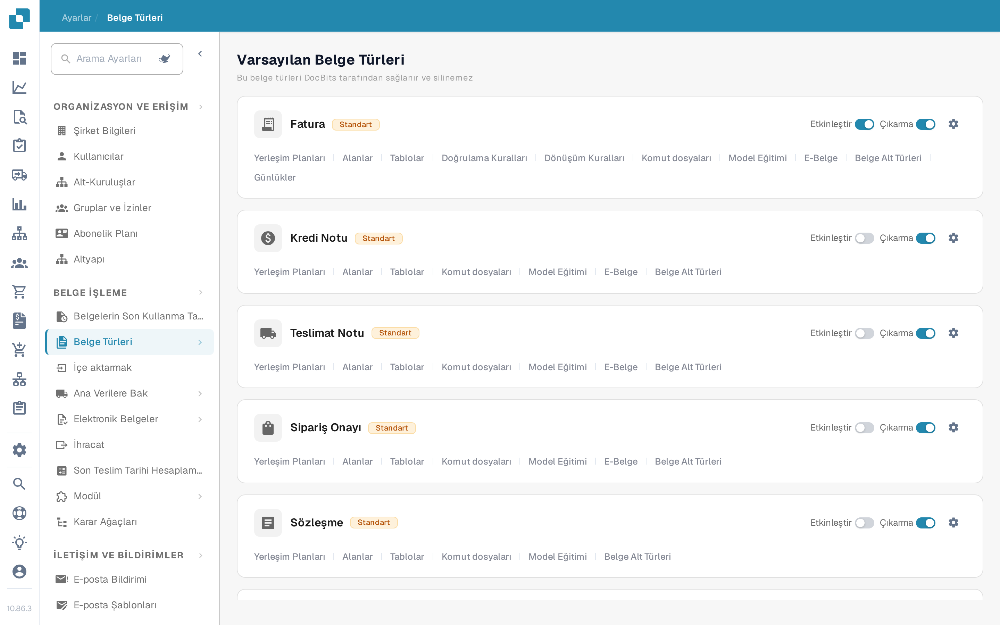
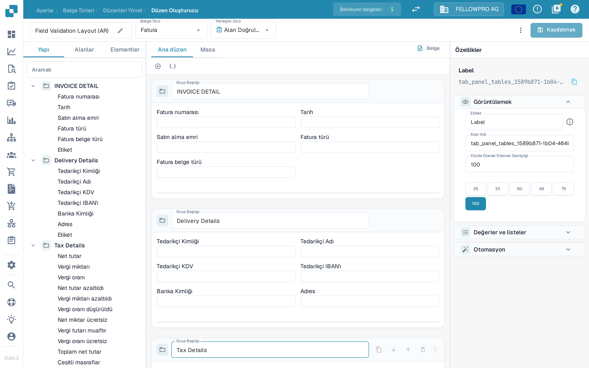
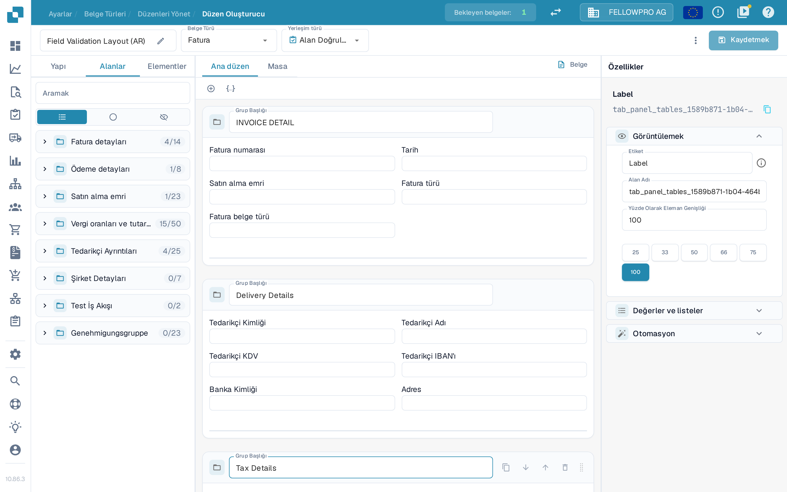
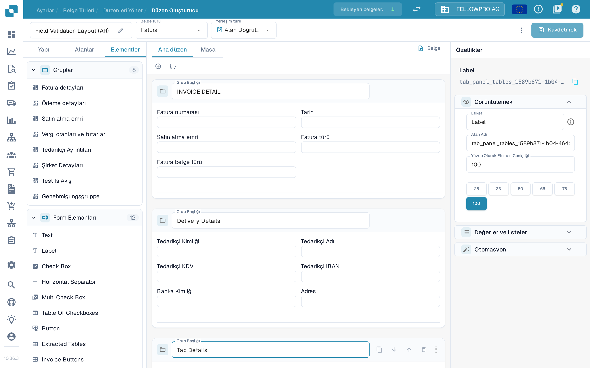

# Düzen Oluşturucu'da Yönelme

Belgede görünen grupları ve alanları düzenlemek için **Düzen Oluşturucu**'yu (Layout Builder) kullanın. Bu rehber, sandbox organizasyonundaki **Fatura** düzenini kullanır.

## Fatura düzenini açma

1. **Ayarlar → Belge Türleri** yoluna gidin.
2. **Fatura** kartını bulun ve adının altındaki **Yerleşim Planları** bağlantısını seçin. Düzen Oluşturucu bu belge türü için açılır.
3. Üst bilgi alanında kaynak seçicisi (burada **Varsayılan**), **Belge Türü** ve **Yerleşim Türü** görünür. Aynı belge türünün başka bir düzenine geçmek için **Yerleşim Türü**'nü kullanın.

<figure><figcaption>**Yerleşim Planları** bağlantısını Fatura kartından açın.</figcaption></figure>

## Üç panel sekmesiyle çalışma

Soldaki panelde üç sekme vardır: **Yapı**, **Alanlar** ve **Elementler**. Oluşturucu **Alanlar** sekmesiyle açılır.

**Yapı**, düzeni bir ağaç olarak gösterir; gruplar ve alanlar belgede göründükleri sırayla listelenir. Bir grubun içerdiği alanları görmek için grubu ok simgesiyle genişletin; sağdaki gri metin alanın teknik adıdır. Arama kutusu ağacı filtreler ve bir satırı seçtiğinizde aynı element tuvalde de seçilir.

<figure><figcaption>Yapı ağacı, tuval ve Özellikler paneli.</figcaption></figure>

**Alanlar**, belge türünün sunduğu tüm alanları gruplarına göre listeler. Grup adının yanındaki sayaç, o grubun alanlarından kaçının yerleştirildiğini gösterir; örneğin **4/14**. Arama kutusunun altındaki üç düğme, tüm alanlar ile yalnızca kullanılmayan ve yalnızca gizli alanlar arasında geçiş yapar. Her satırda solda alanın etiketi, sağda teknik adı bulunur ve düzende zaten yer alan alanlar onay işaretiyle gösterilir.

<figure><figcaption>Alanları filtreleyin ve her etiketin yanındaki teknik adı okuyun.</figcaption></figure>

**Elementler**, tuvale sürükleyeceğiniz blokları içerir: bu düzenin gruplarını listeleyen **Gruplar** ile metin, etiket, onay kutusu, yatay ayırıcı, çoklu onay kutusu, onay kutusu tablosu, düğme, çıkarılan tablolar, fatura düğmeleri, Vertex paneli, QR kod alanları ve alt grup gibi öğeleri içeren **Form Elemanları**.

<figure><figcaption>Gruplar ve Form Elemanları paletleri.</figcaption></figure>

## Elementleri yerleştirme ve düzenleme

* Bir alanı **Alanlar** bölümünden veya bir öğeyi **Elementler** bölümünden, görünmesini istediğiniz grubun içine sürükleyin. Zaten yerleştirilmiş alanlar **Alanlar** sekmesinde onay işareti taşır.
* Bir alanın sırasını değiştirmek için onu grubun içinde veya gruplar arasında sürükleyin.
* Tuvalin üzerindeki **+** boş bir grup ekler; yanındaki JSON simgesi bir JSON tanımından grup oluşturur.
* Grup başlığında grubu **Grup Başlığı** alanında yeniden adlandırabilir, JSON'unu kopyalayabilir, grubu yukarı veya aşağı taşıyabilir ya da silebilirsiniz. Grubu taşımak için başlığın sağındaki sürükleme tutamacını kullanın.
* Özelliklerini sağda açmak için tuvalde bir alan seçin. Seçili alanın altında beliren küçük araç çubuğu, alanı düzenden kaldırır.

## Özellikler paneli

Sağdaki panel her zaman açıktır ve seçtiğiniz elementi izler. Ayarları **Görüntülemek**, davranış, değerler ve listeler, otomasyon ile kenarlıklar ve boşluklar bölümlerinde gruplanır. **Görüntülemek** bölümü etiketi, alan adını ve 25, 33, 50, 66, 75 ve 100 yüzde ön ayarlarından seçtiğiniz eleman genişliğini içerir.

Doğrulama, OCR ve eşleştirme ayarları düzene değil alanın kendisine aittir; bunları ayrı Alan ayarlarında yapılandırın.

## Önizleme ve kaydetme

Tuval, düzeni belgede görüneceği biçimde gösterir. Sayfa ile satır öğeleri tablosu arasında geçiş yapmak için **Ana düzen** ve **Masa** sekmelerini, örnek belgeyi tuvalin yanında açmak için **Belge**'yi kullanın.

İşiniz bittiğinde üst bilgi alanındaki **Kaydetmek** seçeneğini seçin. Şablon oluşturma, varsayılan şablonlar ve bir düzeni kaynaklara uygulama dahil diğer üst bilgi eylemleri için Değişiklikleri Kaydetme ve Uygulama rehberine bakın.
