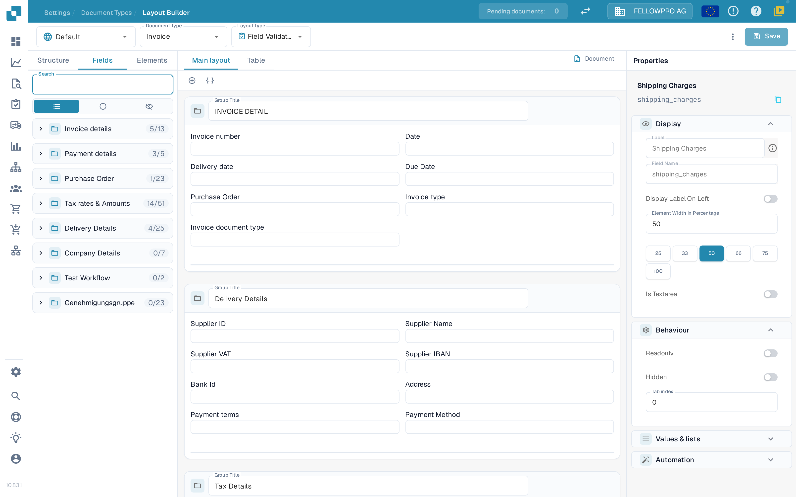
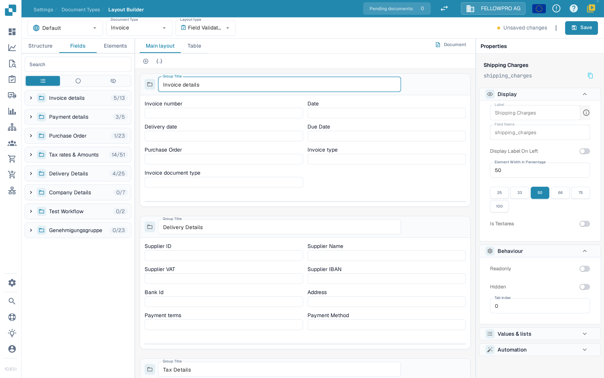
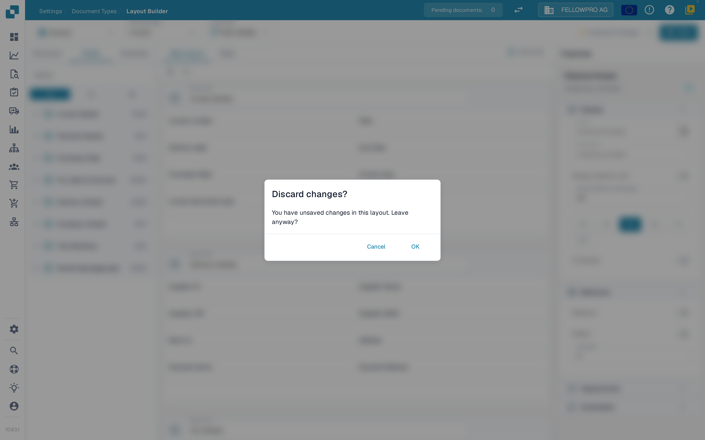
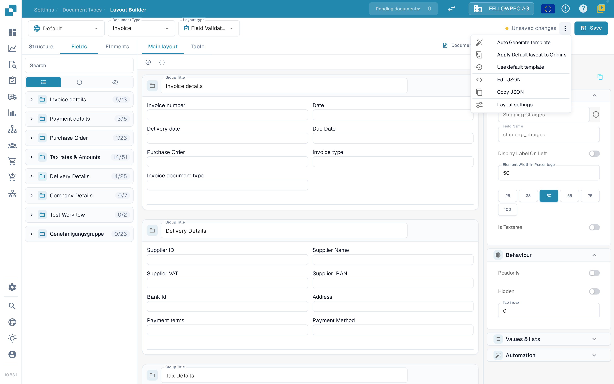

# Save and apply changes

Changes made in the Layout Builder are not live until you save them. Saving stores the layout for the document type so that new documents use it.

## Saving your changes

After you edit the layout, select **Save** in the header at the top right.

<figure><figcaption>The **Save** button sits at the top right of the Layout Builder.</figcaption></figure>

While you work, the header shows the state of your changes:

- A **Save** button without a message next to it means the layout is unchanged.
- **Unsaved changes** appears as soon as you modify the layout. Select **Save** to store the changes.

<figure><figcaption>The **Unsaved changes** indicator appears while the layout has not been saved yet.</figcaption></figure>

After a successful save, the indicator is replaced by the time the layout was last saved. Selecting **Save** again is safe: if nothing has changed since the last save, nothing is written.

If you try to leave the Layout Builder with unsaved changes, DocBits asks whether to discard them. Select **Cancel** to stay and save, or **OK** to leave without saving.

<figure><figcaption>Confirmation shown when leaving with unsaved changes.</figcaption></figure>

## Other header actions

The **More** menu (three dots) next to **Save** holds the remaining layout actions:

- **Auto generate template** — build a layout automatically from the fields of the document type.
- **Apply Default layout to Origins** — copy the default layout to the layouts of the individual origins.
- **Use default template** — reset the layout to the default template.
- **Edit JSON** — edit the raw layout definition as JSON.
- **Copy JSON** — copy the layout definition to the clipboard.
- **Layout settings** — open the general layout settings.

<figure><figcaption>The actions available under the **More** menu.</figcaption></figure>

## Applying the changes

Once saved, the layout is used by the document processing workflow for that document type:

- New documents processed with this document type use the updated layout.
- Documents that were already processed keep the layout they were captured with.

## Testing the changes

After saving, open a document of that document type and check that the fields and groups appear as intended. If something is missing, return to the Layout Builder, adjust the layout and save again.
