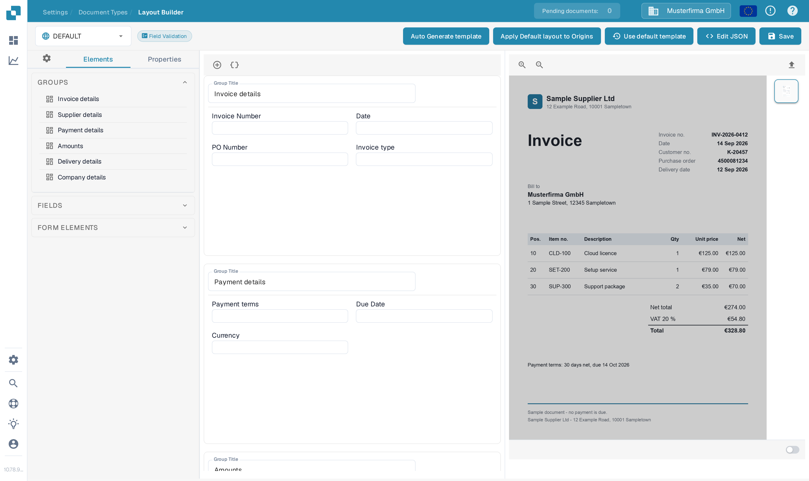
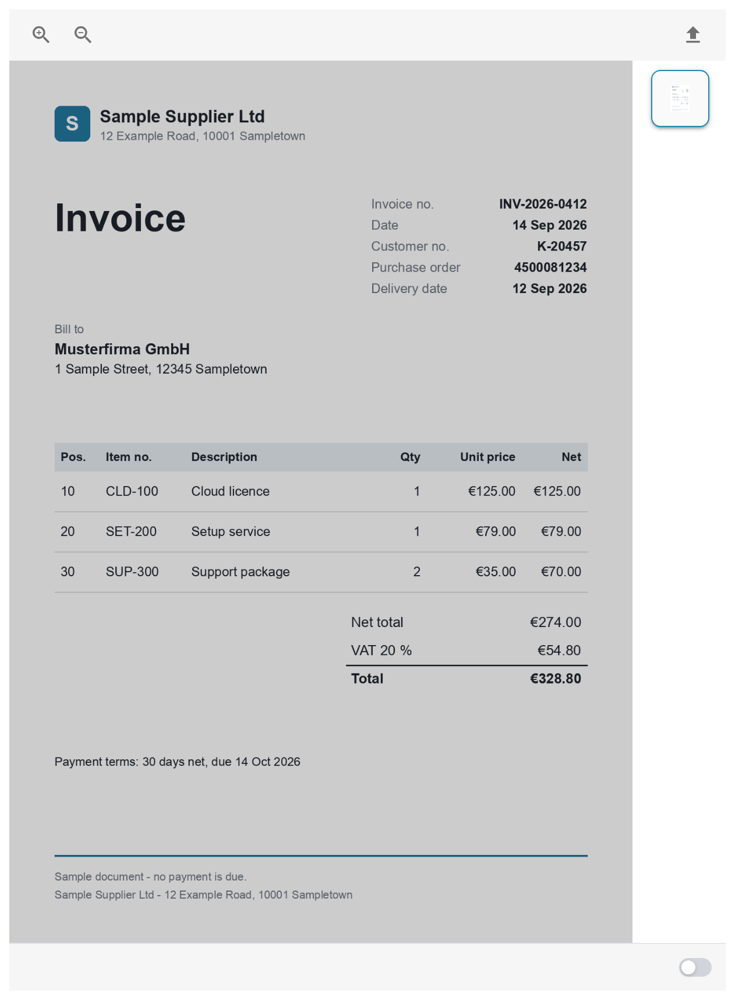
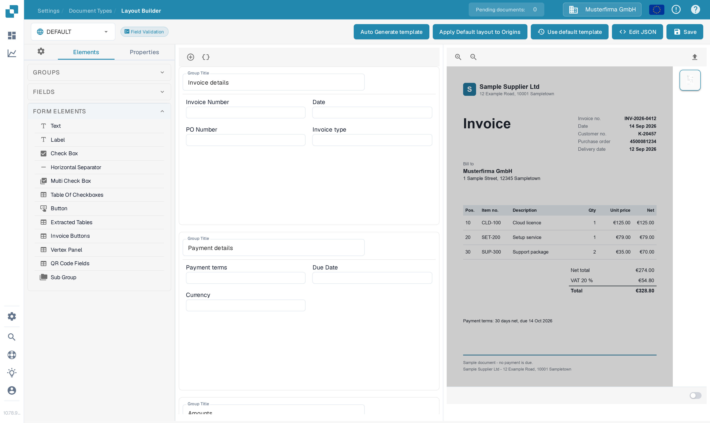
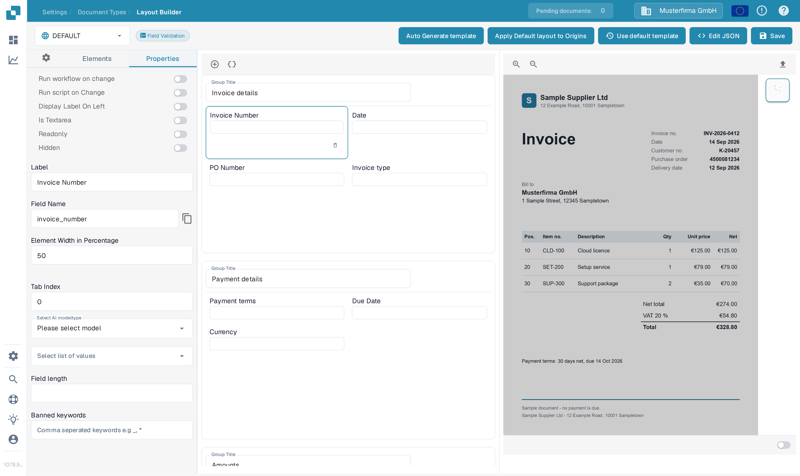

# Using the Template Preview

The **Template Preview** is the part of the Layout Builder that shows the sample document under your current layout. While you arrange groups and fields on the canvas, the preview shows where each element sits on the actual page, so you can check your settings before saving anything.

This page uses the English **Invoice** layout with the **DEFAULT** template and a sample document, on invented example data.

## Open the Layout Builder with the preview

1. Go to **Settings → Document Types**.
2. Find **Invoice** and select **Layouts** on its card. See [Navigating the Layout Manager](navigating-the-layout-manager.md) if you are not sure how to get there.
3. Check the layout selector at the top left. The example below shows **DEFAULT**. If you have several templates, pick the one you want to check here.

<figure><figcaption>
The Invoice layout in the Layout Builder with the DEFAULT template selected.
</figcaption></figure>

## The preview pane with the sample document

The right side of the builder is the preview pane. It shows the sample document that this template was built on, with the layout fields drawn on top of it. Three controls matter here:

- **Zoom in / zoom out** (magnifier buttons, top right of the document): make the page larger or smaller so you can read a field area or see more of the page at once.
- **Upload** (arrow-up button): replace the sample document with another PDF. DocBits re-reads the page images from the uploaded sample, so the preview always shows a real document.
- **Page thumbnails** (right edge): one small picture per page of the sample document. Select a thumbnail to switch the preview and the drawn fields to that page.

<figure><figcaption>
The preview pane: sample document, zoom controls, upload button and page thumbnails.
</figcaption></figure>

The sample document is the template's test page: whatever you upload here is what the preview draws on. Keep a typical document of the type you are configuring as the sample, so what you see matches what production documents will look like.

## Check the layout while you edit

As you change the layout, the preview stays next to the canvas:

- Select a field in the canvas, then open the **Properties** tab to adjust its settings — label, width, read-only, hidden and more. The available options are described in [Configuring Field Properties](configuring-field-properties.md).
- Drag fields between groups or reorder them; the preview reflects the current arrangement of the layout.
- Use the **Form Elements** palette to add visual elements such as Text, Check Box or Separator to the canvas.

<figure><figcaption>
The Form Elements palette you can drag onto the canvas.
</figcaption></figure>

<figure><figcaption>
The Properties tab of a selected field.
</figcaption></figure>

## Save your changes

The preview shows the current state of the layout — it does not store anything by itself. Select **Save** in the top bar when the arrangement looks right; until then your changes only live in the builder. What saving does, and how a layout reaches the documents that use it, is described in [Save and Apply Changes](save-and-apply-changes.md).
