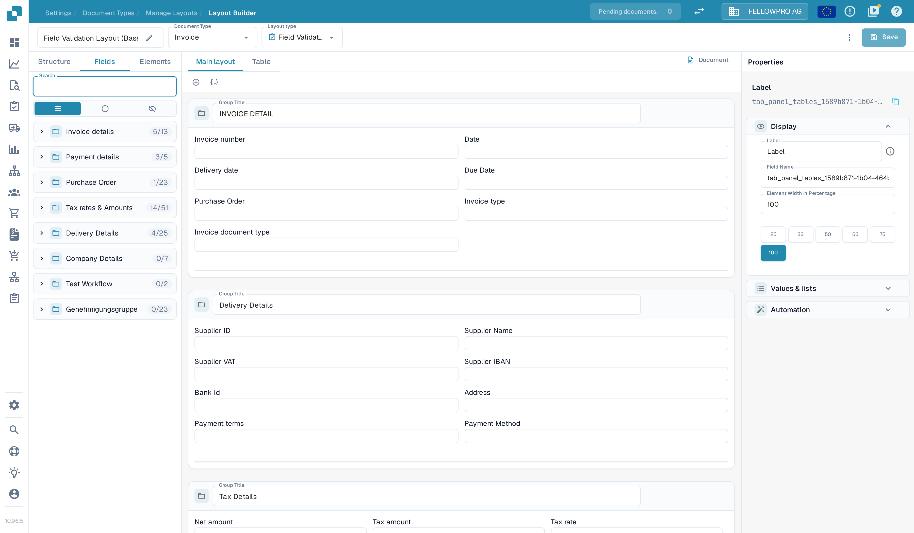
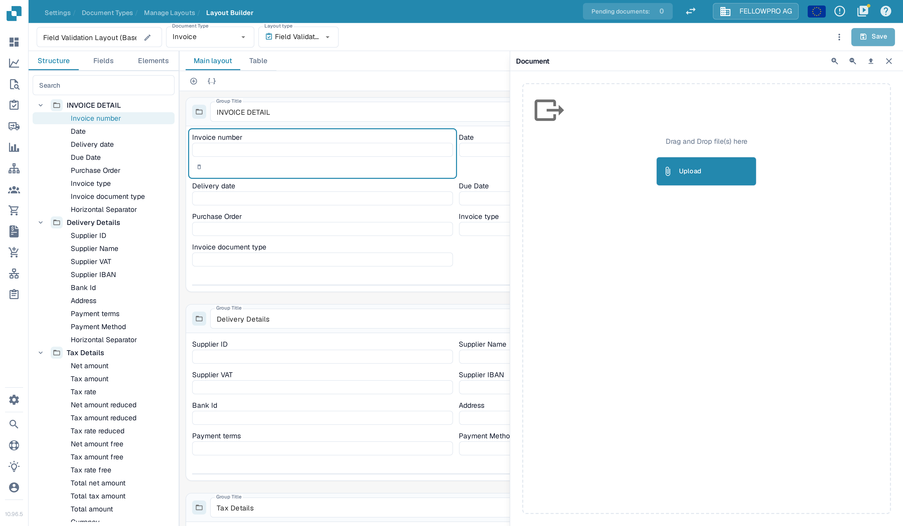
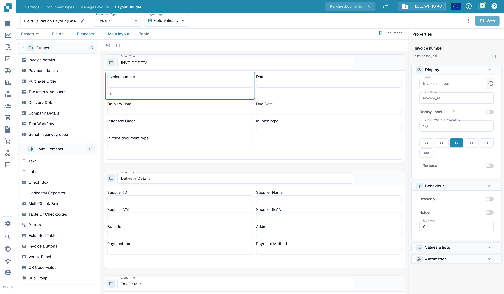
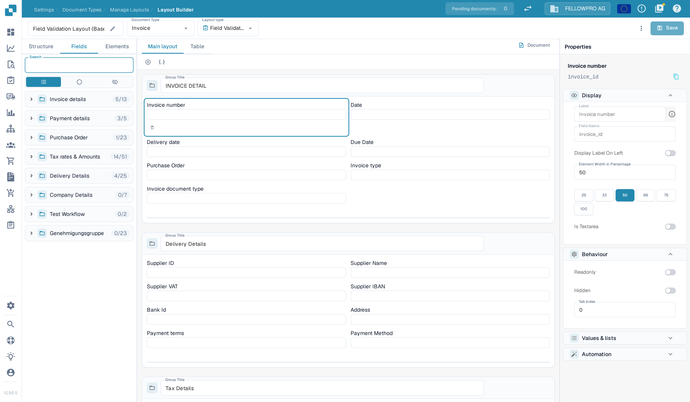

# Using the Template Preview

The Layout Builder shows your layout on a canvas and can display the **sample document** the layout was built on next to it. The sample document is the template's test page: it lets you check where each field and group sits on a real page before you save anything.

The examples below use the **Invoice** document type and one of its **Field Validation** layouts.

## Open the Layout Builder

1. Go to **Settings → Document Types**.
2. Find **Invoice** and select **Layouts** on its card. This opens **Layouts & Selection Rules**; see [Navigating the Layout Manager](navigating-the-layout-manager.md) if you are not sure how to get there.
3. Select **Edit** on the layout you want to check. To look at a **System** layout, clone it first — system layouts open read-only.

The builder has three areas: the panel on the left with the **Structure**, **Fields** and **Elements** tabs, the canvas in the middle, and the **Properties** panel on the right. The header shows the layout name together with the **Document Type** and **Layout type** selectors.

<figure><figcaption>
The Layout Builder: structure and fields on the left, the layout canvas in the middle, properties on the right.
</figcaption></figure>

## The canvas: Main layout and Table

Two tabs sit above the canvas:

- **Main layout** — the fields and groups of the layout. Drag fields between groups or reorder them here.
- **Table** — the layout's table area, with **AI Extracted table**, **Extracted table** and **PO Tables**. The switch next to the tab name activates or deactivates this area.

Selecting a field on the canvas opens its settings in the **Properties** panel on the right.

## Show the sample document

Select **Document** in the canvas tab bar. The sample document opens in a **Document** panel that slides over the Properties column:

- The panel shows the pages of the sample document, with the layout areas drawn on top of them.
- **Page thumbnails** beside the page: one small picture per page of the sample document. Select a thumbnail to switch the preview and the drawn areas to that page.
- **Zoom in** and **zoom out** in the panel header make the page larger or smaller.
- **Close** (the × in the panel header) hides the panel and shows the Properties column again.

The sample document stays available while you edit: arrange the layout on the canvas and check the result against the real page in the panel.

### Replace the sample document

Select **Upload** (the arrow-up button) in the panel header. The panel switches to an upload area: drop a PDF onto **Drag and Drop file(s) here**, or select **Upload** to pick a file. DocBits reads the page images from the uploaded file, so the preview always shows a real document.

Keep a typical document of the type you are configuring as the sample, so what you see matches what production documents will look like. The upload button is not offered on read-only **System** layouts.

<figure><figcaption>
Replacing the sample document in the Document panel.
</figcaption></figure>

## Add elements and adjust fields

- The **Elements** tab lists the layout's **Groups** and the **Form Elements** palette — Text, Label, Check Box, Horizontal Separator, Multi Check Box, Table Of Checkboxes and more. Drag an element onto the canvas to add it.

<figure><figcaption>
The Elements tab: groups of the layout and the Form Elements palette.
</figcaption></figure>

- The **Properties** panel on the right shows the settings of the selected field in four sections: **Display**, **Behaviour**, **Values &amp; lists** and **Automation**. The technical field name appears above these sections. The available options are described in [Configuring Field Properties](configuring-field-properties.md).

<figure><figcaption>
The Properties panel of a selected field.
</figcaption></figure>

## Save your changes

The canvas and the sample document show the current state of the layout — they do not store anything by themselves. Select **Save** in the top bar when the arrangement looks right; until then your changes only live in the builder. What saving does, and how a layout reaches the documents that use it, is described in [Save and Apply Changes](save-and-apply-changes.md).
