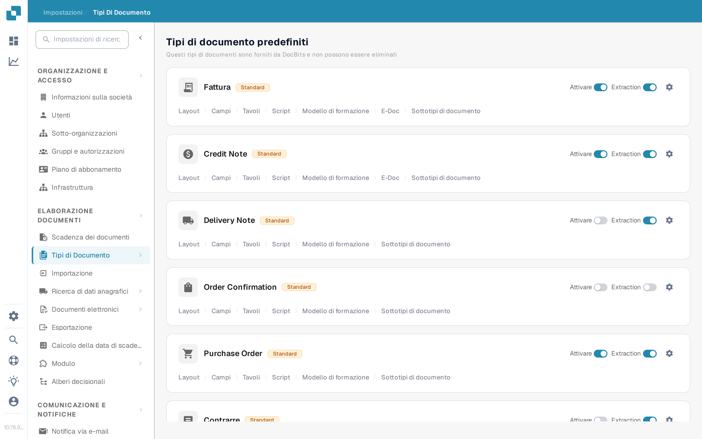
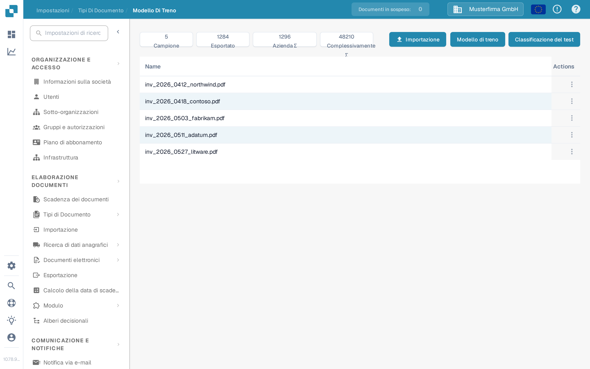
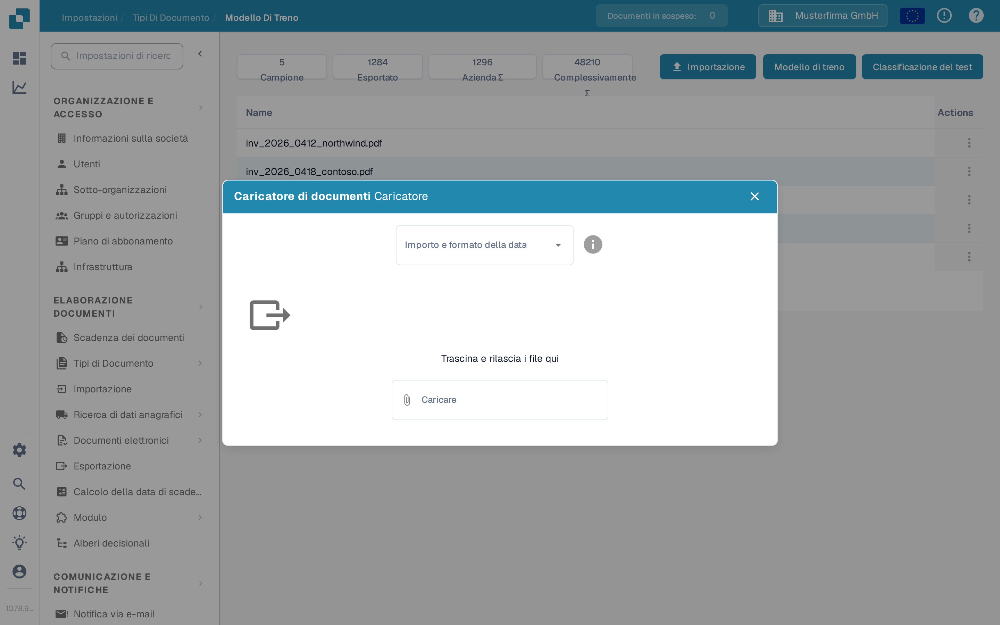
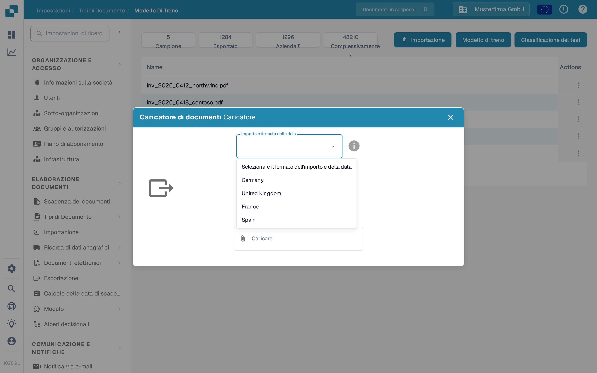
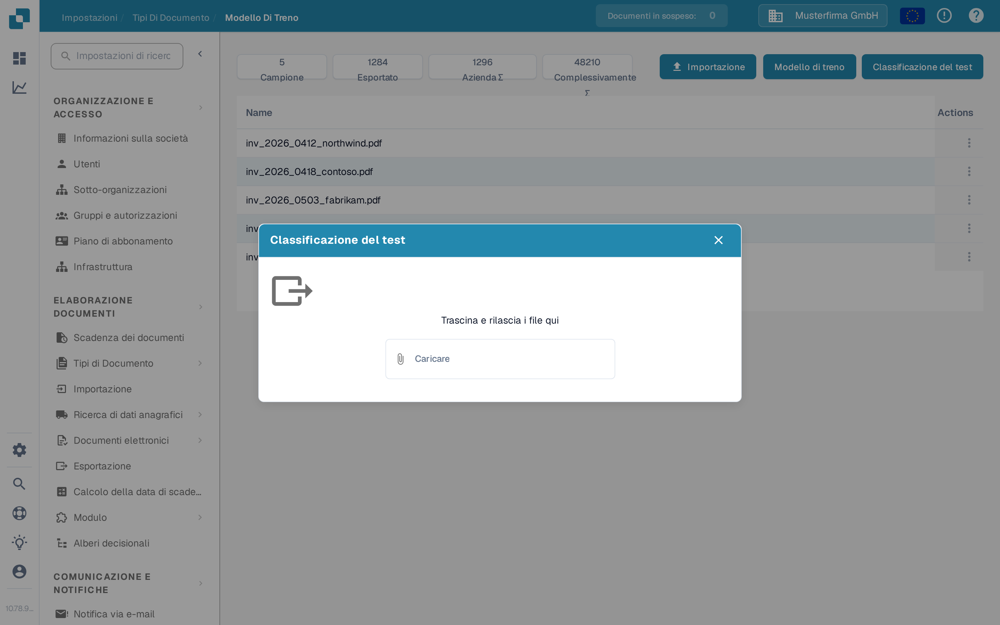

# Importare documenti di esempio per l'addestramento del modello

Usa questa pagina per aggiungere PDF di esempio a un tipo di documento e poi addestrare o testare il suo modello di classificazione. Serve accesso a **Impostazioni** e **Tipi di Documento**. Per lo scopo delle funzioni di addestramento, vedi [Scopo e utilizzo: Addestramento del Modello](purpose-and-use-model-training.md).

## Aprire il tipo di documento

1. Vai a **Impostazioni → Tipi di Documento**.
2. Trova il tipo di documento che vuoi addestrare. Nella sua riga, seleziona **Modello di formazione**. L'esempio seguente usa **Fattura**.

<figure><figcaption>
Apri Modello di formazione dal tipo di documento scelto.
</figcaption></figure>

Gli altri controlli di questa scheda hanno uno scopo diverso: **Attivare** abilita il tipo di documento, **Extraction** cambia la sua modalità di estrazione, l'ingranaggio apre le sue impostazioni e i link rimanenti aprono altre aree di configurazione. Non serve modificarli solo per aprire l'Addestramento del Modello.

La pagina **Modello di treno** mostra il numero di campioni e un elenco dei documenti di addestramento caricati. Nell'organizzazione di esempio, l'elenco contiene cinque documenti; la tua organizzazione può mostrare altri documenti e cifre.

<figure><figcaption>
Le tre azioni sono in alto a destra dell'elenco di addestramento.
</figcaption></figure>

## Importare PDF di esempio

1. Seleziona **Importazione**.
2. Scegli l'**Importo e formato della data** che corrisponde al documento di esempio. Ad esempio, scegli **Germany** per le convenzioni tedesche di numero e data. Questa selezione indica a DocBits come interpretare i valori del documento caricato; non cambia la lingua dell'app.
3. Trascina i file PDF nella finestra di dialogo o usa **Caricare** per selezionarli. L'attuale importer di documenti di esempio accetta **file PDF**; rifiuta altri tipi di file. Selezionando i file parte il caricamento.
4. Chiudi la finestra di dialogo e verifica che i documenti compaiano nell'elenco di addestramento. Se DocBits segnala un errore di caricamento o che un documento esiste già, correggi il file o scegli un altro esempio prima di continuare.

<figure><figcaption>
Scegli un formato prima di selezionare i PDF di esempio.
</figcaption></figure>

<figure><figcaption>
Scegli il formato del documento, non la tua lingua preferita dell'interfaccia.
</figcaption></figure>

Per le azioni sui campioni importati, vedi [Gestire i dati di addestramento](manage-training-data.md).

## Addestrare e verificare il modello

Quando i PDF di esempio previsti sono nell'elenco, seleziona **Modello di treno**. DocBits può elaborare l'addestramento in background; attendi il suo messaggio di completamento prima di considerare il nuovo modello pronto. Il numero di campioni e gli eventuali limiti del piano mostrati in questa pagina appartengono alla tua organizzazione.

Per verificare la classificazione, seleziona **Classificazione del test** e carica un file di esempio separato nella finestra di dialogo. Dopo l'elaborazione, DocBits indica se il tipo di documento previsto corrisponde a questa pagina e mostra i dettagli della classificazione. La finestra di test vuota qui sotto è mostrata senza inviare alcun file.

<figure><figcaption>
Usa Classificazione del test per verificare il modello con un altro documento.
</figcaption></figure>

Per interpretare il risultato, vedi [Test del modello](testing-the-model.md). Se il risultato è scarso, controlla i [dati di addestramento](manage-training-data.md) e la [guida alla risoluzione dei problemi](troubleshooting.md) prima di aggiungere altri campioni.
