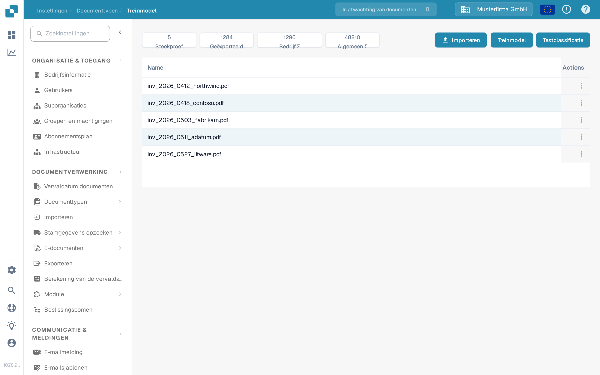
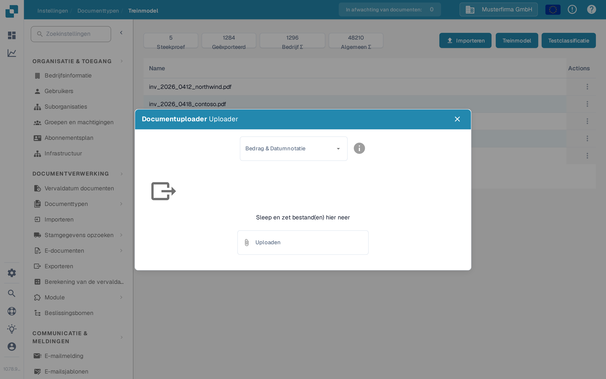
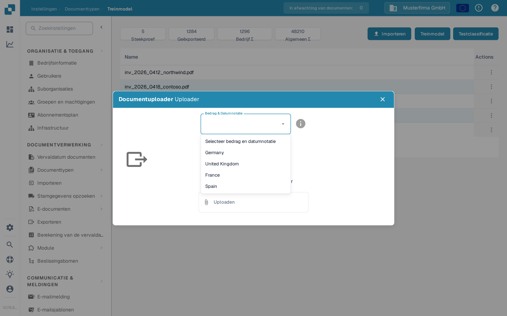
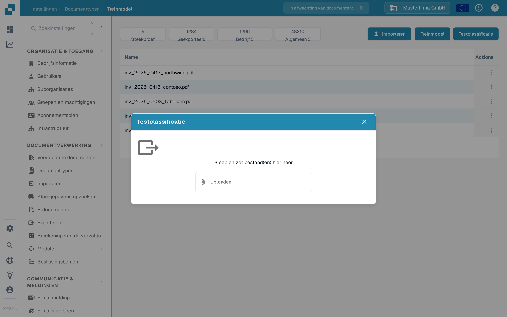

# Voorbeeld-documenten importeren voor modeltraining

Gebruik deze pagina om voorbeeld-PDF's toe te voegen voor een documenttype en daarna het classificatiemodel te trainen of te testen. U hebt toegang nodig tot **Instellingen** en **Documenttypen**. Voor het doel van de trainingsfuncties, zie [Doel en gebruik: modeltraining](purpose-and-use-model-training.md).

## Open het documenttype

1. Ga naar **Instellingen → Documenttypen**.
2. Zoek het documenttype dat u wilt trainen. Selecteer in de rij **Modeltraining**. Het voorbeeld hieronder gebruikt **Factuur**.

<figure><figcaption>
Open Modeltraining vanaf het gekozen documenttype.
</figcaption></figure>

De andere bedieningselementen op deze kaart dienen andere doelen: **Activeren** schakelt het documenttype in, **Extraction** wijzigt de extractiemodus, het tandwiel opent de instellingen, en de overige links openen andere configuratiegebieden. U hoeft ze niet te wijzigen om alleen Modeltraining te openen.

De pagina **Treinmodel** toont het aantal steekproeven en een lijst met geüploade trainingsdocumenten. In de voorbeeldorganisatie bevat de lijst documenten; uw organisatie kan andere documenten en aantallen tonen.

<figure><figcaption>
De drie acties staan rechtsboven in de trainingslijst.
</figcaption></figure>

## Voorbeeld-PDF's importeren

1. Selecteer **Importeren**.
2. Kies de **Bedrag & Datumnotatie** die bij het voorbeelddocument hoort. Kies bijvoorbeeld **Germany** voor de Duitse conventies voor getallen en datums. Deze keuze vertelt DocBits hoe waarden in het geüploade document geïnterpreteerd moeten worden; ze verandert niet de taal van de app.
3. Sleep PDF-bestanden in het dialoogvenster of gebruik **Uploaden** om ze te selecteren. De huidige importeur van voorbeelddocumenten accepteert **PDF-bestanden**; hij wijst andere bestandstypen af. Het selecteren van de bestanden start het uploaden.
4. Sluit het dialoogvenster en controleer of de documenten in de trainingslijst verschijnen. Als DocBits een uploadfout meldt of een document al bestaat, corrigeer dan het bestand of kies een ander voorbeeld voordat u doorgaat.

<figure><figcaption>
Kies een notatie voordat u de voorbeeld-PDF's selecteert.
</figcaption></figure>

<figure><figcaption>
Kies de notatie die in het document gebruikt wordt, niet uw gewenste interfacetaal.
</figcaption></figure>

Voor acties op geïmporteerde voorbeelden, zie [Trainingsgegevens beheren](manage-training-data.md).

## Train en controleer het model

Wanneer de gewenste voorbeeld-PDF's in de lijst staan, selecteert u **Treinmodel**. DocBits kan de training op de achtergrond verwerken; wacht op het voltooiingsbericht voordat u het nieuwe model als gereed beschouwt. Het aantal steekproeven en eventuele abonnementslimiet op deze pagina behoren aan uw organisatie.

Om de classificatie te controleren, selecteert u **Testclassificatie** en uploadt u daarna een apart voorbeeldbestand in het dialoogvenster. Na de verwerking toont DocBits of het voorspelde documenttype overeenkomt met deze pagina en rapporteert de classificatiedetails. Het lege testdialoogvenster hieronder wordt getoond zonder een bestand te uploaden.

<figure><figcaption>
Gebruik Testclassificatie om het model met een ander document te controleren.
</figcaption></figure>

Voor het interpreteren van het resultaat, zie [Het model testen](testing-the-model.md). Als het resultaat slecht is, bekijk dan de [trainingsgegevens](manage-training-data.md) en de [handleiding voor probleemoplossing](troubleshooting.md) voordat u meer voorbeelden toevoegt.
