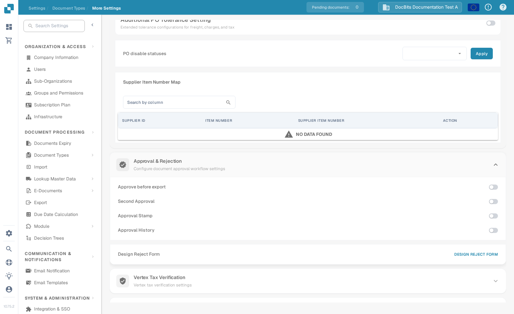
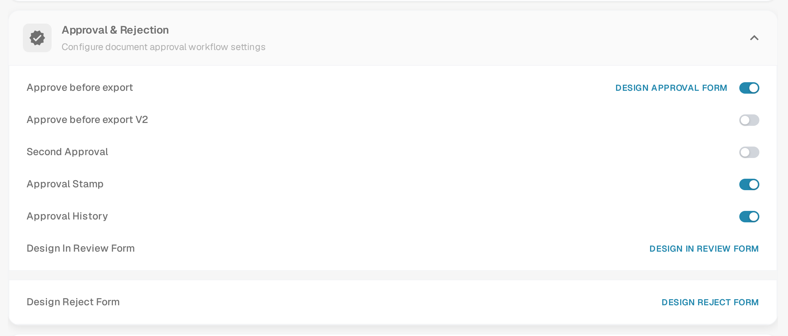

# Approval

Use the approval options to decide how a document is checked before it leaves DocBits. The options are configured for each document type, so start with the type your team uses, such as **Invoice**.

1. Open **Settings** → **Document Types**.
2. Select the document type and open **More Settings**.
3. Scroll to **Approval & Rejection**. Review the switches before changing any of them.

<figure><figcaption>The Approval &amp; Rejection panel for **Invoice**. In this example **Approve before export**, **Approval Stamp** and **Approval History** are on; **Approve before export V2** and **Second Approval** are off.</figcaption></figure>

| Option | What it is for |
| --- | --- |
| **Approve before export** | Require an approval decision before exporting the document. |
| **Approve before export V2** | Use the newer approval screen. With V2 on, the **Ready for approval** screen shows a rebuilt approval form that can restrict fields for the approver. Leave V2 off to keep the previous approval screen. See [Document Status](../../../../../../end-user-and-partner-section/end-user-section/dashboard/document-status.md) for where a document waits for approval. |
| **Second Approval** | Add a second approval step for documents that need two decisions. |
| **Approval Stamp** | Add an approval mark to an approved document. See [Approval Stamp](approval-stamp.md) for the setup and download options. |
| **Approval History** | Keep a record of approval decisions. See [Approval History](approval-history.md) for the setting and how to check the history. |

Choose the options that match your process, then check the approval path with a test document and the intended reviewer roles before applying it to live documents.

## Design the approval forms

Every approval step shows its own form to the reviewer. Design the form before you switch the step on, so the reviewer sees the right fields in the right order.

With **Approve before export** on, the panel shows a link next to each approval step. Select the link to open the form builder for that form:

| Link in the panel | Next to | Form the reviewer sees |
| --- | --- | --- |
| **DESIGN APPROVAL FORM** | **Approve before export** | The approval form for a document that is waiting for approval. |
| **DESIGN APPROVAL FORM V2** | **Approve before export V2** | The approval form used when V2 is on. |
| **DESIGN SECOND APPROVAL FORM** | **Second Approval** | The form for the second approval step. |
| **DESIGN IN REVIEW FORM** | its own row, shown while **Approve before export** is on | The form a reviewer uses while checking a document that is in review. |
| **DESIGN REJECT FORM** | its own row | The form a reviewer uses to reject a document, so they can record a reason. |

A link appears only when the matching step is switched on. The **DESIGN IN REVIEW FORM** row is shown as long as **Approve before export** is on; the **DESIGN REJECT FORM** row is always available in the panel.

<figure><figcaption>The approval steps and their Design links in the panel. Each link opens the form builder for that step.</figcaption></figure>

Selecting a link opens the **form builder** for that form. It is the same builder that is used for document layouts: the top bar starts with the language origin selector (here **DEFAULT**) followed by a coloured badge that names the form you are editing, and the left panel has three tabs:

- **Settings** (gear icon) — set the image and canvas options for this form.
- **Elements** — expand **Groups**, **Fields** and **Form Elements** and drag what you need onto the canvas. **Fields** holds the document fields, **Form Elements** holds visual controls such as text, labels, checkboxes and buttons.
- **Properties** — select something on the canvas to change its label, size, colour and other settings.

The top bar also offers **Use default template** to discard your changes, **Edit JSON** to work on the form definition directly, and **Save**. Saving stores the form for that step and document type only, so the approval form, the in-review form and the reject form are kept apart and none of them changes the document layout.

See [Navigating the Layout Builder](../../layout-manager/navigating-the-layout-manager.md) for a walk-through of the panels and [Save and apply changes](../../layout-manager/save-and-apply-changes.md) for what saving does.
