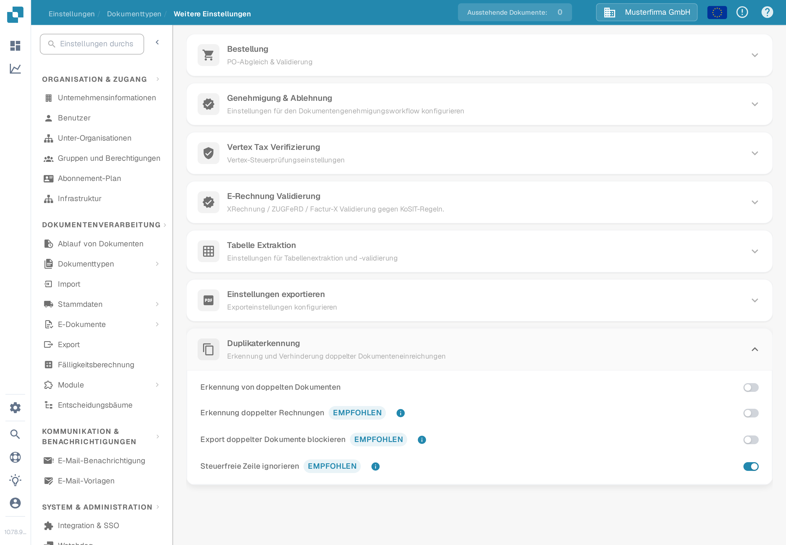
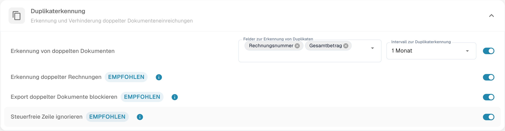
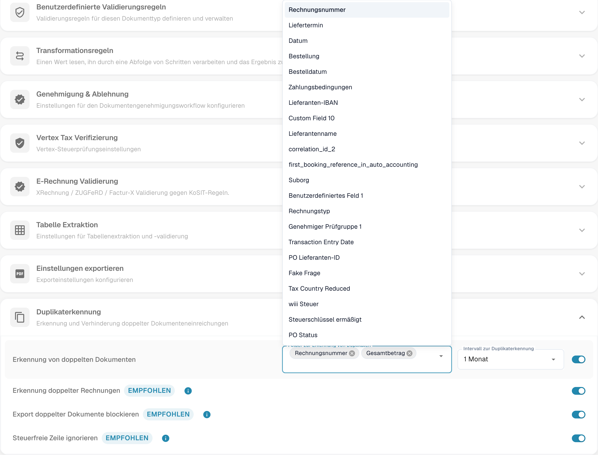

# Erkennung von Duplikaten

Mit der **Erkennung von Duplikaten** markieren Sie Dokumente, die innerhalb eines gewählten Zeitraums mit einem anderen Dokument in ausgewählten Feldern übereinstimmen. Die Optionen gehören zu jedem Dokumenttyp.

## Einstellungen öffnen

1. Öffnen Sie **Einstellungen → Dokumenttypen**.
2. Wählen Sie beim Dokumenttyp, den Sie konfigurieren möchten, **Einstellungen**.
3. Öffnen Sie in **Weitere Einstellungen** den Abschnitt **Duplikaterkennung**.

<figure><figcaption>
Die Rechnungseinstellungen zeigen vier separate Schalter. Die Auswahl für Felder und Intervall erscheint erst, wenn die Erkennung aktiviert ist.
</figcaption></figure>

## Festlegen, was als Duplikat gilt

1. Schalten Sie **Erkennung von doppelten Dokumenten** ein. Die Auswahlmenüs **Felder zur Erkennung von Duplikaten** und **Intervall zur Duplikaterkennung** erscheinen.
2. Wählen Sie die Felder aus, die übereinstimmen müssen. Bei einer Rechnung wählen Sie zum Beispiel **Lieferanten-ID** und **Rechnungsnummer**. Wählen Sie Felder, die Dokumente in Ihrem eigenen Prozess voneinander unterscheiden.
3. Wählen Sie ein Intervall: **1 Monat**, **3 Monate (empfohlen)**, **6 Monate** oder **1 Jahr**. Ein längeres Intervall prüft einen breiteren Datumsbereich und kann länger laden.

    <figure><figcaption></figcaption></figure>
2.  Wählen Sie den gewünschten **Dokumenttyp** aus und klicken Sie auf **Weitere Einstellungen**.

    <figure><figcaption></figcaption></figure>
3.  Gehen Sie zum Abschnitt **Erkennung von Duplikaten**.

    <figure><figcaption>
Deutsche Einstellungen zur Erkennung doppelter Dokumente.
</figcaption></figure>

<figure><figcaption>
Drei Monate sind im Menü als empfohlenes Intervall markiert.
</figcaption></figure>

## Ein markiertes Dokument prüfen

Wenn DocBits eine Übereinstimmung findet, zeigt die Zeile des Dokuments im **Dashboard** ein Duplikat-Symbol. Wählen Sie das Symbol, um die übereinstimmenden Datensätze im Seitenpanel zu vergleichen. Das Symbol erscheint nur, wenn eine Übereinstimmung vorliegt.

## Filter, welche Dokumente als Duplikate erkannt werden sollen

Sobald die **Erkennung von Duplikaten** aktiviert ist, stehen zwei Dropdown-Menüs zur Konfiguration zur Verfügung:

*   **Felder zur Erkennung von Duplikaten**\
    Wählen Sie die Felder aus, die zur Identifizierung von Duplikaten verwendet werden sollen (z. B. Lieferanten-ID, Datum, Rechnungsnummer usw.). Dokumente, die diesen Feldern entsprechen, werden als Duplikate gekennzeichnet.

    <figure><figcaption>
Feldauswahl für die Erkennung doppelter Dokumente.
</figcaption></figure>
*   **Intervall zur Duplikaterkennung**

    Verwenden Sie diese Einstellung, um den Zeitraum zu definieren, innerhalb dessen Duplikate erkannt werden. Dokumente, die innerhalb des ausgewählten Intervalls hochgeladen werden, werden anhand der ausgewählten Felder miteinander verglichen.

    **Verfügbare Optionen:**

    * 1 Monat
    * 3 Monate (Empfohlen)
    * 6 Monate
    * 1 Jahr

    <mark style="color:red;">**Hinweis**</mark>: Ein 3-Monats-Intervall wird empfohlen, um eine optimale Leistung sicherzustellen. Die Auswahl eines längeren Intervalls kann zu langsameren Ladezeiten des Dashboards führen.

    <figure><figcaption></figcaption></figure>

## Anzeigen doppelter Dokumente im Dashboard

Vergleichen Sie Rechnungsnummer, Lieferant, Datum und Betrag der betroffenen Dokumente. Die deutsche Warnleiste unten zeigt den Hinweis auf ein erkanntes Duplikat.

Sobald die **Erkennung von Duplikaten** aktiviert ist, wird bei allen als Duplikate identifizierten Dokumenten ein Duplikatindikator-Symbol im Dashboard angezeigt.

*   Klicken Sie auf dieses Symbol, um die übereinstimmenden Datensätze in einer nebeneinander angeordneten Split-Screen-Ansicht für einen einfachen Vergleich zu öffnen. \
    <mark style="color:red;">**Hinweis**</mark>: Das Symbol erscheint nur, wenn mindestens ein Duplikat für das Dokument erkannt wurde.

*   Beim Anzeigen eines gekennzeichneten Dokuments erscheint oben eine Warnleiste, die darauf hinweist, dass das Dokument ein Duplikat ist.

    <figure><figcaption></figcaption></figure>
