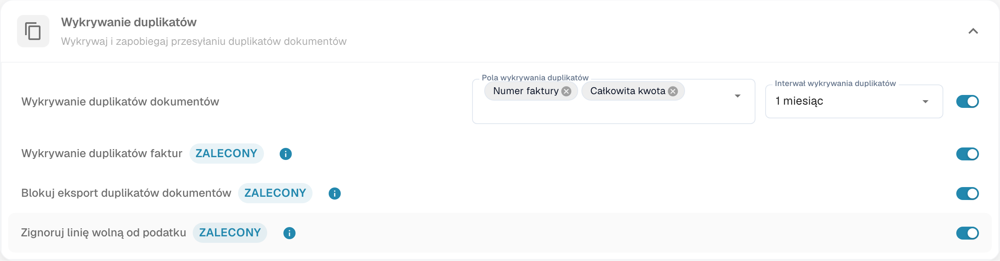
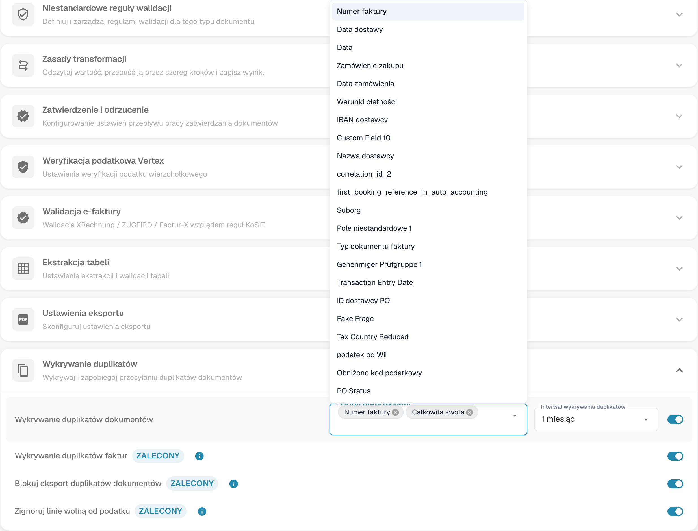

# Wykrywanie duplikatów

## Przegląd

W **DocBits** możesz filtrować duplikaty dokumentów, określając, które pola muszą się zgadzać oraz definiując interwał czasowy, w którym duplikaty powinny być wykrywane.

Ta strona zawiera szczegółowy przewodnik, jak skutecznie włączyć i korzystać z funkcji **Wykrywanie duplikatów**.

## Włączanie wykrywania duplikatów

Aby włączyć wykrywanie duplikatów dokumentów w **DocBits**, wykonaj następujące kroki:

1.  Przejdź do **Ustawienia** → **Ustawienia globalne** → **Typy dokumentów**.

    
2.  Wybierz żądany **Typ dokumentu** i kliknij **Więcej ustawień**.

    
3.  Przejdź do sekcji **Wykrywanie duplikatów**.

<figure><figcaption>
Ustawienia wykrywania zduplikowanych dokumentów.
</figcaption></figure>

DocBits oferuje dwie opcje identyfikacji duplikatów dokumentów:

1. **Wykrywanie duplikatów dokumentów**:\
   Ta funkcja sprawdza duplikaty dokumentów przesłanych do **DocBits** na podstawie wybranych kryteriów. Jeśli jakikolwiek dokument pasuje do wybranych kryteriów w innych dokumentach, zostanie oznaczony jako duplikat.
2.  **Wykrywanie duplikatów faktur** (Dostępne tylko dla typu dokumentu **Faktura**):\
    Ta funkcja wymaga synchronizacji faktur dostawców z Infor do DocBits. Porównuje numery faktur w panelu DocBits z tymi w Infor. Jeśli ten sam numer faktury pojawi się więcej niż raz, zostanie oznaczony jako duplikat.

    <mark style="color:red;">**Uwaga**</mark>: Korzystanie z funkcji **Wykrywanie duplikatów faktur** spowoduje dodatkową opłatę kredytową.

## Filtruj, które dokumenty powinny być wykrywane jako duplikaty

Gdy **Wykrywanie duplikatów** jest włączone, dostępne będą dwa menu rozwijane do konfiguracji:

*   **Pola wykrywania duplikatów**\
    Wybierz pola, które powinny być używane do identyfikacji duplikatów (np. Identyfikator dostawcy, Data, Numer faktury itp.). Dokumenty pasujące do tych pól będą oznaczane jako duplikaty.

<figure><figcaption>
Dostępne pola wykrywania duplikatów.
</figcaption></figure>

*   **Interwał wykrywania duplikatów**

    Użyj tego ustawienia, aby zdefiniować zakres czasowy, w którym wykrywane są duplikaty. Dokumenty przesłane w wybranym interwale będą porównywane ze sobą na podstawie wybranych pól.

    **Dostępne opcje:**

    * 1 miesiąc
    * 3 miesiące (Zalecane)
    * 6 miesięcy
    * 1 rok

    <mark style="color:red;">**Uwaga**</mark>: Zaleca się interwał 3 miesięcy, aby zapewnić optymalną wydajność. Wybór dłuższego interwału może prowadzić do wolniejszego ładowania panelu.

    

## Wyświetlanie duplikatów dokumentów na panelu

Gdy **Wykrywanie duplikatów** jest włączone, wszelkie dokumenty zidentyfikowane jako duplikaty będą wyświetlać ikonę wskaźnika duplikatu na panelu.

*   Kliknij tę ikonę, aby otworzyć pasujące rekordy w widoku podzielonego ekranu obok siebie dla łatwego porównania.\
    <mark style="color:red;">**Uwaga**</mark>: Ikona pojawi się tylko wtedy, gdy dla dokumentu wykryto przynajmniej jeden duplikat.

*   Podczas przeglądania oznaczonego dokumentu, na górze pojawi się pasek ostrzegawczy, wskazujący, że dokument jest duplikatem.

    

Przy podejrzeniu duplikatu porównaj numer faktury, dostawcę, datę i kwotę. Użyj ostrzeżenia i szczegółów dokumentu, aby ustalić potrzebną korektę.
