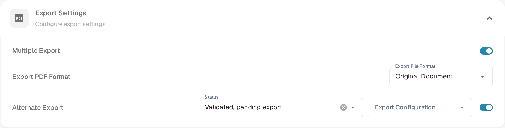

# Alternate Export

## Overview

You can configure an alternate export option to appear in the export dropdown within the purchase order section when a document is in a specific status.\
The setting lives in the **Export Settings** section of the document type. This page explains how to set up this option.

## Activation Steps

1.  Go to **Settings → Document Types**.
2.  Find the card of the document type and click its gear icon (**More Settings**).
3.  Open the **Export Settings** section and switch on **Alternate export**.

    <figure><figcaption>The <strong>Alternate export</strong> switch in the <strong>Export Settings</strong> section. With the switch on, the <strong>Status</strong> and <strong>Export Configuration</strong> dropdowns appear next to it.</figcaption></figure>

## How to set up

Once the setting is enabled, you can choose a document status and assign a predefined export configuration.

* **Status** — the document status in which the extra export option is offered.
* **Export Configuration** — the export configuration the option uses.

More information on setting up export configurations can be found [here](../../../../document-processing/export.md).

You can choose between the following statuses:

* Classified
* Pending confirmation
* Pending Approval
* Pending second approval
* Validated, pending export
* Approved pending export
* Rejected
* Finished
* Exported
* On hold
* Workflow
* Error
* In Review

After setup, an additional export option will appear in the purchase order matching export options. This option uses the specified export configuration when the document matches the defined status.

<figure><figcaption>The <strong>Alternate Export</strong> entry in the export dropdown of a document.</figcaption></figure>
