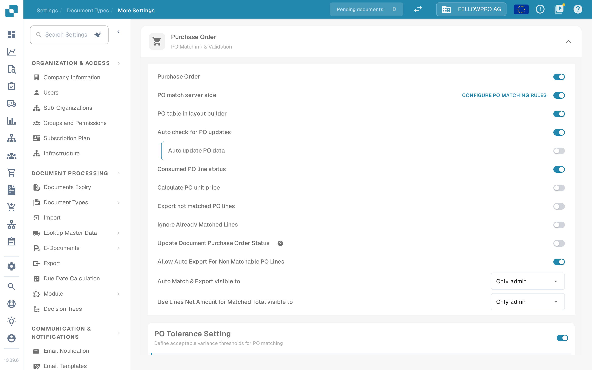
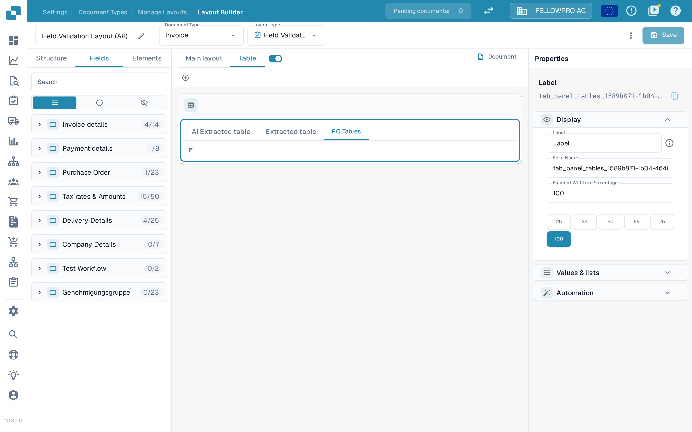
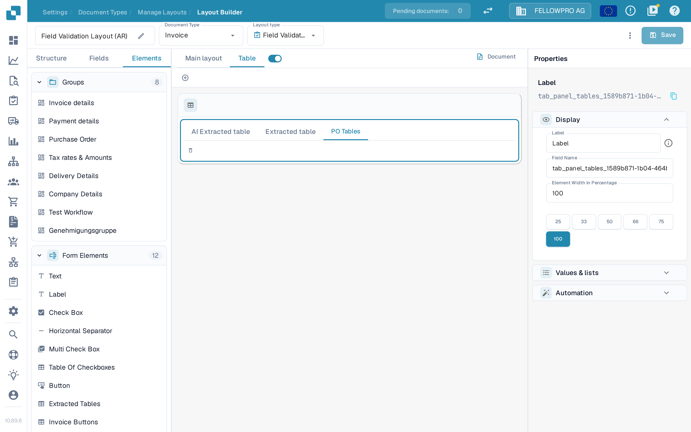

# PO Table in Layout Builder

This setting controls whether the **purchase order (PO) table** is available in the **Layout Builder** and on the **Validation Screen**.

## Enabling the PO table

1. Go to **Settings → Document Types** and open the settings of the **Invoice** document type.
2. Open the **Purchase Order** section.
3. Switch on **PO table in layout builder**.

<figure><figcaption>The setting is the entry **PO table in layout builder** in the **Purchase Order** section.</figcaption></figure>

## Where the PO table appears in the Layout Builder

With the setting on, the layout of the document type carries the PO table. Open the layout in the **Layout Builder** (**Settings → Document Types → Invoice → Layouts**, then **Edit** on a layout) and select the **Table** tab on the canvas. The table on the canvas has three tabs:

* **AI Extracted table** — the table that the AI extraction fills.
* **Extracted table** — the table that the extraction rules fill.
* **PO Tables** — the purchase order table.

<figure><figcaption>The **PO Tables** tab appears in the **Table** tab of the layout canvas.</figcaption></figure>

## Adding the PO table back to the layout

If the PO table no longer shows up in the layout:

1. Open the layout in the **Layout Builder**.
2. Open the **Elements** tab on the left and add **Extracted Tables** from the **Form Elements** list.
3. Save the layout.

<figure><figcaption>**Extracted Tables** is part of the **Form Elements** list on the **Elements** tab.</figcaption></figure>

## When the setting is off

* The **PO Tables** tab in the Layout Builder is marked with a warning.
* The PO table is not shown on the **Validation Screen**, so the purchase order lines cannot be checked there.

Once the setting is on again and the layout saved, the PO table is available in both places as soon as a purchase order is matched to the document.

## Display per-item charge price in approval layouts

Approval layouts (for example the Pending Approval layout of an Order Confirmation) have one more option on the **PO Tables** element: **Display per-item charge price**.

You find it in the **Layout Builder**: select the **PO Tables** element on the canvas and open the element's properties on the right.

* **On**, or not set at all: a costing element shows the per-item price and the total effective cost, for example `181.8182 (200.00)`.
* **Off**: a costing element shows only the total effective cost, for example `200.00`.
* Tax costing elements keep showing their tax rate in both cases.

The option only changes the display. The stored value stays the per-item price, because approving the document saves it as the approved unit price.

The checkbox is only offered on approval layouts. Validation layouts have no charge comparison table, so the option does not appear there. Existing approval layouts keep the current display until you clear the checkbox.
