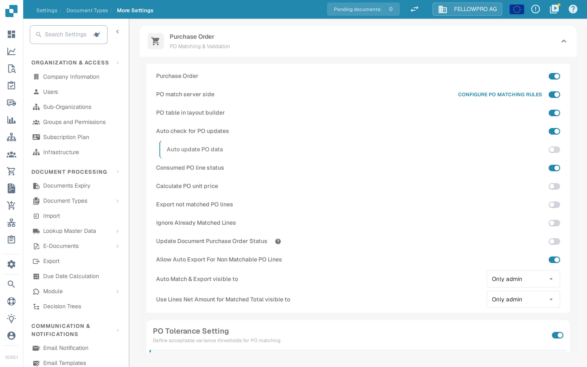

# Purchase Order

## Overview

This setting enables the [**Purchase Order Matching**](../../../../../../end-user-and-partner-section/end-user-section/purchase-order-matching/) section, which becomes accessible after document validation.

<mark style="color:red;">**Note**</mark>: For the **Invoice** document type, the following additional requirements must be met:

* The **Purchase Order** setting must be enabled (as described on this page)
* The invoice must be of type **Purchase Invoice**
* An **Extracted Table** must be present

## Activation Steps 

1. Go to **Settings → Document Types**.
2. Find the card of the document type and click its gear icon (**More Settings**).
3. Open the **Purchase Order** section and switch on **Purchase Order**.

<figure><figcaption>The <strong>Purchase Order</strong> section in <strong>More Settings</strong>. The first switch enables purchase order matching for the document type; the switches below it refine the matching.</figcaption></figure>

## **Functionality**

Once activated, the [**Purchase Order Matching**](../../../../../../end-user-and-partner-section/end-user-section/purchase-order-matching/) section becomes available after document validation.&#x20;

### Which quantity is matched

Which quantity from the purchase order the match compares against depends on **PO match server side**:

* **PO match server side off** — a **Match quantity** dropdown sits next to the **Purchase Order** switch. Choose **Quantity**, **Received Quantity** or **Received Delivery Open Quantity**. DocBits matches with its built-in matcher and compares the selected quantity.
* **PO match server side on** — the matching runs with the rule set of the document type, and **Match quantity** is part of those rules. The header row of the section then shows the **Configure PO matching rules** link, which opens the rules. See [Purchase Order Matching Rules](purchase-order-matching-rules.md).


The capture above was taken with **PO match server side** switched on, so the **Match quantity** dropdown is not on that screen — it is configured in the matching rules instead.

