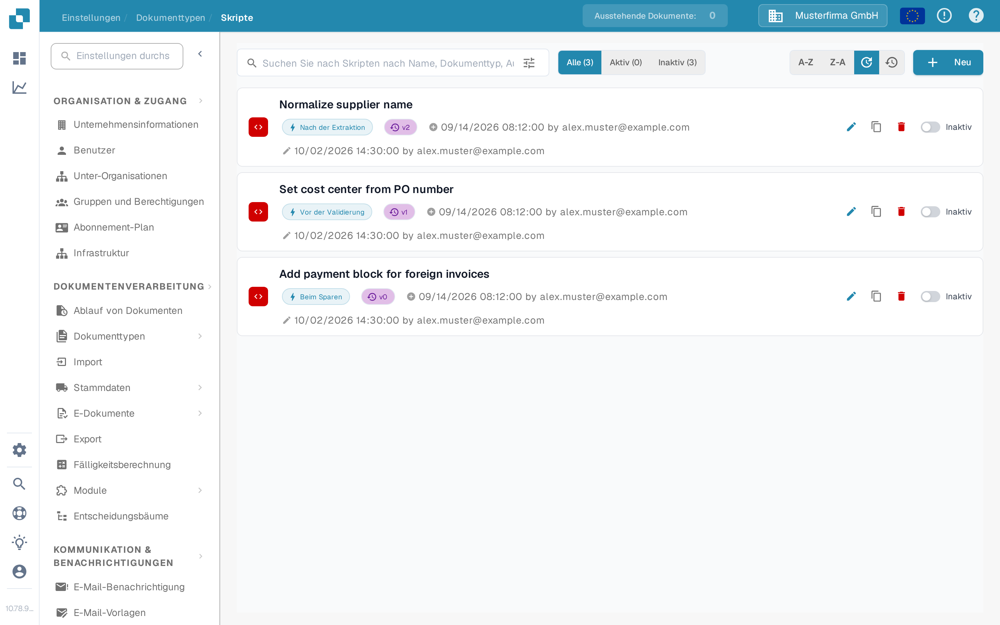
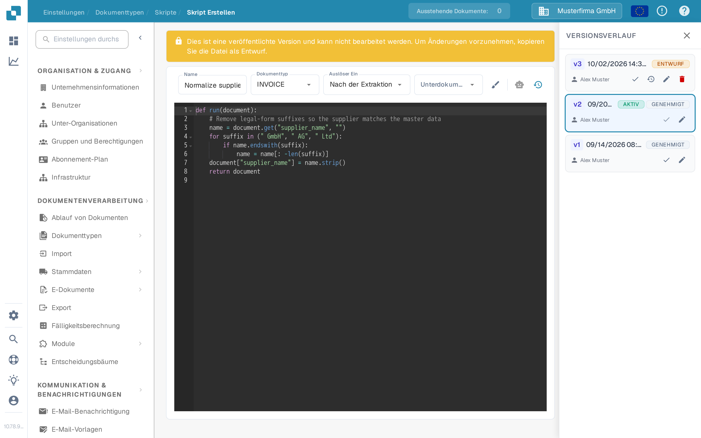
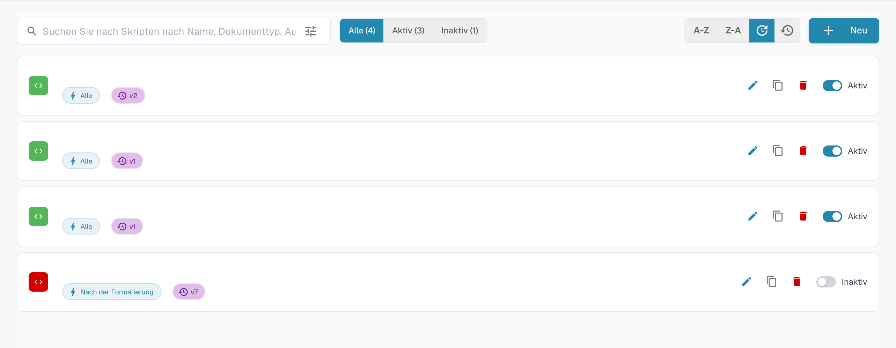
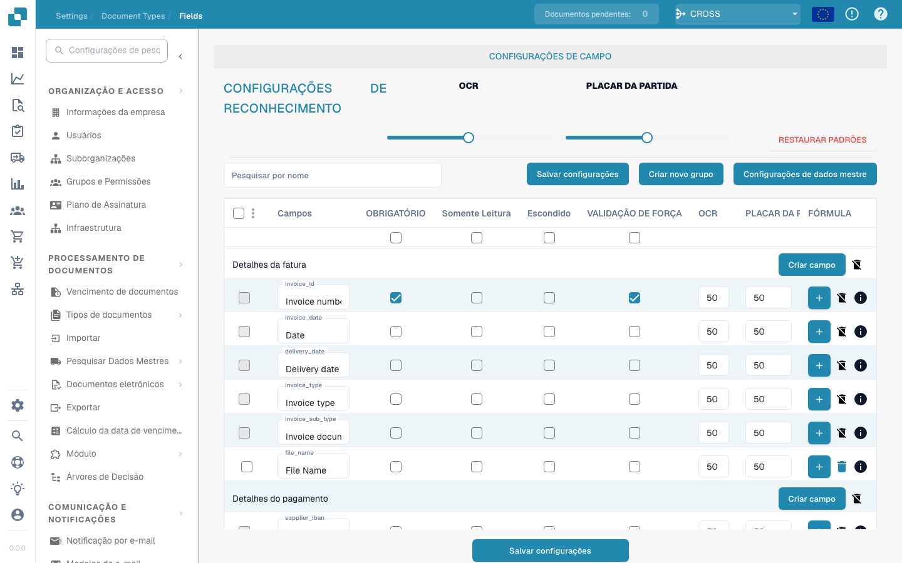

# Skriptaktivierung und -verwaltung

## Videoanleitung: Skripte verwalten


Skripte eines Dokumenttyps verwalten


Das Video zeigt die Skriptliste mit Filter und Sortierung, das Aktivieren und Deaktivieren, das Kopieren, den Versionsverlauf und das Löschen mit Rückfrage.

## Hier ist eine Anleitung, wie Sie bestehende Skripte in DocBits aktivieren, deaktivieren und verwalten können, um sie an Ihre aktuellen Verarbeitungsanforderungen anzupassen:

## Ein Skript finden

1. Öffnen Sie **Einstellungen → Dokumenttypen**.
2. Wählen Sie beim gewünschten Dokumenttyp **Skripte** aus. Die Seite listet die Skripte für diesen Dokumenttyp auf.
3. Suchen Sie nach Name oder grenzen Sie die Liste mit **Alle**, **Aktiv** und **Inaktiv** ein. Sie können sie auch nach Name oder Änderungsdatum sortieren.

<figure><figcaption></figcaption></figure>

<figure><figcaption>
Prüfen Sie den Status rechts auf der Skriptkarte, bevor Sie ihn ändern.
</figcaption></figure>

## Ein Skript aktivieren oder deaktivieren

**Anzeigen vorhandener Skripte:**

## Ein bestehendes Skript ändern

<figure><figcaption></figcaption></figure>

<figure><figcaption>
Eine veröffentlichte Version kann nicht direkt bearbeitet werden. Verwenden Sie den Stift im Versionsverlauf, um einen Entwurf zu erstellen.
</figcaption></figure>

<figure><figcaption>
Speichern und prüfen Sie den Entwurf, bevor Sie ihn zur aktiven Version machen.
</figcaption></figure>

**Bearbeiten eines Skripts:**

* Wenn Sie ein bestehendes Skript bearbeiten müssen, suchen Sie in der Skriptverwaltungsoberfläche nach der Schaltfläche zum Bearbeiten des Skripts.

<figure><figcaption>
Deutsche Skriptverwaltung mit der Aktion zum Bearbeiten; Skriptnamen sind ausgeblendet.
</figcaption></figure>

* Klicken Sie darauf, um den Editor zu öffnen, in dem Sie den Code des Skripts ändern können.
* Nachdem Sie Ihre Änderungen vorgenommen haben, speichern Sie das Skript erneut.

<figure><figcaption></figcaption></figure>

**Überprüfung und Test:**

* Bevor Sie Änderungen an einem Skript vornehmen, überprüfen Sie sorgfältig den vorhandenen Code und überlegen Sie, welche Auswirkungen Ihre Änderungen haben könnten.
* Testen Sie das Skript in einer Testumgebung, um sicherzustellen, dass es wie erwartet funktioniert.

<figure><figcaption></figcaption></figure>

**Dokumentation:**

* Vergessen Sie nicht, Ihre Änderungen zu dokumentieren.
* Notieren Sie, welche Änderungen Sie vorgenommen haben und warum, damit andere Benutzer im Team verstehen können, wie das Skript funktioniert und welche Auswirkungen Ihre Änderungen haben könnten.

**Veröffentlichen von Änderungen:**

* Wenn Sie mit Ihren Änderungen zufrieden sind, veröffentlichen Sie das Skript erneut in der DocBits-Produktionsumgebung, damit die aktualisierte Version in Kraft tritt.

Diese Schritte ermöglichen es Ihnen, bestehende Skripte in DocBits zu aktivieren, zu deaktivieren und zu verwalten, um sie an die aktuellen Verarbeitungsanforderungen anzupassen und sicherzustellen, dass Ihre Dokumentationsprozesse effizient und korrekt ablaufen.
