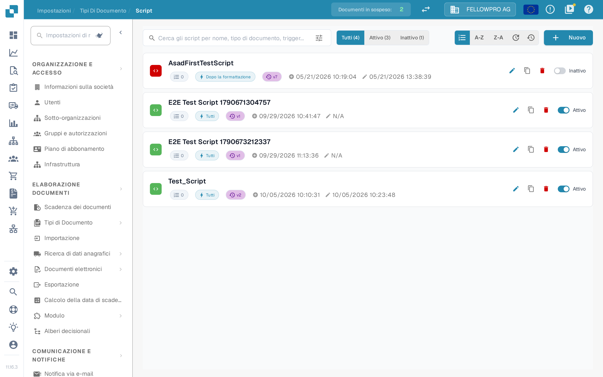
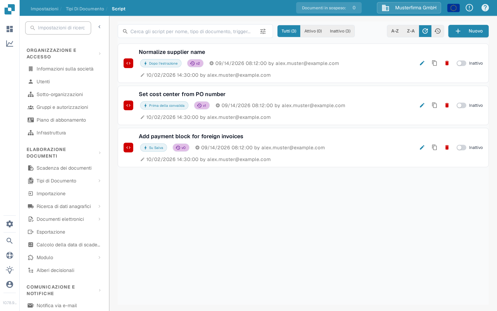
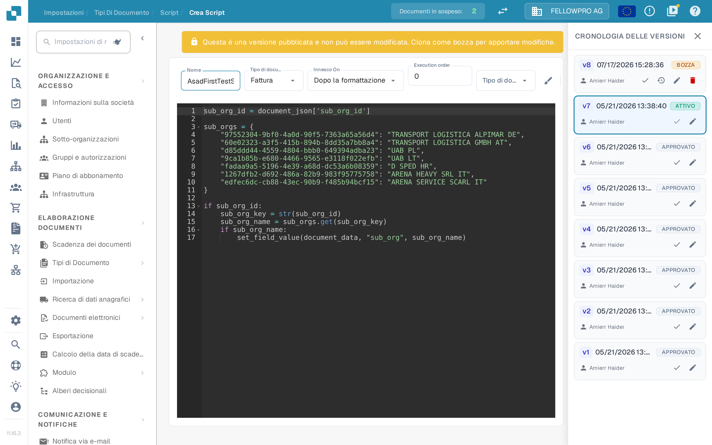

# Attivazione e gestione degli script

Gli amministratori possono usare gli **Script** per gestire le regole di elaborazione di un tipo di documento. Questa guida mostra dove trovare gli script, come attivarli o disattivarli e come modificare in sicurezza uno script già pubblicato.

## Trovare uno script

1. Aprire **Impostazioni → Tipi di Documento**.
2. Nel tipo di documento da gestire, selezionare **Script**. La pagina mostra l'elenco degli script di quel tipo di documento.
3. Cercare per nome oppure usare **Tutti**, **Attivo** e **Inattivo** per restringere l'elenco. È anche possibile ordinarlo per nome o per data di modifica.

Ogni scheda mostra il nome dello script, il suo ordine di esecuzione come badge numerato, l'innesco, la versione e lo stato. La matita apre l'editor; l'icona di copia duplica lo script. **Nuovo** apre l'editor per creare un nuovo script.

<figure><figcaption>
Il badge numerato su ogni scheda è l'ordine di esecuzione dello script.
</figcaption></figure>

<figure><figcaption>
Controllare lo stato a destra della scheda dello script prima di modificarlo.
</figcaption></figure>

## Impostare l'ordine di esecuzione

Il campo **Execution order** stabilisce l'ordine in cui vengono eseguiti gli script: i numeri più bassi vengono eseguiti per primi. Il campo resta etichettato in inglese anche nell'interfaccia italiana.

1. Aprire lo script nell'editor.
2. Immettere un numero intero a partire da 0 nel campo **Execution order**. Lasciare il campo vuoto per mantenere 0.
3. Salvare lo script. Lettere, decimali e numeri negativi vengono rifiutati con un messaggio di errore sul campo e non viene salvato nulla.

Se si modifica l'ordine di esecuzione e poi si attiva una versione, DocBits salva prima lo script e attiva la versione solo se quel salvataggio riesce.

<figure><figcaption>
L'ordine di esecuzione nell'editor dello script.
</figcaption></figure>

## Attivare o disattivare uno script

Usare l'interruttore **Attivo/Inattivo** sulla scheda dello script. La modifica viene salvata immediatamente; i conteggi dell'elenco si aggiornano per mostrare il risultato. Uno script inattivo resta disponibile per essere esaminato o modificato, ma non viene eseguito durante l'elaborazione dei documenti.

**Controllare lo stato dopo aver creato uno script.** Nell'interfaccia attuale del Sandbox, salvando un nuovo script viene creata una versione attiva e la scheda risulta **Attivo**. Passarla a **Inattivo** se si tratta solo di una bozza o di un esempio di prova.

## Modificare uno script esistente

1. Selezionare la scheda dello script o la sua icona a matita. Una versione pubblicata è di sola lettura, quindi non è possibile scriverci sopra direttamente.
2. In **Cronologia delle versioni**, selezionare l'icona a matita della versione che si vuole modificare. Questo crea una **Bozza** basata su quella versione.
3. Modificare la bozza e selezionare l'icona **Salva**. Prima di salvare, controllare il nome, il tipo di documento, l'innesco e il codice.
4. Provare lo script modificato con documenti rappresentativi in un ambiente di prova. Quando è pronto, selezionare l'icona di spunta della bozza in **Cronologia delle versioni** per rendere quella versione attiva.
5. Tornare all'elenco degli script e controllare l'interruttore **Attivo/Inattivo** della scheda. La versione contrassegnata come **ATTIVO** nella Cronologia delle versioni indica la versione selezionata; l'interruttore della scheda determina se lo script viene eseguito.

<figure><figcaption>
Una versione pubblicata non può essere modificata direttamente. Usare la matita nella Cronologia delle versioni per creare una bozza.
</figcaption></figure>

<figure><figcaption>
Salvare e controllare la bozza prima di renderla la versione attiva.
</figcaption></figure>

Per esempi di script e le funzioni disponibili, vedere [Scripting in DocBits](scripting-in-docbits/README.md).
