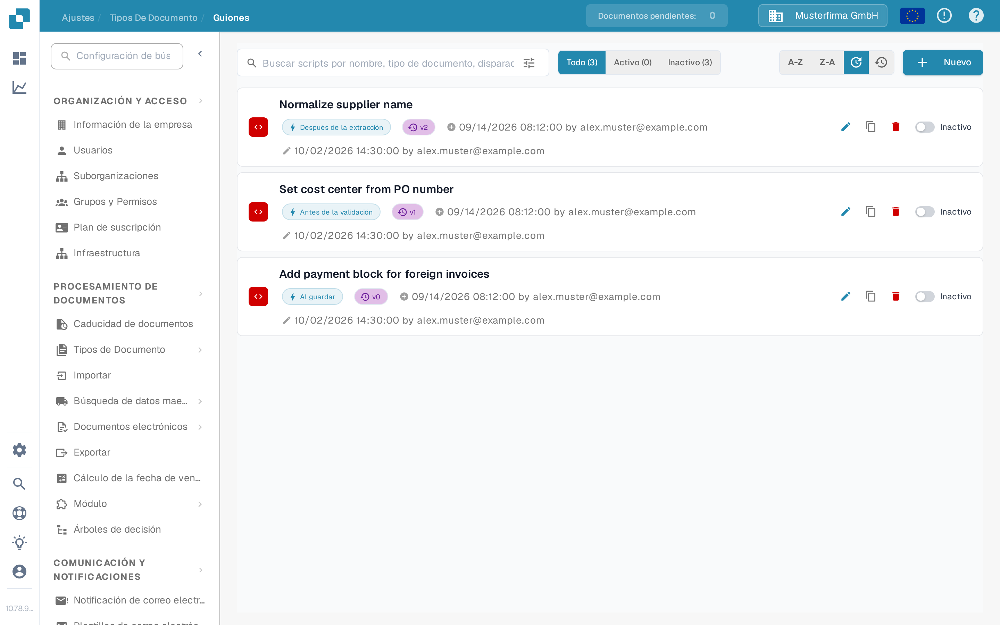
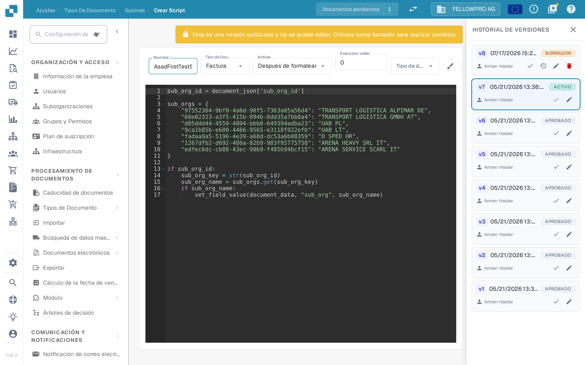
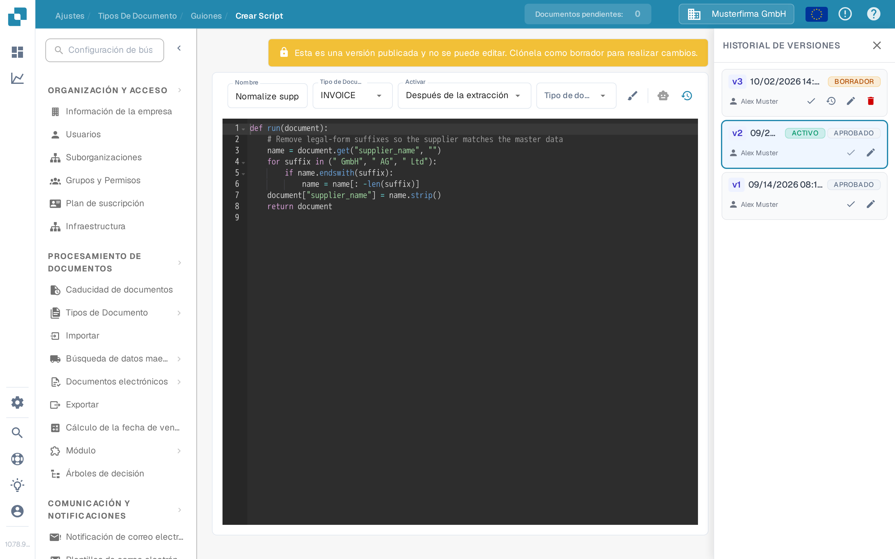

# Activación y gestión de scripts

Los administradores pueden usar **Scripts** para gestionar las reglas de procesamiento de un tipo de documento. Esta guía muestra dónde encontrar los scripts, cómo activarlos o desactivarlos y cómo cambiar de forma segura un script ya publicado.

## Buscar un script

1. Abra **Ajustes → Tipos de Documento**.
2. En el tipo de documento que quiera gestionar, seleccione **Guiones**. La página muestra la lista de scripts de ese tipo de documento.
3. Busque por nombre o use **Todo**, **Activo** e **Inactivo** para acotar la lista. También puede ordenarla por nombre o por fecha de modificación.

Cada tarjeta muestra el nombre del script, su orden de ejecución como una etiqueta numerada, el disparador, la versión y el estado. El lápiz abre el editor; el icono de copiar duplica el script. **Nuevo** abre el editor para crear un script nuevo.

<figure><figcaption>
La etiqueta numerada de cada tarjeta es el orden de ejecución del script.
</figcaption></figure>

<figure><figcaption>
Compruebe el estado a la derecha de la tarjeta del script antes de cambiarlo.
</figcaption></figure>

## Definir el orden de ejecución

El campo **Execution order** controla el orden en que se ejecutan los scripts: los números más bajos se ejecutan primero. El campo mantiene la etiqueta en inglés también en la interfaz en español.

1. Abra el script en el editor.
2. Introduzca un número entero a partir de 0 en el campo **Execution order**. Deje el campo vacío para mantener 0.
3. Guarde el script. Las letras, los decimales y los números negativos se rechazan con un mensaje de error en el campo y no se guarda nada.

Si cambia el orden de ejecución y después activa una versión, DocBits guarda primero el script y solo activa la versión cuando ese guardado se ha realizado correctamente.

<figure><figcaption>
El orden de ejecución en el editor de scripts.
</figcaption></figure>

## Activar o desactivar un script

Use el interruptor **Activo/Inactivo** de la tarjeta del script. El cambio se guarda de inmediato; los contadores de la lista se actualizan para mostrar el resultado. Un script inactivo sigue disponible para consultarlo o editarlo, pero no se ejecuta durante el procesamiento de documentos.

**Compruebe el estado después de crear un script.** En la interfaz actual del Sandbox, al guardar un script nuevo se crea una versión activa y la tarjeta queda en **Activo**. Páselo a **Inactivo** si solo es un borrador o un ejemplo de prueba.

## Cambiar un script existente

1. Seleccione la tarjeta del script o su icono de lápiz. Una versión publicada es de solo lectura, así que no puede escribir sobre ella directamente.
2. En **Historial de versiones**, seleccione el icono de lápiz de la versión que quiera cambiar. Esto crea un **Borrador** a partir de esa versión.
3. Edite el borrador y seleccione el icono **Guardar**. Revise el nombre, el tipo de documento, el disparador y el código antes de guardar.
4. Pruebe el script modificado con documentos representativos en un entorno de pruebas. Cuando esté listo, seleccione el icono de verificación del borrador en **Historial de versiones** para convertir esa versión en la activa.
5. Vuelva a la lista de Scripts y compruebe el interruptor **Activo/Inactivo** de la tarjeta. La versión marcada como **ACTIVO** en el Historial de versiones indica la versión seleccionada; el interruptor de la tarjeta controla si el script se ejecuta.

<figure><figcaption>
Una versión publicada no se puede editar directamente. Use el lápiz del Historial de versiones para crear un borrador.
</figcaption></figure>

<figure><figcaption>
Guarde y revise el borrador antes de convertirlo en la versión activa.
</figcaption></figure>

Para ver ejemplos de scripts y las funciones disponibles, consulte [Programación en DocBits](scripting-in-docbits/README.md).
