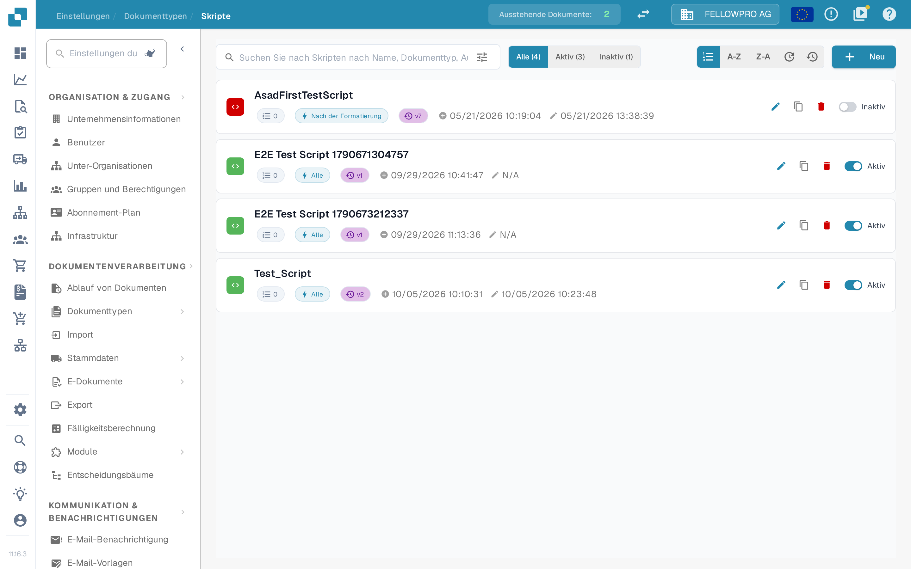
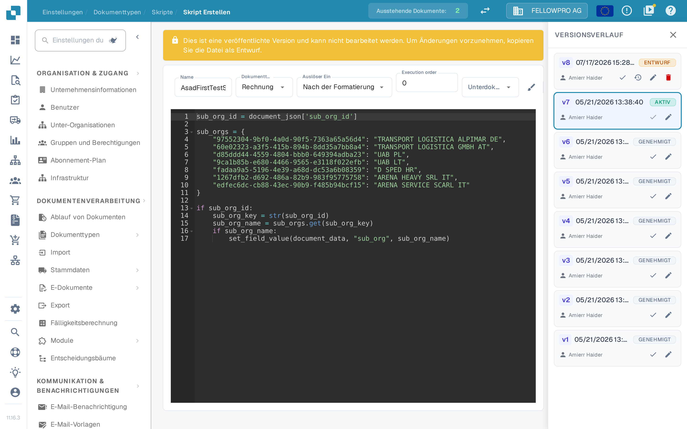

# Skriptaktivierung und -verwaltung

Administratoren können **Skripte** verwenden, um Verarbeitungsregeln für einen Dokumenttyp zu verwalten. Diese Anleitung zeigt, wo Sie Skripte finden, wie Sie sie ein- oder ausschalten und wie Sie ein veröffentlichtes Skript sicher ändern.

## Ein Skript finden

1. Öffnen Sie **Einstellungen → Dokumenttypen**.
2. Wählen Sie beim gewünschten Dokumenttyp **Skripte** aus. Die Seite listet die Skripte für diesen Dokumenttyp auf.
3. Suchen Sie nach Name oder grenzen Sie die Liste mit **Alle**, **Aktiv** und **Inaktiv** ein. Sie können sie auch nach Name oder Änderungsdatum sortieren.

Jede Karte zeigt den Skriptnamen, seine Ausführungsreihenfolge als nummerierten Chip, den Auslöser, die Version und den Status. Das Stift-Symbol öffnet den Editor; das Kopieren-Symbol dupliziert das Skript. **Neu** öffnet den Editor für ein neues Skript.

<figure><figcaption>
Der nummerierte Chip auf jeder Karte ist die Ausführungsreihenfolge des Skripts.
</figcaption></figure>

<figure><figcaption>
Prüfen Sie den Status rechts auf der Skriptkarte, bevor Sie ihn ändern.
</figcaption></figure>

## Ausführungsreihenfolge festlegen

Mit dem Feld **Execution order** steuern Sie, in welcher Reihenfolge Skripte laufen: kleinere Zahlen laufen zuerst. Das Feld ist auch in der deutschen Oberfläche englisch beschriftet.

1. Öffnen Sie das Skript im Editor.
2. Geben Sie im Feld **Execution order** eine ganze Zahl ab 0 ein. Lassen Sie das Feld leer, um 0 zu behalten.
3. Speichern Sie das Skript. Buchstaben, Dezimalzahlen und negative Zahlen werden mit einer Fehlermeldung am Feld abgelehnt, und es wird nichts gespeichert.

Wenn Sie die Ausführungsreihenfolge ändern und danach eine Version aktivieren, speichert DocBits zuerst das Skript und aktiviert die Version erst, wenn dieses Speichern erfolgreich war.

<figure><figcaption>
Die Ausführungsreihenfolge im Skript-Editor.
</figcaption></figure>

## Ein Skript aktivieren oder deaktivieren

Verwenden Sie den Schalter **Aktiv/Inaktiv** auf der Skriptkarte. Die Änderung wird sofort gespeichert; die Zähler der Liste aktualisieren sich entsprechend. Ein inaktives Skript bleibt zum Ansehen oder Bearbeiten verfügbar, läuft aber während der Dokumentenverarbeitung nicht.

**Prüfen Sie den Status nach dem Erstellen eines Skripts.** In der aktuellen Sandbox-Oberfläche wurde beim Speichern eines neuen Skripts eine aktive Version angelegt und die Karte auf **Aktiv** gesetzt. Stellen Sie den Schalter auf **Inaktiv**, wenn es nur ein Entwurf oder ein Testbeispiel ist.

## Ein bestehendes Skript ändern

1. Wählen Sie die Skriptkarte oder ihr Stift-Symbol aus. Eine veröffentlichte Version ist schreibgeschützt, Sie können sie nicht direkt überschreiben.
2. Wählen Sie im **Versionsverlauf** das Stift-Symbol der Version aus, die Sie ändern möchten. Dadurch wird ein **Entwurf** auf Grundlage dieser Version erstellt.
3. Bearbeiten Sie den Entwurf und wählen Sie das Speichern-Symbol. Prüfen Sie vor dem Speichern Name, Dokumenttyp, Auslöser und Code.
4. Testen Sie das geänderte Skript mit repräsentativen Dokumenten in einer Testumgebung. Wenn es bereit ist, wählen Sie das Häkchen-Symbol für den Entwurf im **Versionsverlauf**, um diese Version aktiv zu machen.
5. Kehren Sie zur Skriptliste zurück und prüfen Sie den Schalter **Aktiv/Inaktiv** der Karte. Die im Versionsverlauf mit **AKTIV** markierte Version bezeichnet die ausgewählte Version; der Kartenschalter steuert, ob das Skript ausgeführt wird.

<figure><figcaption>
Eine veröffentlichte Version kann nicht direkt bearbeitet werden. Verwenden Sie den Stift im Versionsverlauf, um einen Entwurf zu erstellen.
</figcaption></figure>

<figure><figcaption>
Speichern und prüfen Sie den Entwurf, bevor Sie ihn zur aktiven Version machen.
</figcaption></figure>

Beispielskripte und verfügbare Funktionen finden Sie unter [Skripterstellung in DocBits](scripting-in-docbits/README.md).

Wie Sie ein Skript erstellen, den Editor bedienen (Formatierung, Zurücksetzen des Entwurfs, KI-Assistent) und den Code eingeben, beschreibt die Seite [Erstellen und Bearbeiten von Skripten](creating-and-editing-scripts.md).

Das Papierkorb-Symbol in der Skriptliste löscht ein Skript endgültig; das Pfeil-Symbol in einer Versionszeile des Versionsverlaufs lädt eine ältere Version als Entwurf in den Editor.
