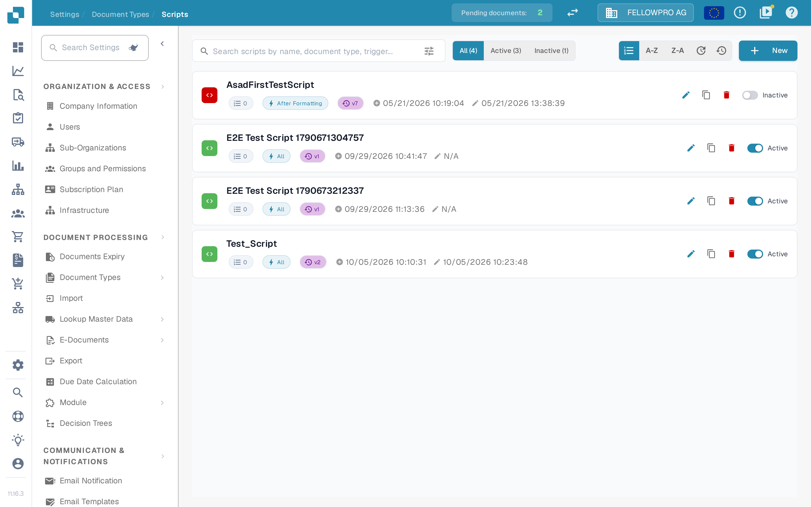
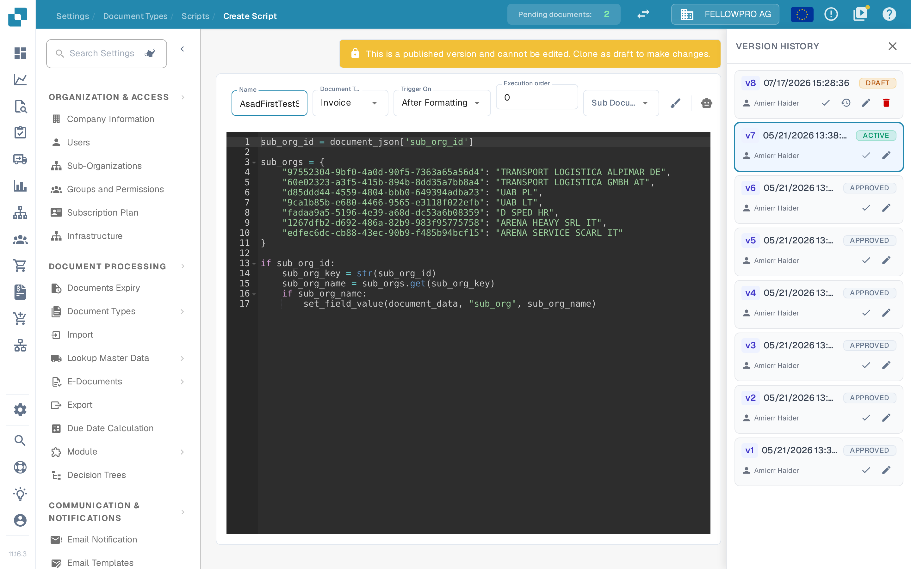

# Aktivacija i upravljanje skriptama

Administratori mogu da koriste **skripte** za upravljanje pravilima obrade za tip dokumenta. Ovaj vodič pokazuje gde se skripte nalaze, kako se uključuju ili isključuju i kako se objavljena skripta menja bezbedno.

## Pronalaženje skripte

1. Otvorite **Podešavanja → Tipovi dokumenata**.
2. Na tipu dokumenta kojim želite da upravljate izaberite **Skripte**. Stranica prikazuje listu skripti za taj tip dokumenta.
3. Pretražite po nazivu ili suzite listu pomoću **Sve**, **Aktivno** i **Neaktivno**. Lista je podrazumevano sortirana po redosledu izvršavanja; dugmad za sortiranje prebacuju između redosleda izvršavanja, naziva (A-Z / Z-A) i datuma izmene.

Svaka kartica prikazuje naziv skripte, njen redosled izvršavanja kao numerisanu oznaku, okidač, verziju i status. Ikona olovke otvara editor; ikona za kopiranje duplira skriptu. **Novo** otvara editor za novu skriptu.

<figure><figcaption>
Numerisana oznaka na svakoj kartici je redosled izvršavanja skripte.
</figcaption></figure>

## Podešavanje redosleda izvršavanja

Polje **Execution order** određuje redosled u kom se skripte izvršavaju: manji brojevi se izvršavaju prvi.

1. Otvorite skriptu u editoru.
2. Unesite ceo broj od 0 naviše u polje **Execution order**. Ostavite polje prazno da zadržite 0.
3. Sačuvajte skriptu. Slova, decimale i negativni brojevi se odbijaju uz poruku o grešci na polju i ništa se ne čuva.

Ako promenite redosled izvršavanja i zatim aktivirate verziju, DocBits prvo čuva skriptu i aktivira verziju samo ako to čuvanje uspe.

<figure><figcaption>
Redosled izvršavanja u editoru skripte.
</figcaption></figure>

## Aktiviranje ili deaktiviranje skripte

Koristite prekidač **Aktivno/Neaktivno** na kartici skripte. Izmena se čuva odmah; brojači u listi se ažuriraju i prikazuju rezultat. Neaktivna skripta ostaje dostupna za pregled ili izmenu, ali se ne izvršava tokom obrade dokumenata.

## Izmena postojeće skripte

1. Izaberite karticu skripte ili njenu ikonu olovke. Objavljena verzija je samo za čitanje, pa je ne možete direktno prepisati.
2. U **Istoriji verzija** izaberite ikonu olovke na verziji koju želite da izmenite. Time se pravi **Nacrt** na osnovu te verzije.
3. Izmenite nacrt i izaberite ikonu za čuvanje. Pre čuvanja proverite naziv, tip dokumenta, okidač i kod.
4. Testirajte izmenjenu skriptu sa reprezentativnim dokumentima u test okruženju. Kada bude spremna, izaberite ikonu za potvrdu nacrta u **Istoriji verzija** da tu verziju učinite aktivnom.
5. Vratite se na listu skripti i proverite prekidač **Aktivno/Neaktivno** na kartici. Verzija označena kao **AKTIVNO** u Istoriji verzija pokazuje izabranu verziju; prekidač na kartici određuje da li se skripta izvršava.

Primere skripti i dostupne funkcije potražite u [Skriptovanje u DocBits-u](scripting-in-docbits/README.md).

Slike u ovoj stranici prikazuju engleski interfejs aplikacije, jer aplikacija nema srpski prevod.
