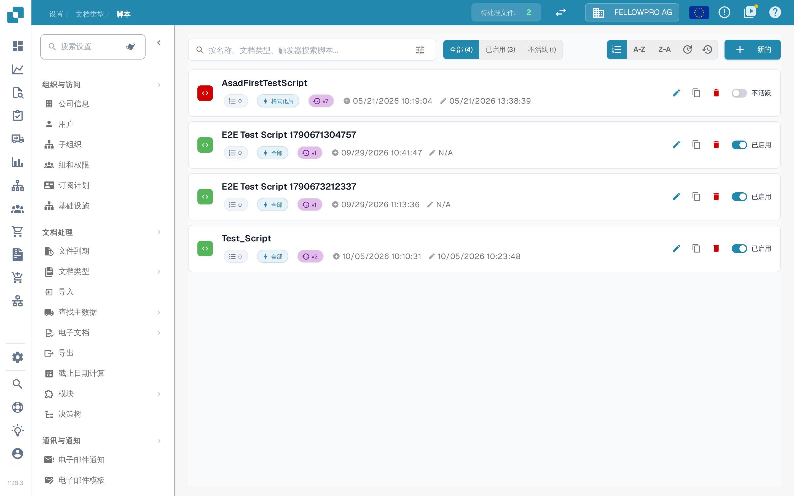
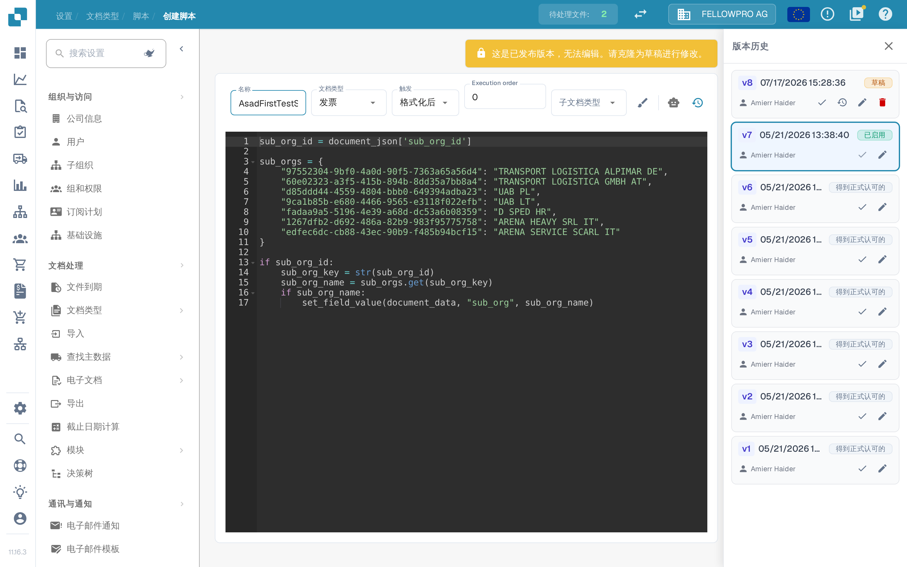
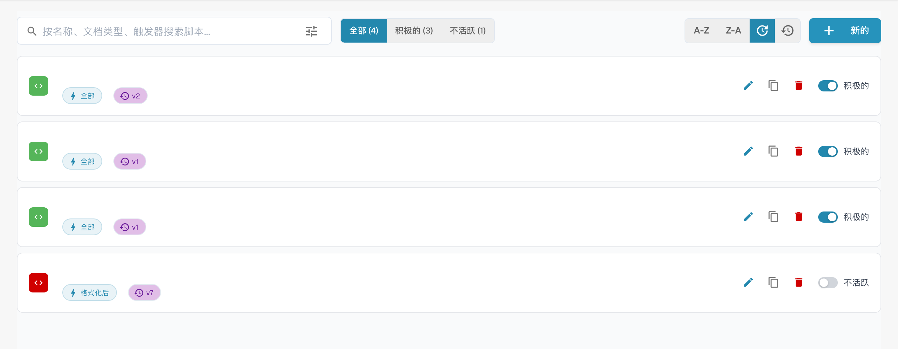

# 启用和管理脚本

## 视频教程：管理脚本


管理文档类型的脚本


视频演示脚本列表的筛选与排序、启用与停用、复制、版本历史，以及需确认的删除。

脚本管理提供脚本列表与编辑入口。打开脚本设置，检查所选脚本和可用操作。

列表默认按执行顺序排序；排序按钮可切换到名称（A-Z / Z-A）或修改日期。每张卡片的脚本名称旁显示带数字的执行顺序标签。

<figure><figcaption>
每张卡片上的数字标签就是脚本的执行顺序。
</figcaption></figure>

## 设置执行顺序

用 **Execution order** 字段控制脚本的运行顺序：数字越小越先运行。该字段在中文界面中同样显示英文标签。

1. 在编辑器中打开脚本。
2. 在 **Execution order** 字段中输入 0 或更大的整数。留空则保持 0。
3. 保存脚本。输入字母、小数或负数时，字段会显示错误提示，脚本不会被保存。

如果修改了执行顺序后再启用某个版本，DocBits 会先保存脚本，只有保存成功后才会启用该版本。

<figure><figcaption>
脚本编辑器中的执行顺序。
</figcaption></figure>

<figure><figcaption>
脚本管理及编辑操作；名称已隐藏。
</figcaption></figure>

技术代码与标识符保持原样。更改或启用脚本前，检查输入、输出和对文档流程的影响，并按组织流程测试。图片展示管理界面，没有运行或保存脚本。
