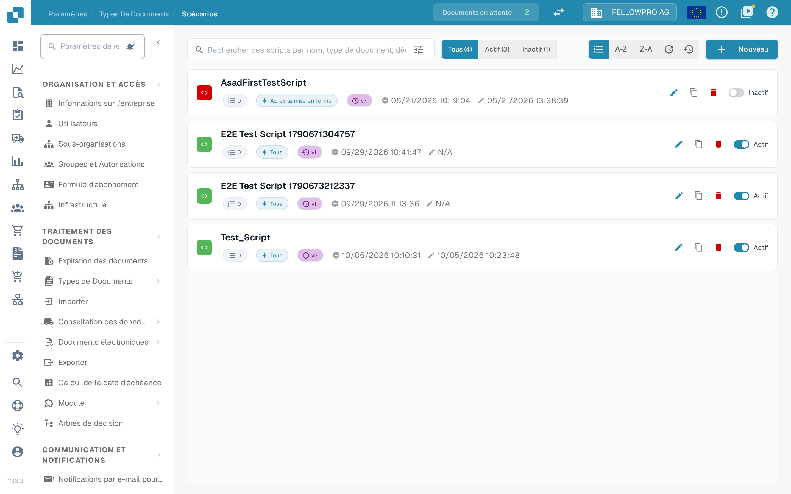
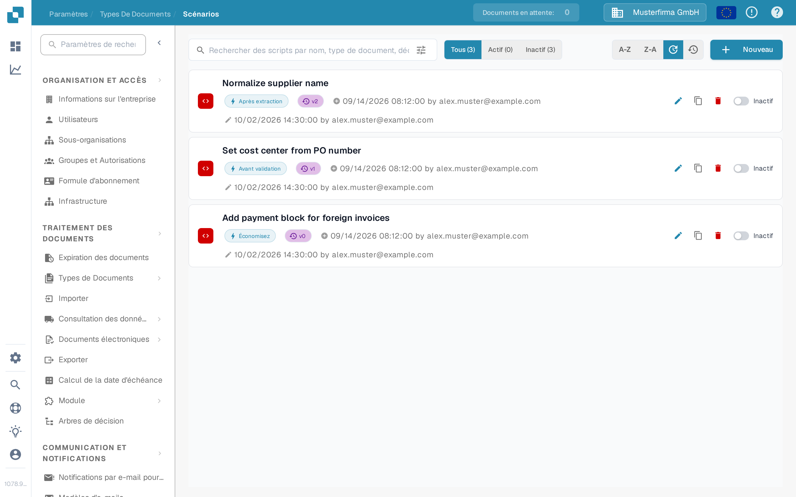
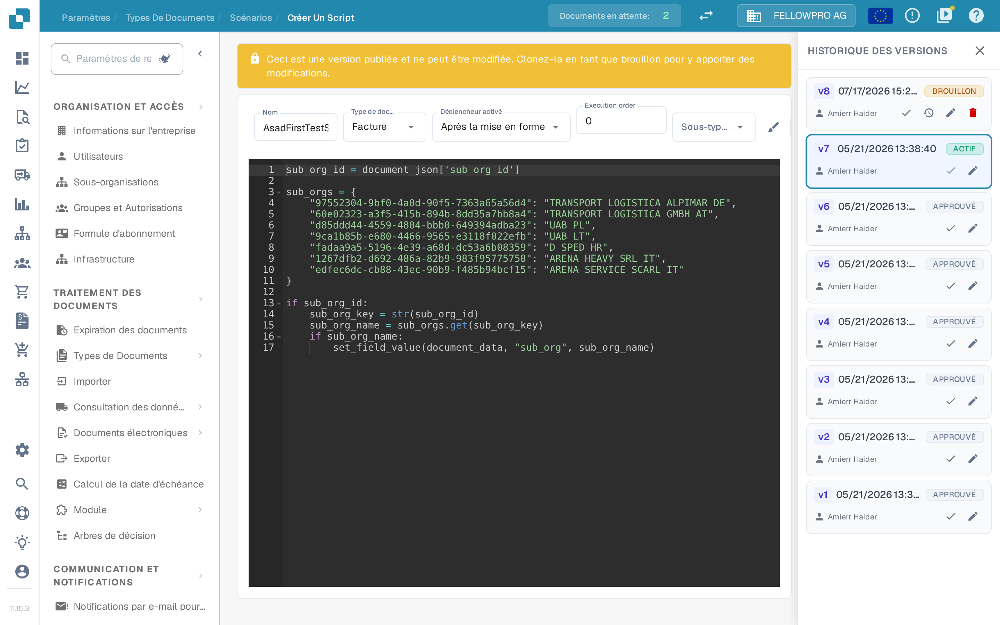
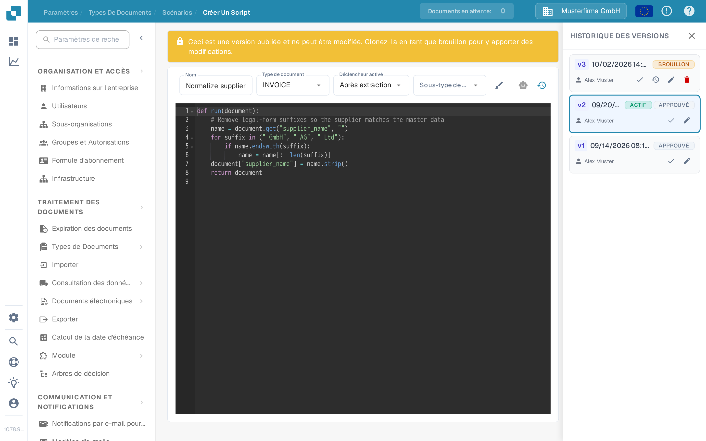
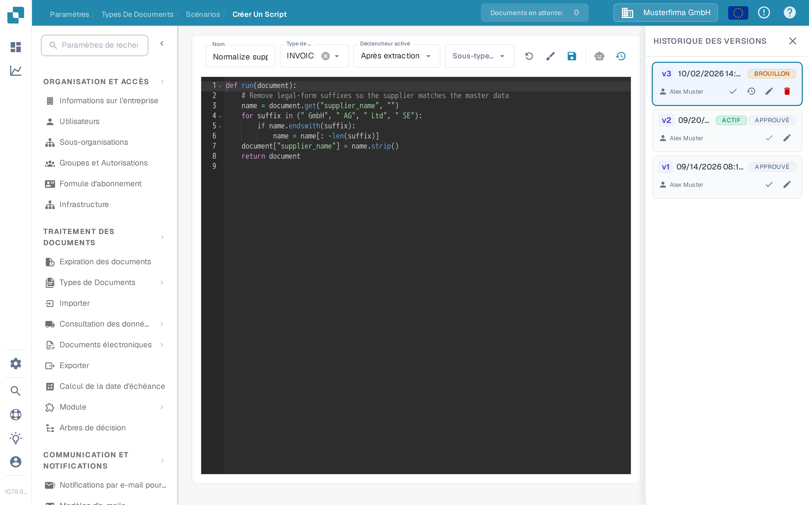

# Activation et gestion des scripts

Les administrateurs peuvent utiliser les **scripts** pour gérer les règles de traitement d'un type de document. Ce guide montre où trouver les scripts, comment les activer ou les désactiver et comment modifier un script publié en toute sécurité.

## Trouver un script

1. Ouvrez **Paramètres → Types de Documents**.
2. Sur le type de document à gérer, sélectionnez **Scénarios**. La page liste les scripts de ce type de document.
3. Recherchez par nom ou utilisez **Tous**, **Actif** et **Inactif** pour affiner la liste. Vous pouvez aussi la trier par nom ou par date de modification.

Chaque carte affiche le nom du script, son ordre d'exécution sous forme de pastille numérotée, le déclencheur, la version et le statut. Le crayon ouvre l'éditeur ; l'icône de copie duplique le script. **Nouveau** ouvre l'éditeur pour un nouveau script.

<figure><figcaption>
La pastille numérotée sur chaque carte correspond à l'ordre d'exécution du script.
</figcaption></figure>

<figure><figcaption>
Vérifiez le statut à droite de la carte du script avant de le modifier.
</figcaption></figure>

## Définir l'ordre d'exécution

Le champ **Execution order** détermine l'ordre dans lequel les scripts s'exécutent : les nombres les plus petits passent en premier. Le champ reste libellé en anglais dans l'interface française.

1. Ouvrez le script dans l'éditeur.
2. Saisissez un nombre entier à partir de 0 dans le champ **Execution order**. Laissez le champ vide pour conserver 0.
3. Enregistrez le script. Les lettres, les décimales et les nombres négatifs sont refusés par un message d'erreur sur le champ et rien n'est enregistré.

Si vous modifiez l'ordre d'exécution puis activez une version, DocBits enregistre d'abord le script et n'active la version que si cet enregistrement réussit.

<figure><figcaption>
L'ordre d'exécution dans l'éditeur de script.
</figcaption></figure>

## Activer ou désactiver un script

Utilisez l'interrupteur **Actif/Inactif** de la carte du script. La modification est enregistrée immédiatement ; les compteurs de la liste se mettent à jour pour montrer le résultat. Un script inactif reste consultable et modifiable, mais il ne s'exécute pas pendant le traitement des documents.

**Vérifiez le statut après la création d'un script.** Dans l'interface Sandbox actuelle, l'enregistrement d'un nouveau script crée une version active et passe la carte à **Actif**. Passez-le à **Inactif** s'il ne s'agit que d'un brouillon ou d'un exemple de test.

## Modifier un script existant

1. Sélectionnez la carte du script ou son icône crayon. Une version publiée est en lecture seule : vous ne pouvez donc pas la modifier directement.
2. Dans **Historique des versions**, sélectionnez l'icône crayon de la version à modifier. Cela crée un **Brouillon** à partir de cette version.
3. Modifiez le brouillon et sélectionnez l'icône **Enregistrer**. Vérifiez le nom, le type de document, le déclencheur et le code avant d'enregistrer.
4. Testez le script modifié avec des documents représentatifs dans un environnement de test. Lorsqu'il est prêt, sélectionnez l'icône de validation du brouillon dans **Historique des versions** pour rendre cette version active.
5. Revenez à la liste des scripts et vérifiez l'interrupteur **Actif/Inactif** de la carte. La version marquée **ACTIF** dans l'Historique des versions identifie la version sélectionnée ; l'interrupteur de la carte commande si le script s'exécute.

<figure><figcaption>
Une version publiée ne peut pas être modifiée directement. Utilisez le crayon dans l'Historique des versions pour créer un brouillon.
</figcaption></figure>

<figure><figcaption>
Enregistrez et vérifiez le brouillon avant de le rendre version active.
</figcaption></figure>

Pour des exemples de scripts et les fonctions disponibles, voir [Scripting dans DocBits](scripting-in-docbits/README.md).
