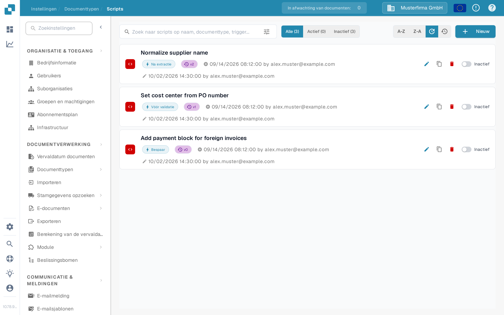
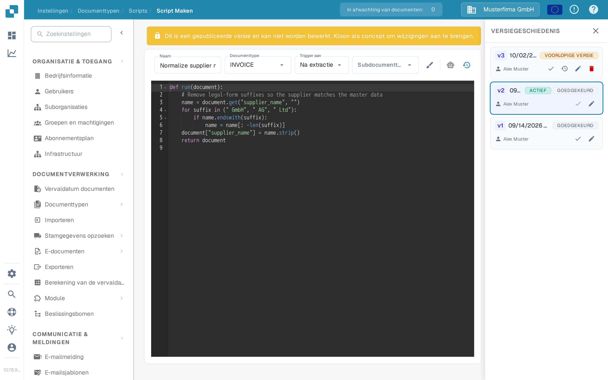

# Scriptactivering en -beheer

Beheerders kunnen **Scripts** gebruiken om verwerkingsregels voor een documenttype te beheren. Deze handleiding laat zien waar u scripts vindt, hoe u ze in- of uitschakelt en hoe u een gepubliceerd script veilig wijzigt.

## Een script vinden

1. Open **Instellingen → Documenttypen**.
2. Selecteer bij het gewenste documenttype **Scripts**. De pagina toont de scripts voor dat documenttype.
3. Zoek op naam of beperk de lijst met **Alle**, **Actief** en **Inactief**. U kunt de lijst ook sorteren op naam of wijzigingsdatum.

Elke kaart toont de scriptnaam, de trigger, de versie en de status. Het potlood-pictogram opent de editor; het kopieer-pictogram dupliceert het script. **Nieuw** opent de editor voor een nieuw script.

<figure><figcaption>
Controleer de status rechts op de scriptkaart voordat u deze wijzigt.
</figcaption></figure>

## Een script activeren of deactiveren

Gebruik de schakelaar **Actief/Inactief** op de scriptkaart. De wijziging wordt direct opgeslagen; de tellers in de lijst worden bijgewerkt. Een inactief script blijft beschikbaar om te bekijken of te bewerken, maar wordt tijdens de documentverwerking niet uitgevoerd.

**Controleer de status na het maken van een script.** In de huidige Sandbox-interface is bij het opslaan van een nieuw script een actieve versie aangemaakt en is de kaart op **Actief** gezet. Zet de schakelaar op **Inactief** als het slechts een concept of een testvoorbeeld is.

## Een bestaand script wijzigen

1. Selecteer de scriptkaart of het potlood-pictogram. Een gepubliceerde versie is alleen-lezen; u kunt deze niet direct overschrijven.
2. Selecteer in de **Versiegeschiedenis** het potlood-pictogram bij de versie die u wilt wijzigen. Er wordt dan een **Voorlopige versie** (concept) op basis van die versie aangemaakt.
3. Bewerk het concept en selecteer het opslag-pictogram. Controleer vóór het opslaan de naam, het documenttype, de trigger en de code.
4. Test het gewijzigde script met representatieve documenten in een testomgeving. Als het gereed is, selecteert u het vinkje-pictogram bij het concept in de **Versiegeschiedenis** om die versie actief te maken.
5. Ga terug naar de scriptlijst en controleer de schakelaar **Actief/Inactief** van de kaart. De versie die in de versiegeschiedenis met **ACTIEF** is gemarkeerd, is de geselecteerde versie; de kaartschakelaar bepaalt of het script wordt uitgevoerd.

<figure><figcaption>
Een gepubliceerde versie kan niet direct worden bewerkt. Gebruik het potlood in de versiegeschiedenis om een concept te maken.
</figcaption></figure>

<figure><figcaption>
Sla het concept op en controleer het voordat u het de actieve versie maakt.
</figcaption></figure>

Voor scriptvoorbeelden en beschikbare functies, zie [Scripting in DocBits](scripting-in-docbits/README.md).

Hoe u een script maakt, de editor bedient (opmaak, concept terugzetten, AI-assistent) en de code invoert, beschrijft de pagina [Scripts maken en bewerken](creating-and-editing-scripts.md).

Het prullenbak-pictogram in de scriptlijst verwijdert een script definitief; het pijl-pictogram in een versieregel van de versiegeschiedenis laadt een oudere versie als concept in de editor.
