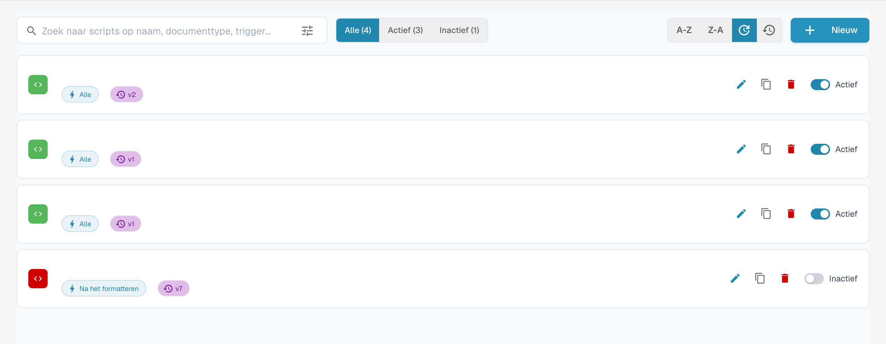
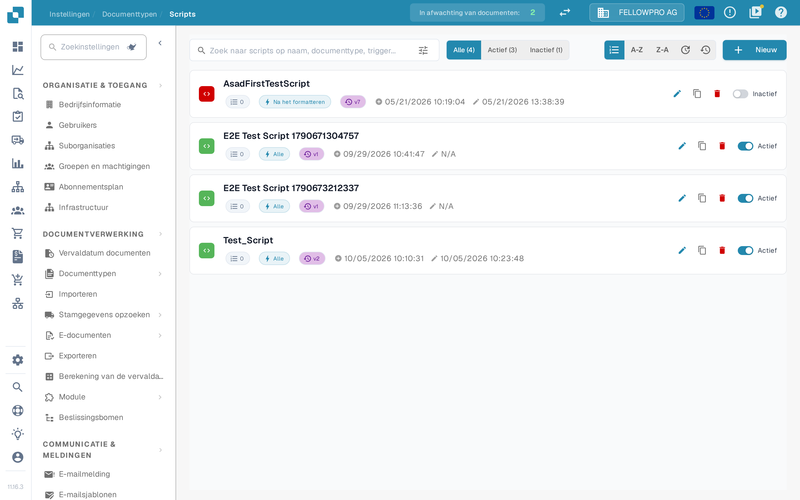
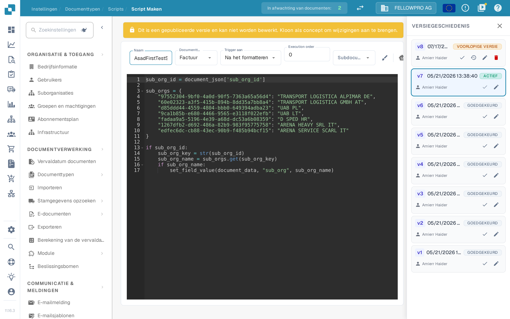

# Scripts activeren en beheren

## Videohandleiding: scripts beheren


De scripts van een documenttype beheren


De video toont de scriptlijst met filter en sortering, activeren en deactiveren, kopiëren, de versiegeschiedenis en verwijderen met bevestiging.

Open het documenttype en het bijbehorende scriptbeheer. De lijst toont scripts en acties voor bewerken, kopiëren en status. Namen zijn in het voorbeeld afgeschermd.

<figure><figcaption>
Scriptbeheer en bewerkingsacties; namen zijn afgeschermd.
</figcaption></figure>

Filter op status of zoek het bedoelde script voordat u het opent. Controleer documenttype, uitvoeringsmoment en code voordat u opslaat.

De lijst staat standaard op uitvoeringsvolgorde; met de sorteerknoppen schakelt u naar naam (A-Z / Z-A) of naar de wijzigingsdatum. Elke kaart toont de uitvoeringsvolgorde als genummerd label naast de naam van het script.

<figure><figcaption>
Het genummerde label op elke kaart is de uitvoeringsvolgorde van het script.
</figcaption></figure>

## Uitvoeringsvolgorde instellen

Met het veld **Execution order** bepaalt u in welke volgorde scripts lopen: lagere nummers lopen eerst. Het veld blijft ook in de Nederlandse interface Engels gelabeld.

1. Open het script in de editor.
2. Vul in het veld **Execution order** een heel getal vanaf 0 in. Laat het veld leeg om 0 te behouden.
3. Sla het script op. Letters, decimalen en negatieve getallen worden met een foutmelding bij het veld geweigerd en er wordt niets opgeslagen.

Als u de uitvoeringsvolgorde wijzigt en daarna een versie activeert, slaat DocBits eerst het script op en activeert de versie pas als dat opslaan is gelukt.

<figure><figcaption>
De uitvoeringsvolgorde in de scripteditor.
</figcaption></figure>

De beschikbare acties hangen af van uw rechten. Test bedoelde wijzigingen met representatieve documenten voordat u ze in een echte workflow gebruikt.
