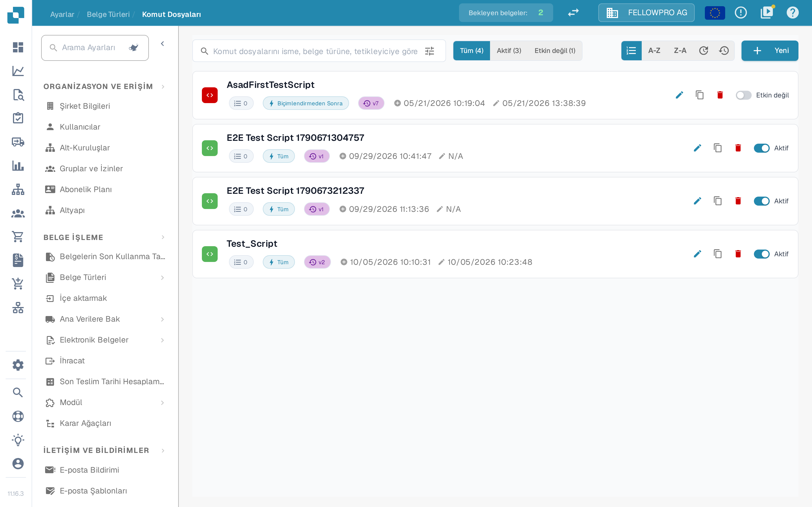
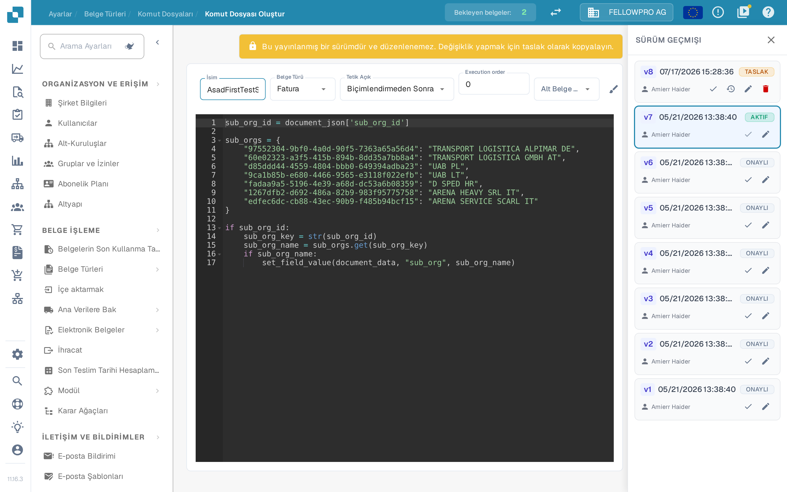

# Script Etkinleştirme ve Yönetimi

Yöneticiler, bir belge türünün işleme kurallarını yönetmek için **script** kullanabilir. Bu kılavuz scriptlerin nerede bulunduğunu, nasıl açılıp kapatıldığını ve yayımlanmış bir scriptin güvenle nasıl değiştirileceğini gösterir.

## Script bulma

1. **Ayarlar → Belge Türleri** bölümünü açın.
2. Yönetmek istediğiniz belge türünde **Komut Dosyaları** seçeneğini seçin. Sayfa, bu belge türünün scriptlerini listeler.
3. Ada göre arayın veya listeyi **Tüm**, **Aktif** ve **Etkin değil** ile daraltın. Liste varsayılan olarak yürütme sırasına göre sıralanır; sıralama düğmeleri yürütme sırası, ad (A-Z / Z-A) ve değiştirme tarihi arasında geçiş yapar.

Her kartta scriptin adı, numaralı bir etiket olarak yürütme sırası, tetikleyici, sürüm ve durum görünür. Kalem simgesi düzenleyiciyi açar; kopyalama simgesi scripti çoğaltır. **Yeni** düğmesi yeni bir script için düzenleyiciyi açar.

<figure><figcaption>
Her karttaki numaralı etiket scriptin yürütme sırasıdır.
</figcaption></figure>

## Yürütme sırasını ayarlama

**Execution order** alanı scriptlerin hangi sırada çalışacağını belirler: küçük sayılar önce çalışır. Alan Türkçe arayüzde de İngilizce etiketle görünür.

1. Scripti düzenleyicide açın.
2. **Execution order** alanına 0 veya daha büyük bir tam sayı girin. 0 değerini korumak için alanı boş bırakın.
3. Scripti kaydedin. Harfler, ondalık sayılar ve negatif sayılar alanda bir hata mesajıyla reddedilir ve hiçbir şey kaydedilmez.

Yürütme sırasını değiştirip ardından bir sürümü etkinleştirirseniz DocBits önce scripti kaydeder ve sürümü yalnızca bu kayıt başarılı olduğunda etkinleştirir.

<figure><figcaption>
Script düzenleyicide yürütme sırası.
</figcaption></figure>

## Bir scripti etkinleştirme veya devre dışı bırakma

Script kartındaki **Aktif/Etkin değil** anahtarını kullanın. Değişiklik hemen kaydedilir ve listedeki sayılar sonucu gösterecek şekilde güncellenir. Etkin olmayan bir script incelenebilir veya düzenlenebilir, ancak belge işleme sırasında çalışmaz.

## Mevcut bir scripti değiştirme

1. Script kartını veya kalem simgesini seçin. Yayımlanmış bir sürüm salt okunurdur, bu nedenle doğrudan üzerine yazamazsınız.
2. **Sürüm Geçmişi** bölümünde değiştirmek istediğiniz sürümün kalem simgesini seçin. Bu, o sürüme dayanan bir **Taslak** oluşturur.
3. Taslağı düzenleyin ve kaydet simgesini seçin. Kaydetmeden önce adı, belge türünü, tetikleyiciyi ve kodu kontrol edin.
4. Değiştirilen scripti bir test ortamında temsili belgelerle deneyin. Hazır olduğunda **Sürüm Geçmişi**'ndeki taslağın onay simgesini seçerek o sürümü etkin yapın.
5. Script listesine dönün ve kartın **Aktif/Etkin değil** anahtarını kontrol edin. Sürüm Geçmişi'nde **AKTİF** olarak işaretlenen sürüm seçili sürümü gösterir; karttaki anahtar scriptin çalışıp çalışmadığını belirler.

Script örnekleri ve kullanılabilir fonksiyonlar için bkz. [DocBits'te Scripting](scripting-in-docbits/README.md).
