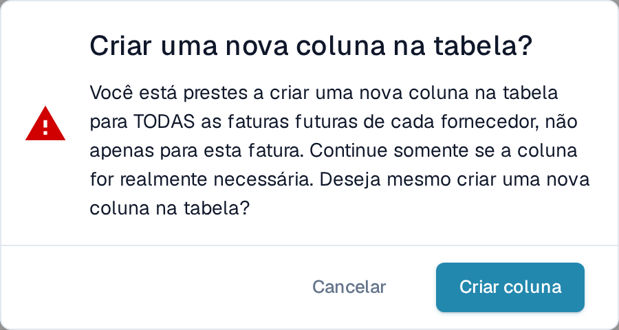

# Adicionando uma nova coluna

Adicione uma coluna quando um valor precisar ser capturado por item de linha e as colunas padrão não o cobrirem, como um centro de custo, um número de projeto ou um número de artigo interno.

## Antes de começar

* Decida a qual **tabela** a coluna pertence. A maioria dos tipos de documento tem uma tabela (por exemplo, `INVOICE_TABLE`). Se a lista estiver vazia, clique primeiro em **Create new table**; a caixa de diálogo pede apenas um nome de tabela.
* Decida o **tipo**: `AMOUNT` para valores monetários, `NUMBER` para quantidades, `DATE`, `BOOLEAN` para sim/não, `CURRENCY` para um código de moeda ISO e `STRING` para todo o resto. O tipo não pode ser alterado depois de salvar.
* Verifique se já existe uma **coluna padrão** com o mesmo significado, mas oculta. As colunas ocultas aparecem na lista com o indicador *Hidden* ativado; reexiba-a em vez de criar uma duplicata.

## Etapas

1. Abra **Settings → Global Settings → Document Types → Table Columns**.
2. Clique em **Add new table column**.

<figure><figcaption>
Add new table column
</figcaption></figure>

3. Preencha a caixa de diálogo:

| Campo | O que informar |
|---|---|
| **Title** | Rótulo que o usuário vê na tela de validação, por exemplo `Cost Centre`. Somente letras e números. O DocBits deriva dele o *Column name* técnico (`COST_CENTRE`). |
| **Is column required?** | Marque quando o documento não puder ser aprovado enquanto a coluna estiver vazia em qualquer linha. |
| **Select column type** | Consulte a lista de tipos acima. |
| **Select Table** | A tabela que receberá a coluna. |

4. Clique em **Prosseguir**. Uma caixa de confirmação lembra que a nova coluna vale para **todas as faturas futuras de todos os fornecedores**, não apenas para o documento aberto.

<figure><figcaption>
Confirme antes de a coluna ser criada para todos os fornecedores.
</figcaption></figure>

5. Selecione **Criar coluna** para salvar, ou **Cancelar** para voltar sem criar nada. A coluna aparece na lista com *Read Only*, *Hidden* e *Use AI* desativados. Altere esses indicadores na lista, se necessário; consulte [Editando e excluindo colunas](editing-and-deleting-columns.md).

## Depois de adicionar

* A coluna fica **vazia nos documentos existentes**. Ela é preenchida nos documentos enviados ou reiniciados após a alteração.
* Para fornecedores com **regras treinadas**, abra um dos documentos deles no treinamento de tabelas e mapeie a nova coluna; caso contrário, a coluna permanece vazia para esse fornecedor. Consulte [Defining tables and columns](../../../../setup/document-training/training-line-fields-table-training/defining-tables-and-columns.md).
* Com a **extração de tabela por IA**, a IA preenche a coluna se o valor for reconhecível no documento. Marque a coluna com *Use AI* se o fornecedor tiver regras treinadas, mas esta coluna ainda deva vir da IA.
* Adicione a coluna ao **mapeamento de exportação** se o ERP deve recebê-la; consulte [Export](../../../document-processing/export.md).

## Mensagens

| Mensagem | Significado |
|---|---|
| *Column name already exists* | Já existe na tabela uma coluna com este nome técnico. Escolha outro título. |
| *Column name already exists – Please activate it in Table Column settings* | Uma coluna padrão oculta tem este nome. Desative o indicador *Hidden* dela em vez de criar uma nova. |
| *No table exists. Please create table before creating columns.* | O tipo de documento ainda não tem tabela: clique primeiro em **Create new table**. |
