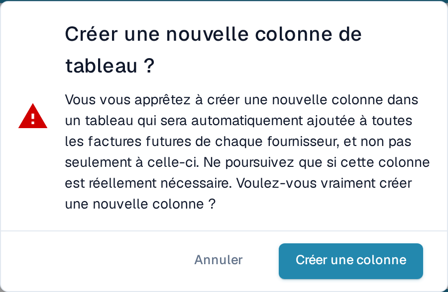

# Ajouter une nouvelle colonne

Ajoutez une colonne lorsqu'une valeur doit être saisie pour chaque ligne et que les colonnes par défaut ne la couvrent pas : un centre de coûts, un numéro de projet, un numéro d'article interne.

## Avant de commencer

* Décidez à quelle **table** appartient la colonne. La plupart des types de document ont une seule table (par exemple `INVOICE_TABLE`). Si la liste est vide, cliquez d'abord sur **Create new table** ; la boîte de dialogue demande uniquement un nom de table.
* Décidez du **type** : `AMOUNT` pour les montants, `NUMBER` pour les quantités, `DATE`, `BOOLEAN` pour oui/non, `CURRENCY` pour un code de devise ISO, `STRING` pour tout le reste. Le type ne peut plus être modifié après l'enregistrement.
* Vérifiez si une **colonne par défaut** de même signification existe déjà mais est masquée. Les colonnes masquées apparaissent dans la liste avec l'indicateur *Hidden* activé ; réaffichez-la au lieu de créer un doublon.

## Étapes

1. Ouvrez **Settings → Global Settings → Document Types → Table Columns**.
2. Cliquez sur **Add new table column**.

<figure><figcaption>
Add new table column
</figcaption></figure>

3. Remplissez la boîte de dialogue :

| Champ | Ce qu'il faut saisir |
|---|---|
| **Title** | Libellé que l'utilisateur voit sur l'écran de validation, par exemple `Cost Centre`. Lettres et chiffres uniquement. DocBits en déduit le *Column name* technique (`COST_CENTRE`). |
| **Is column required?** | Cochez si le document ne doit pas être approuvé tant que la colonne est vide dans une ligne quelconque. |
| **Select column type** | Voir la liste des types ci-dessus. |
| **Select Table** | La table qui reçoit la colonne. |

4. Cliquez sur **Continuer**. Une boîte de confirmation rappelle que la nouvelle colonne s'applique à **toutes les futures factures de chaque fournisseur**, et pas seulement au document ouvert.

<figure><figcaption>
Confirmez avant que la colonne ne soit créée pour tous les fournisseurs.
</figcaption></figure>

5. Sélectionnez **Créer une colonne** pour enregistrer, ou **Annuler** pour revenir sans rien créer. La colonne apparaît dans la liste avec *Read Only*, *Hidden* et *Use AI* désactivés. Modifiez ces indicateurs dans la liste si nécessaire, voir [Modifier et supprimer des colonnes](editing-and-deleting-columns.md).

## Après l'ajout

* La colonne est **vide sur les documents existants**. Elle est remplie sur les documents téléversés ou redémarrés après la modification.
* Pour les fournisseurs avec des **règles entraînées**, ouvrez l'un de leurs documents dans l'entraînement de tableau et associez la nouvelle colonne, sinon la colonne reste vide pour ce fournisseur. Voir [Defining tables and columns](../../../../setup/document-training/training-line-fields-table-training/defining-tables-and-columns.md).
* Avec l'**extraction de tableau par IA**, l'IA remplit la colonne si la valeur est reconnaissable sur le document. Cochez *Use AI* pour la colonne si le fournisseur a des règles entraînées mais que cette colonne doit tout de même provenir de l'IA.
* Ajoutez la colonne au **mapping d'export** si l'ERP doit la recevoir, voir [Export](../../../document-processing/export.md).

## Messages

| Message | Signification |
|---|---|
| *Column name already exists* | Une colonne portant ce nom technique existe déjà dans la table. Choisissez un autre titre. |
| *Column name already exists – Please activate it in Table Column settings* | Une colonne par défaut masquée porte ce nom. Désactivez son indicateur *Hidden* au lieu d'en créer une nouvelle. |
| *No table exists. Please create table before creating columns.* | Le type de document n'a pas encore de table : cliquez d'abord sur **Create new table**. |
