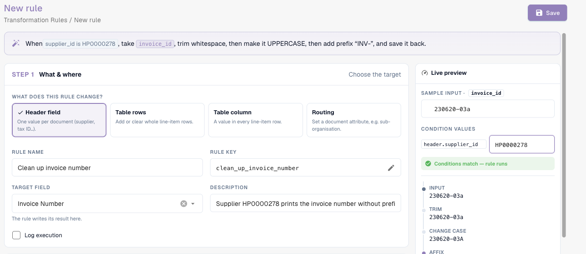
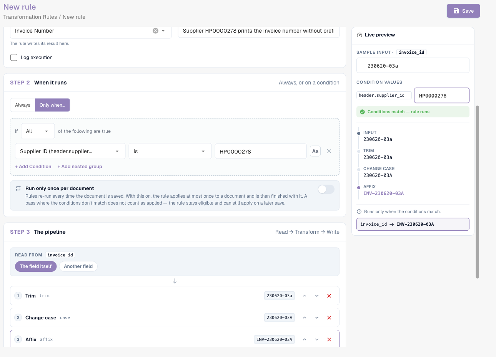
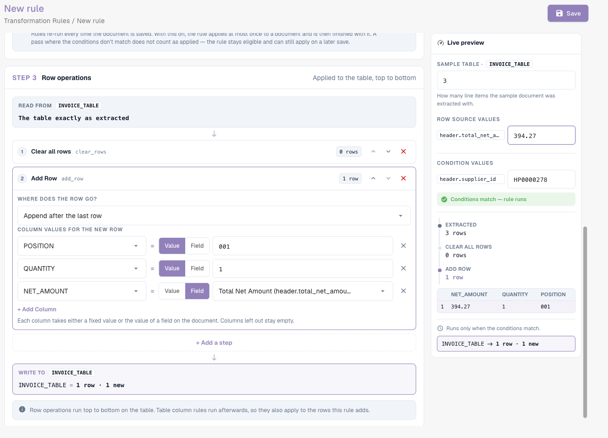
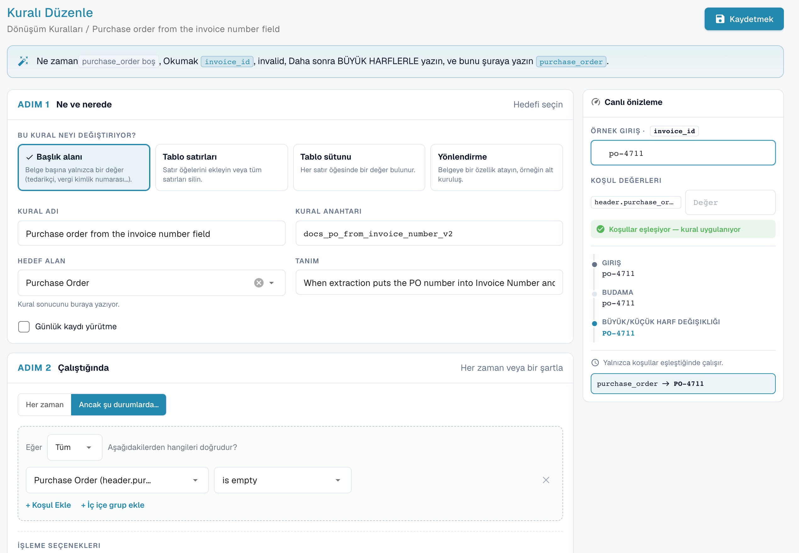
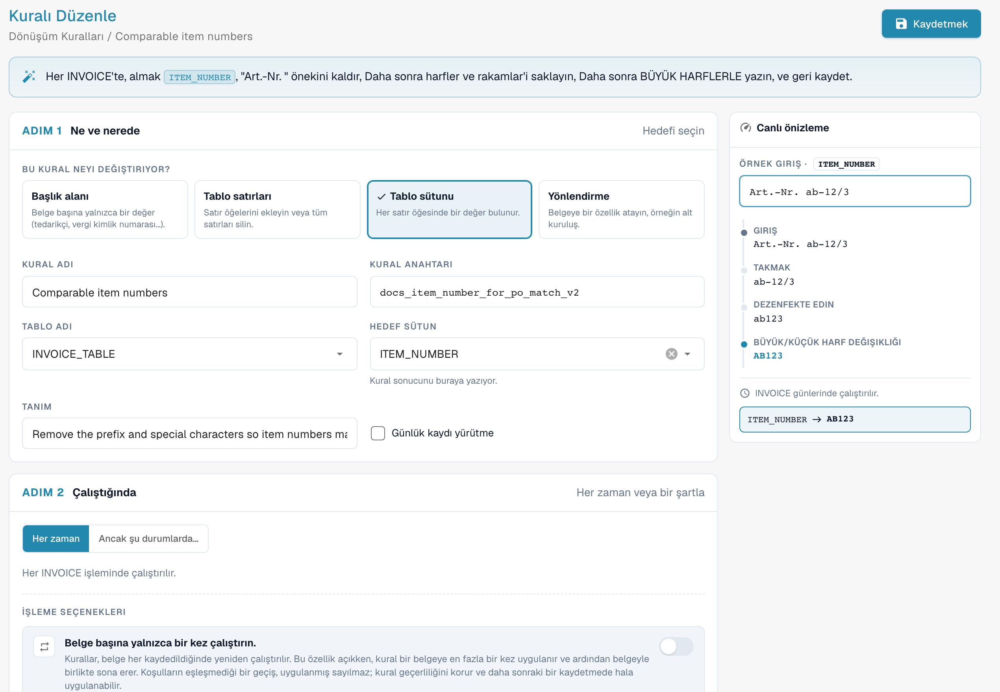

# Dönüşüm Kuralları

## Genel Bakış

Dönüşüm kuralları, çıkarılan verileri her belge işlendiğinde ve her kaydedildiğinde **otomatik olarak** temizler veya yeniden yazar. Bir kural şunları değiştirebilir:

* bir **başlık alanını** (fatura numarası, para birimi, tedarikçi vergi kimlik numarası …),
* bir tablonun her satırındaki bir **sütunu** (birim, kalem numarası, fiyat temeli …),
* bir tablonun **satırlarını** (satırları temizleme, satır ekleme),
* **belgenin bir özniteliğini** — şu anda belgenin ait olduğu alt organizasyonu (**Yönlendirme**).

Her kural bir değeri **okur**, kısa bir **işlem hattından** (pipeline) geçirir ve sonucu geri **yazar**. Kurallar doğrulamadan, betiklerden ve satın alma siparişi eşleştirmesinden **önce** çalışır; böylece sonraki tüm işlemler zaten düzeltilmiş değerleri görür.

Dönüşüm kuralları, kuruluşların eskiden "bu alanı her zaman kırp", "bu tedarikçinin birim kodlarını eşleştir", "ERP'mizin beklediği öneki ekle" veya "bu tedarikçinin satırlarını tek bir toplam satırda birleştir" gibi ihtiyaçlar için yazdığı küçük betiklerin çoğunun yerini alır — bir form, canlı bir önizleme ile ve kod yazmadan.

### Çözdüğü sorunlar

| Gereksinim | Kural |
| --- | --- |
| Bir tedarikçi fatura numarasını ERP'mizin beklediği `INV-` öneki olmadan yazdırıyor | *Fatura Numarası* başlık alanı, yalnızca bu tedarikçi için: Budama → BÜYÜK HARF → Takmak: `INV-` öneki ekle |
| Tedarikçiler Almanca birim kodları (`STK`, `Std`) gönderiyor, ERP ise UN/ECE kodlarını (`PCE`, `HUR`) bekliyor | *UNIT* tablo sütunu: Değer eşleme `STK → PCE`, `KG → KGM`, `Std → HUR` |
| Kalem numaraları `Art.-Nr. 4711` gibi bir önekle geliyor | *ITEM_NUMBER* tablo sütunu: Takmak: `Art.-Nr. ` önekini çıkar |
| Vergi kimlik numaraları boşluk ve nokta içeriyor | *Tedarikçi Vergi Kimlik No* başlık alanı: Dezenfekte edin, yalnızca alfanümerik karakterleri koru |
| Bir tedarikçi satırlar üzerinden değil, toplam üzerinden eşleştiriliyor | Tablo satırları: Tüm satırları temizle → Net tutarla bir satır ekle |
| Belirli tedarikçilerin tüm belgeleri bir alt organizasyona ait | Yönlendirme: *Tedarikçi Kimliği şunlardan biri …* olduğunda alt organizasyonu ayarla |
| Tarihler serbest metin alanına sabit bir biçimde yazılmalı | Başlık alanı: Tarihi yeniden biçimlendir `%d.%m.%Y` |
| Satın alma siparişi numarası yanlış alanda duruyor (örneğin *Fatura Numarası* içinde) | *Satın Alma Siparişi* başlık alanı: *Fatura Numarası* alanından oku, yalnızca *Satın Alma Siparişi boş* olduğunda |
| Satın alma siparişi numarasında, siparişte bulunmayan baştaki sıfırlar veya bir önek var | *Satın Alma Siparişi* başlık alanı: Soldan `0` karakterini buda veya Takmak: öneki çıkar |
| Kalem numaraları, satın alma siparişi satırlarından büyük/küçük harf, boşluk veya önek bakımından farklı | *ITEM_NUMBER* tablo sütunu: Takmak: öneki çıkar → Dezenfekte edin → BÜYÜK HARF |


Özellik beta aşamasındayken, aşağıda açıklanan ayarlar yalnızca **Belge Türleri** ayar sayfası adresin sonuna `?beta=true` eklenerek açıldığında görünür.


## Dönüşüm kurallarını etkinleştirme

Dönüşüm kuralları **belge türü başına** bir **kuruluş yöneticisi** tarafından açılır.

1. **Ayarlar → Genel Ayarlar → Belge Türleri** yolunu izleyin.
2. Belge türü kartındaki **ayarlar** (dişli) simgesine tıklayın.
3. **Dönüşüm Kuralları** bölümünü açın ve anahtarı açın. Listeyi açmak için **Dönüşüm kurallarını yönet** seçeneğine tıklayın.

<figure><figcaption>
Bir belge türünün ek ayarlarındaki Dönüşüm Kuralları anahtarı
</figcaption></figure>

Belge türünün kartında artık bir **Dönüşüm Kuralları** bağlantısı ve çalıştırma kayıtları için bir **Günlükler** bağlantısı görünür.

## Kural listesi

Liste, belge türünün tüm kurallarını çalışma sırasına göre gösterir. Her kural için tek cümlelik bir özet ("invoice_id abcd olduğunda, invoice_id değerini al, BÜYÜK HARFE çevir ve geri kaydet."), kapsamı (**Başlık**, **Tablo**, **Sütun**, **Yönlendirme**), adım sayısı, kaynağı ve **Günlük kaydı yürütme** seçeneğinin açık olup olmadığı gösterilir. Kapsama ve **Aktif / Pasif** durumuna göre filtreleyebilir, arama yapabilir ve bir kuralı çoğaltmak veya silmek için **⋮** menüsünü kullanabilirsiniz.

Kurallar, doğrulama kurallarında olduğu gibi üç kaynaktan gelir: DocBits ile birlikte gelen **Sistem varsayılanı** kuralları (düzenlenebilir bir kopya almak için **Özelleştir** seçeneğine tıklayın), **Özelleştirilmiş** sistem kuralları (**Varsayılana Sıfırla** orijinali geri yükler) ve sizin oluşturduğunuz **Özel** kurallar.

## Kural oluşturma

**Yeni kural** seçeneğine tıklayın. Oluşturucunun solda üç adımı, sağda bir **Canlı önizlemesi** vardır. En üstte, kuralı siz oluştururken tek cümleyle özetler.

<figure><figcaption>
1. adım: Kuralın neyi değiştirdiği. En üstteki cümle kuralı sade bir dille açıklar
</figcaption></figure>

### Adım 1 — Ne ve nerede

**Bu kural neyi değiştiriyor?** — kapsam:

| Kapsam | Değiştirdiği | Hedef | Çalışma sıklığı |
| --- | --- | --- | --- |
| **Başlık alanı** | belge başına tek bir değer | bir başlık alanı, örn. *Fatura Numarası* | belge başına bir kez |
| **Tablo satırları** | tüm kalem satırları — satırları temizleme veya satır ekleme | bir tablo, örn. `INVOICE_TABLE` | belge başına bir kez |
| **Tablo sütunu** | her kalem satırındaki bir değer | bir tablo ve bir sütun, örn. `INVOICE_TABLE` / `UNIT` | satır başına bir kez |
| **Yönlendirme** | belgenin bir özniteliği — şu anda alt organizasyon | *alt organizasyon* | belge başına bir kez |

Ardından **Kural adı** girin (**Kural anahtarı** bundan oluşturulur), **Hedef alan** / **Tablo adı** / **Hedef sütun** seçimini yapın ve isteğe bağlı olarak bir **Tanım** ekleyin. **Günlük kaydı yürütme**, her uygulama için bir kayıt girdisi yazar — bir kuralı ayarlarken faydalıdır.

### Adım 2 — Çalıştığında

* **Her zaman** — kural, türdeki her belgede çalışır.
* **Ancak şu durumlarda…** — kural yalnızca bir koşul doğruysa çalışır, örneğin *Tedarikçi Kimliği HP0000278 ise*. **Tablo sütunu** kurallarında koşul, geçerli satırın sütunlarını kullanabilir ve satır satır denetlenir. Tüm alanlar, operatörler ve örnekler için bkz. [Kural Koşulları (Uygulanma koşulu)](rule-conditions-applies-when.md).

İki seçenek, kuralın ne sıklıkla uygulanacağını belirler:

| Seçenek | Etkisi |
| --- | --- |
| **Belge başına yalnızca bir kez çalıştırın** (Run only once per document) | Normalde kurallar her kayıtta yeniden çalışır. Bu seçenek açıkken kural bir belgeye **en fazla bir kez** uygulanır ve ardından o belgeyle işi biter. Koşulların eşleşmediği bir geçiş uygulanmış sayılmaz; böylece kural daha sonraki bir kayıtta yine uygulanabilir. Her kayıtta değeri tekrar değiştirecek adımlar için ([İdempotentlik](#bir-kez-calistir-ve-idempotentlik) bölümüne bakınız) ve satırları tekrar oluşturmaması gereken tablo kuralları için gereklidir. |
| **Arama verisi doldurulduktan sonra çalıştır (SA eşleştirmesinden önce)** (Run after lookup population (before PO match)) | *(yeni sürümler)* Kuralı, arama verileri (örneğin tedarikçi ana verileri) doldurulduktan sonra ve satın alma siparişi eşleştirmesinden önce ek bir geçişte çalıştırır. Kuralın, bir aramanın sağladığı bir değere ihtiyacı olduğunda kullanın. Kural yine olağan aşamalarda da çalışır; bu seçenekle bir kez çalışan bir kural, çıkarmanın hemen ardından çalışmak yerine bu geçişi bekler. |

### Adım 3 — İşlem hattı

<figure><figcaption>
Oku → Budama → Büyük/küçük harf değişikliği → Takmak → Yaz; her adımdan sonraki değer canlı önizlemede görünür
</figcaption></figure>

* **Şuradan oku** — **alanın (veya sütunun) kendisi** ya da **başka bir alan**. Başka bir alandan okumak, bir alanı diğerinden doldurmanızı sağlar; örneğin satın alma siparişi numarasını bir serbest metin alanından kopyalamak.
* **Adımlar** — değer adımlardan **yukarıdan aşağıya** geçer; bir adımın çıktısı bir sonrakinin girdisidir. **+ Adım ekle** ile adım ekleyin, okları kullanarak sırasını değiştirin, **✕** ile kaldırın. Her adım, örneğin ara değerini sağında gösterir.
* **Şuraya yaz** — 1. adımdaki hedef. DocBits saklanan değeri yazar ve ardından görüntülenen değeri otomatik olarak yeniler.

### Adımlar

<figure><figcaption>
Tüm adımlar, amaçlarına göre gruplandırılmış
</figcaption></figure>

Adım adları, uygulamanın Türkçe arayüzünde gösterildiği gibi verilmiştir; parantez içinde İngilizce adı yer alır.

| Adım | Ayarlar | Örnek girdi → çıktı |
| --- | --- | --- |
| **Büyük/küçük harf değişikliği** (Change case) | BÜYÜK HARF, küçük harf, Başlık Biçimi, İlk harfi büyüt | `inv-4711` → `INV-4711` |
| **Budama** (Trim) | taraf (her ikisi, sol, sağ); karakterler (boş = boşluk) | `  4711 ` → `4711`; `0` karakteri ve sol taraf ile: `004711` → `4711` |
| **Doldurma** (Pad) | uzunluk, dolgu karakteri, taraf | uzunluk 10, `0`, sol: `4711` → `0000004711` |
| **Kısaltma** (Truncate) | en fazla uzunluk | 10: `ABCDEFGHIJKL` → `ABCDEFGHIJ` |
| **Takmak** (Affix) | önek ekle, sonek ekle, öneki çıkar, soneki çıkar; metin | `INV-` öneki ekle: `4711` → `INV-4711`; `Art.-Nr. ` öneki çıkar: `Art.-Nr. 4711` → `4711` |
| **Dezenfekte edin** (Sanitise) | yalnızca şunları koru (alfanümerik, harfler, rakamlar, alfanümerik + boşluk) veya verilen karakterleri çıkar | alfanümerik koru: `DE 123.456.789` → `DE123456789` |
| **Dilim al** (Take a slice) | başlangıç, uzunluk veya bitiş | başlangıç 0, uzunluk 4: `2026-09-29` → `2026` |
| **Ayıkla** (Extract) | desen, yakalama grubu | desen `PO[- ]?(\d+)`, grup 1: `Order PO-45001234` → `45001234` |
| **Bul ve değiştir** (Find & replace) | desen, şununla değiştir, adet (0 = tümü) | desen `\s+`, şununla değiştir ` `: `ACME    GmbH` → `ACME GmbH` |
| **Değer eşle** (Map values) | eşlemeler (kaynak → hedef), eşleşme yoksa değer (boş = girdiyi koru), büyük/küçük harfi yoksay | `STK → PCE`: `stk` → `PCE` |
| **Tarihi yeniden biçimlendir** (Reformat date) | çıktı deseni (`%d.%m.%Y`, `%m/%d/%Y`, `%Y-%m-%d`, `%d %b %Y`) | `%d.%m.%Y`: `2026-09-29` → `29.09.2026` |
| **Sayıyı biçimlendir** (Format number) | yerel ayar (de_DE, en_US, en_GB, fr_FR), en az ve en fazla ondalık basamak | de_DE, 2 ondalık: `1234.5` → `1.234,50` |
| **Sabit değer** (Fix value) | değer | alan ne içerirse içersin her zaman bu değeri yazar |
| **Temizle** (Clear) | – | alanı boşaltır |

**Tablo satırları** kuralları, değerler yerine satırlar üzerinde çalışan iki farklı adım kullanır:

| Adım | Etkisi |
| --- | --- |
| **Tüm satırları temizle** (Clear all rows) | çıkarılan tüm satırları siler. Sonraki bir adımın eklediği satırlar korunur. |
| **Satır ekle** (Add a row) | **son satırdan sonra** veya **ilk satırdan önce** bir satır ekler. Her sütun için **Değer** (sabit bir değer) veya **Alan** (bir başlık alanının değeri) seçin. Dışarıda bıraktığınız sütunlar boş kalır. |


**Tarihi yeniden biçimlendir**, tarihin DocBits'in dahili olarak sakladığı biçimde (`YYYY-MM-DD`) olmasını bekler. Bunu alanın kendisine uygulayın; biçimlendirilmiş bir tarih içeren bir metne uygulamayın.


### Canlı önizleme

Canlı önizleme, kuralı siz oluştururken bir örnek üzerinde çalıştırır:

* **Örnek giriş** — bir değeri belgeden geleceği gibi yazın. Tablo kuralları için çıkarılan satır sayısını (**Örnek tablo**) ve yeni satırların okuduğu alanların değerlerini (**Satır kaynak değerleri**) girin.
* **Koşul değerleri** — koşullu kurallar için koşul alanlarının değerlerini yazın. Önizleme **Koşullar eşleşiyor — kural uygulanıyor** veya **Koşullar eşleşmiyor — kural atlanıyor** mesajını gösterir.
* Aşağıda, **her adımdan** sonraki değeri ve yazılacak nihai sonucu görürsünüz ("invoice_id → INV-230620-03A" veya "değişmedi").

Önizlemeyi kullanırken hiçbir şey kaydedilmez. Kuralı saklamak için **Kaydetmek** düğmesine tıklayın.

## Örnekler

### Bir tedarikçinin fatura numarasını temizleme

**Fatura Numarası** başlık alanı · yalnızca *Tedarikçi Kimliği HP0000278 ise* · Budama → Büyük/küçük harf değişikliği BÜYÜK HARF → Takmak: `INV-` öneki ekle.
Örnek `  230620-03a ` → `INV-230620-03A`. Yukarıdaki işlem hattı ekran görüntüsüne bakın.

### Birim kodlarını eşleme

**INVOICE_TABLE / UNIT** tablo sütunu · her zaman · Budama → Değer eşle `STK → PCE`, `KG → KGM`, `Std → HUR`, **Eşleştirirken büyük/küçük harfi yoksay** açık, eşleşme yoksa değer boş (girdiyi koru).

<figure><figcaption>
UNIT sütununda Değer eşle: <code>stk</code> değeri <code>PCE</code> olur
</figcaption></figure>

### Toplam üzerinden eşleşen tedarikçi için tek toplam satır

**INVOICE_TABLE** tablo satırları · yalnızca *Tedarikçi Kimliği HP0000278 ise* · Tüm satırları temizle → `POSITION` = değer `001`, `QUANTITY` = değer `1`, `NET_AMOUNT` = alan *Toplam Net Tutar* ile bir satır ekle.

<figure><figcaption>
Çıkarılan üç satırın yerini, net tutarı taşıyan tek bir satır alır
</figcaption></figure>

Sıra önemlidir: **Tüm satırları temizle** adımı **Satır ekle** adımından **önce** gelmelidir. Oluşturucu, sıra yanlışsa sizi uyarır ("Tüm satırları temizle, Satır ekle adımından sonra çalışıyor …") ve ayrıca bir **Satır ekle** adımının öncesinde **Tüm satırları temizle** yoksa da uyarır; çünkü kural aksi halde her kayıtta satırın bir kopyasını daha ekler. Bu kuralı, tek satırlı belgeler için etkin olan, toplam üzerinden eşleştiren bir satın alma siparişi eşleştirme kuralıyla birlikte kullanın.

### Satın alma siparişini fatura numarası alanından doldurma

**Satın Alma Siparişi** başlık alanı · yalnızca *Satın Alma Siparişi boş ise* · **Şuradan oku** *Fatura Numarası* → Budama → Büyük/küçük harf değişikliği BÜYÜK HARF.

<figure><figcaption>
Kural ve canlı önizlemesi: <code>po-4711</code> değeri <code>purchase_order</code> alanında <code>PO-4711</code> olur. Bir test belge türü üzerinde örnek kural.
</figcaption></figure>

Bazı tedarikçiler sipariş numarasını, çıkarmanın fatura numarasını beklediği yere yazdırır. Bu durumda **Fatura Numarası** satın alma siparişi numarasını içerir, **Satın Alma Siparişi** boştur ve satın alma siparişi eşleştirici eşleştirecek bir şey bulamaz. Bu kural, eşleştirme başlamadan önce değeri kopyalar. Bir geliştirme sisteminde yapılan testte, tam olarak bu sorunu yaşayan bir belge, kural ile kaydedildiğinde *eşleşmedi* durumundan *tam eşleşti* (2 satırın 2'si) durumuna geçti. Kural yalnızca **Satın Alma Siparişi** boşken çalışır; bu nedenle doğru çıkarılmış bir numaranın üzerine asla yazmaz.

### Kalem numaralarını satın alma siparişi eşleştirmesi için karşılaştırılabilir yapma

**INVOICE_TABLE / ITEM_NUMBER** tablo sütunu · her zaman · Takmak: `Art.-Nr. ` öneki çıkar → Dezenfekte edin: alfanümerik koru → Büyük/küçük harf değişikliği BÜYÜK HARF.

<figure><figcaption>
Canlı önizleme her adımı gösterir: <code>Art.-Nr. ab-12/3</code> değeri <code>AB123</code> olur
</figcaption></figure>

Fatura `Art.-Nr. ab-12/3` yazıyor ve satın alma siparişinde `AB123` varsa, satırlar eşleşmez. Kural, fatura değerini satın alma siparişinin biçimine getirir. Satın alma siparişlerinizin kullandığı biçimi kontrol edin ve adımları buna göre uyarlayın.

### Diğer örnekler

| Hedef | Kapsam | Koşul | Adımlar |
| --- | --- | --- | --- |
| Vergi kimlik numarasından boşlukları ve noktaları kaldırma | Başlık *Tedarikçi Vergi Kimlik No* | her zaman | Dezenfekte edin: alfanümerik koru |
| Ürün önekini çıkarma | Sütun *ITEM_NUMBER* | her zaman | Takmak: `Art.-Nr. ` öneki çıkar |
| 10 haneli tedarikçi numaraları | Başlık *Tedarikçi Kimliği* | her zaman | Budama → Doldurma: uzunluk 10, `0` ile, sol |
| Satın alma siparişi numarasını bir referans metninden alma | Başlık *Satın Alma Siparişi*, başka bir alandan oku | yalnızca *Satın Alma Siparişi boş ise* | Ayıkla `PO[- ]?(\d+)`, grup 1 |
| Bir tedarikçi için her zaman tek bir para birimi kullanma | Başlık *Para Birimi* | yalnızca *Tedarikçi Kimliği 10040 ise* | Sabit değer `CHF` |
| Yanlış çıkarılmış bir değeri kaldırma | Başlık *İskonto Koşulu* | yalnızca *Tedarikçi Kimliği 20723 ise* | Temizle |
| Birim başına fiyat temeli | Sütun *UNIT_PRICE_PER* | yalnızca *row.UNIT_PRICE_PER boş ise* | Sabit değer `1` |
| Tedarikçileri bir alt organizasyona yönlendirme | Yönlendirme | *Tedarikçi Kimliği şunlardan biri* `10040, 10041` | sabit bir alt organizasyon ata |
| Satın alma siparişi numarasındaki baştaki sıfırları kaldırma | Başlık *Satın Alma Siparişi* | her zaman | Budama: `0` karakteri, sol taraf |
| Satın alma siparişi numarasının yalnızca rakamlarını tutma | Başlık *Satın Alma Siparişi* | her zaman | Dezenfekte edin: yalnızca rakamları koru (`PO-45001234` → `45001234`) |
| Çok uzun bir satın alma siparişi referansını kısaltma | Başlık *Satın Alma Siparişi* | yalnızca *Tedarikçi Kimliği 20723 ise* | Kısaltma: 10 karakter |
| Satın alma siparişi numarasına ERP'nizin beklediği öneki ekleme | Başlık *Satın Alma Siparişi* | yalnızca *Tedarikçi Kimliği 10040 ise* | Takmak: `4500` öneki ekle |
| Tutarları ERP'nizin okuduğu biçimde yazma | Başlık *Toplam Tutar* | her zaman | Sayıyı biçimlendir, yerel ayar `de_DE`, 2 ondalık |
| Kalem numaraları içindeki boşlukları kaldırma | Sütun *ITEM_NUMBER* | her zaman | Dezenfekte edin: ` ` (boşluk) karakterlerini çıkar |
| Kalem numaralarında büyük harf kullanma | Sütun *ITEM_NUMBER* | her zaman | Büyük/küçük harf değişikliği BÜYÜK HARF |
| Bir tesisin satın alma siparişlerini bir alt organizasyona gönderme | Yönlendirme | *Satın Alma Siparişi şununla başlıyor* `4500` | sabit bir alt organizasyon ata |

## Yönlendirme kuralları (alt organizasyon)

Bir **Yönlendirme** kuralı bir alanı değiştirmez. Koşulları eşleştiğinde belgeye bir öznitelik damgalar — şu anda **alt organizasyon**. **Sabit bir alt organizasyon ata** seçeneğini seçip alt organizasyonu listeden seçin veya çıkarılan bir alanın değerlerini alt organizasyonlara eşlemek için **Bir alandan eşle** seçeneğini kullanın. Belge bundan sonra, kullanıcıları, yetkileri ve ayarlarıyla birlikte bu alt organizasyona ait olur. Geçerli bir alt organizasyon olmayan bir değer asla yazılmaz.

## Kurallar ne zaman çalışır

* **İşleme sırasında**, çıkarmadan sonra ve ana veri araması, doğrulama, betikler ve satın alma siparişi eşleştirmesinden önce.
* Çıkarılan verilerin değiştiği belgenin **her kaydında**. **Belge başına yalnızca bir kez çalıştırın** seçeneği olmayan kurallar her seferinde yeniden uygulanır.
* Bir geçiş içinde kurallar kapsam kapsam şu sırayla çalışır: **Başlık → Yönlendirme → Tablo satırları → Tablo sütunu**. Bu nedenle bir sütun kuralı, bir tablo kuralının yeni eklediği satırlara da uygulanır. Bir kapsam içinde kurallar önceliğe göre, ardından anahtara göre çalışır.

### Bir kez çalıştır ve idempotentlik

Çoğu adım, kendi çıktısı üzerinde çalıştığında aynı sonucu verir — kırpılmış bir değeri tekrar kırpmak, `PCE` değerini tekrar eşlemek, zaten var olan bir öneki eklemek gibi. Bu kurallar her kayıtta güvenle çalışabilir.

**Dilim al**, **Ayıkla** ve **Bul ve değiştir** farklıdır: kendi sonuçları üzerinde tekrar çalıştırıldığında değeri değiştirmeye devam ederler (bir dilim, ilk dört karakterin ilk dört karakterini alır …). Bu nedenle DocBits, bu adımları kuralın kendi hedef alanına uygulayan bir kuralı kaydetmenize izin vermez. Şunlardan birini yapın:

* **Belge başına yalnızca bir kez çalıştırın** seçeneğini açın veya
* **Başka bir alandan okuyun**, böylece girdi değişmeden kalır.

## Dönüşüm kuralları ve satın alma siparişi eşleştirme

Kurallar satın alma siparişi eşleştirmesinden **önce** çalışır; bu nedenle eşleştiricinin okuyacağı verileri tam olarak hazırlayabilirler:

| Eşleştiricinin okuduğu | Bir kuralın yapabileceği | Örnek |
| --- | --- | --- |
| Başlıktaki satın alma siparişi numarası | başka bir alandan kopyalamak, bir metinden ayıklamak, önekleri ve baştaki sıfırları kaldırmak | [Satın alma siparişini fatura numarası alanından doldurma](#satin-alma-siparisini-fatura-numarasi-alanindan-doldurma) |
| Satırların kalem numaraları | önekleri çıkarmak, özel karakterleri kaldırmak, büyük/küçük harfi birleştirmek | [Kalem numaralarını karşılaştırılabilir yapma](#kalem-numaralarini-satin-alma-siparisi-eslestirmesi-icin-karsilastirilabilir-yapma) |
| Birim kodları | tedarikçinin kodlarını sizin kodlarınıza eşlemek | [Birim kodlarını eşleme](#birim-kodlarini-esleme) |
| Satır sayısı | satırları tek bir toplam satırda birleştirmek | [Tek toplam satır](#toplam-uzerinden-eslesen-tedarikci-icin-tek-toplam-satir) |

Tablo kuralları ve sütun kuralları, satın alma siparişi eşleştiricinin gördüğünü değiştirir:

* Satırları **yeniden oluşturan** bir tablo kuralı (örneğin tüm satırları temizleyip tek bir toplam satır eklemek), **aynı satırları tekrar ürettiği sürece** mevcut satın alma siparişi eşleşmesini korur — değerler anlamlarına göre karşılaştırılır, bu yüzden `1.0` ve `1.00` aynı satırdır. Satırlar kimliklerini korur ve eşleşme her kayıtta devam eder.
* Bir kural **eşleşmiş satırları değiştirir veya kaldırırsa**, eşleşme korunamaz. Belge bu durumda hangi kuralın eşleşmeyi bozduğunu kaydeder, Satın Alma Siparişi Eşleştirme ekranı bunu neden olarak gösterir ("_Satın alma siparişi eşleşmesi kaydedilemedi: "…" dönüşüm kuralı tabloyu yeniden oluşturdu_") ve yöneticilere kurala bir bağlantı sunar. Belgenin **eşleştirme geçmişi**, ilk eşleştirme aşamasından önce, çalışan kurallarla birlikte bir _Dönüşüm kuralları_ adımı gösterir.
* Kurallardan sonra kalan satır sayısı, eşleştirme kurallarının [etkinleştirme koşulları](more-settings/purchase-order/purchase-order-matching-rules.md#aktivasyon-kosullari) tarafından sayılır. Bir faturayı **tek** satıra indirgeyen bir kural, yalnızca tek satırlı belgeler için etkin olan, toplam üzerinden eşleştiren bir kuralla birlikte anlamlıdır (`[[count(table_lines)]] >= 1`).

## Günlükler

**Günlük kaydı yürütme** açıkken, kuralın her uygulaması **Belge Türleri → (belge türü) → Günlükler** bölümüne yazılır; sonuç (uygulandı, değişiklik yok, atlandı), belge ve — atlanan kurallar için — nedeni açıklayan koşul izi ile birlikte. Bkz. [Günlüklerdeki koşul izini okuma](rule-conditions-applies-when.md#read-the-condition-trace-in-the-logs).

## En iyi uygulamalar

* **Kural başına tek amaç.** "Fatura numarasını temizle" ve "Birim kodlarını eşle" tek kural değil, iki kuraldır.
* **Canlı önizleme ile oluşturun**; belgelerden kopyaladığınız gerçek değerleri, tuhaf olanlar (boşluklar, küçük harf, önekler) dahil kullanın.
* **Tedarikçiye özel kuralları bir koşulla sınırlayın**; her şey üzerinde çalışmalarına izin vermeyin.
* **İdempotent adımları tercih edin.** "Yalnızca bir kez çalıştır" seçeneğini yalnızca gerektiği yerde kullanın.
* Tablo kuralları ekledikten sonra **satın alma siparişi eşleşmesini izleyin**; birkaç belgenin eşleştirme geçmişini kontrol edin.
* Kural çalıştıktan sonra **Günlük kaydı yürütme** seçeneğini kapatın.

## Sorun Giderme

| Belirti | Kontrol Edilecekler |
| --- | --- |
| Kural hiçbir şeyi değiştirmedi | Aktif mi ve özellik belge türü için etkin mi? Koşul bu belge için doğru mu (boşluklar ve büyük/küçük harf dahil tam değer)? Belgeye zaten bir **bir kez çalıştır** kuralı uygulanmış mı? Günlük izini kontrol edin. |
| Değer her kayıtta tekrar değişiyor | İşlem hattında Dilim al, Ayıkla veya Bul ve değiştir var. **Belge başına yalnızca bir kez çalıştırın** seçeneğini açın veya başka bir alandan okuyun. |
| Bir tablo her kayıtta bir satır daha kazanıyor | Öncesinde **Tüm satırları temizle** olmayan bir **Satır ekle** adımı var. Önce temizleme adımını ekleyin veya bir kez çalıştırmayı açın. |
| Satın alma siparişi eşleşmesi kaydettikten sonra kayboluyor | Bir tablo kuralı eşleşmiş satırları değiştirdi. Belgedeki neden kuralı belirtir; kuralı aynı satırları üretecek şekilde düzenleyin veya bir kez çalışacak şekilde ayarlayın. |
| Dönüşümden sonra bir eşleştirme kuralı hiç çalışmıyor | Kural satır sayısını değiştirdi; eşleştirme kuralının etkinleştirme koşulunu ayarlayın. |
| Kuralın tedarikçi ana verilerinden bir değere ihtiyacı var ama değer hâlâ boş | **Arama verisi doldurulduktan sonra çalıştır (SA eşleştirmesinden önce)** seçeneğini açın. |
| Bir tarih yeniden biçimlendirilmiyor | Tarihi yeniden biçimlendir, girdi olarak `YYYY-MM-DD` bekler. |

## İlgili

* [Kural Koşulları (Uygulanma koşulu)](rule-conditions-applies-when.md) — koşullar ayrıntılı olarak
* [Özel Doğrulama Kuralları](custom-validation-rules.md) — dönüştürülmüş değerleri kontrol edin
* [Düzen Seçim Kuralları](layout-manager/layout-selection-rules.md) — bir belgenin kullandığı düzeni seçin
* [Satınalma Siparişi Eşleştirme Kuralları](more-settings/purchase-order/purchase-order-matching-rules.md)
