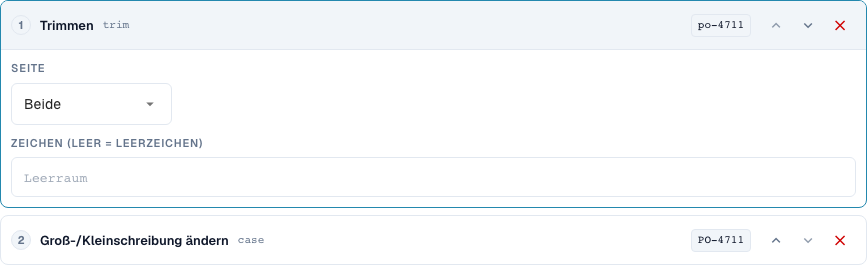
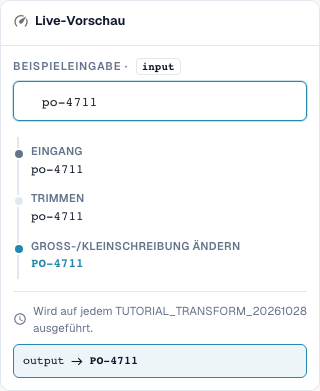
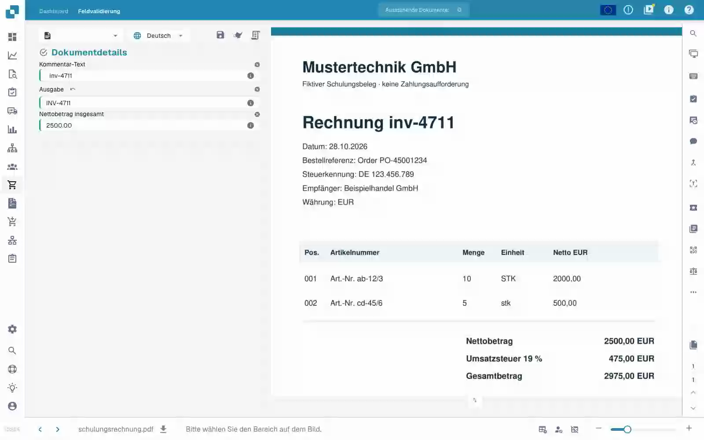

# Grundlagen, Geltungsbereiche und sichere Tests

[Zurück zum vollständigen Praxisüberblick](praxisueberblick.md)

Kopffeld · Ziel Ergebnis · Quelle Originaltext · Trimmen → Großschreibung → Präfix INV-.

## Vorgehen im Editor

1. Im isolierten Schulungs-Dokumenttyp eine neue Regel für ein **Kopffeld** anlegen. Als Ziel `output` und als getrennte Quelle `header.input` wählen; die tatsächlichen Feldnamen Ihrer Organisation können abweichen.
2. Die Schritte **Trimmen**, Seite beide, Zeichen leer und danach **Groß-/Kleinschreibung ändern**, Modus upper, hinzufügen. Die Reihenfolge muss Trimmen → Großschreibung sein.
3. Den Testwert `  inv-4711  ` eingeben. Der letzte Vorschauwert muss `INV-4711` lauten; die Zwischenwerte zeigen zuerst `inv-4711`.
4. Die Regel ausschließlich für den Schulungsumfang aktivieren und speichern. Den Eintrag erneut öffnen und Quelle, Ziel und beide Schritte kontrollieren.
5. Den Übungsbeleg speichern, neu laden und beide Felder prüfen: Die Quelle enthält weiterhin die ursprünglichen Leerzeichen, die Ausgabe lautet `INV-4711`. Nochmals speichern und dieselbe Prüfung wiederholen.

<figure><figcaption>
Konfiguration der Schritte. Originalaufnahme der deutschen Oberfläche. Die Vorschau verändert keine gespeicherten Dokumente.
</figcaption></figure>

<figure><figcaption>
Live-Vorschau mit Schulungswert. Originalaufnahme der deutschen Oberfläche. Die Vorschau verändert keine gespeicherten Dokumente.
</figcaption></figure>

## 1. Geltungsbereich

Eine Transformation verändert bereits extrahierte Daten. Sie ersetzt keine Texterkennung. Im Editor wähle ich zuerst den Geltungsbereich. Ein Kopffeld wird einmal pro Dokument bearbeitet. Eine Tabellenspalte wird für jede Zeile bearbeitet. Tabellenregeln verändern ganze Positionen. Routing ordnet das Dokument einer Unterorganisation zu. Diese vier Aufgaben haben unterschiedliche Ziele und unterschiedliche Schritte. Ich lege meine Beispiele auf einem eigenen Testdokumenttyp an, damit keine produktiven Rechnungen verändert werden.

## 2. Quelle und Verarbeitung

Danach wähle ich das Zielfeld. Die Quelle kann dieses Feld selbst oder ein anderes Feld sein. Die Schritte laufen von oben nach unten. Jeder Zwischenwert wird zur Eingabe des nächsten Schritts. Mein Beispiel liest eine Rechnungsnummer, entfernt äußere Leerzeichen und schreibt Großbuchstaben. Aus einem kleinen Buchstaben wird ein großer. Mit einer Bedingung begrenze ich die Regel auf den passenden Lieferanten. Bei einer Tabellenspalte kann die Bedingung außerdem Werte der aktuellen Zeile prüfen. Mehrere Bedingungen lassen sich mit Und, Oder und Gruppen kombinieren.

## 3. Wirkung überprüfen

Die Live-Vorschau speichert noch nichts. Ich prüfe einen passenden Wert, einen Gegenfall und ein bereits korrigiertes Ergebnis. Anschließend speichere ich die Regel, öffne sie erneut und kontrolliere die gespeicherten Einstellungen. Für die tatsächliche Dokumentwirkung brauche ich zusätzlich ein Testdokument, einen Speichervorgang und das neu geladene Ergebnis. Eine Vorschau beweist weder einen erfolgten Export noch einen erfolgreichen Bestellabgleich. Ausführungsprotokolle helfen mir, angewendete und übersprungene Bedingungen auseinanderzuhalten. In den nächsten Folgen gehen wir die einzelnen Transformationen und ihre Grenzen durch.

## Geprüfte Beispiele und Gegenfälle

Diese Werte wurden serverseitig als trockener Test geprüft. Ein solcher Test verändert keine gespeicherten Dokumente.

| Fall | Eingabe | Serverergebnis |
| --- | --- | --- |
| copy | `  po-4711  ` | `PO-4711` |

## Abnahme

Prüfen Sie einen passenden Fall, einen Gegenfall, einen leeren Wert und ein bereits verarbeitetes Ergebnis. Wiederholen Sie den Dokument-Speichervorgang. Prüfen Sie PO-Abgleich und ERP-Empfang zusätzlich, wenn sie zum fachlichen Ziel gehören.

## Gespeicherte Wirkung am Übungsbeleg

<figure><figcaption>
Der vorbereitete Originalwert bleibt erhalten; Ausgabe zeigt INV-4711. Zwei native Speichervorgänge, erneutes Laden und eine separate Serverabfrage bestätigen das stabile Ergebnis. Dies belegt die Regelwirkung auf vorbereiteten Testwerten, nicht die Genauigkeit einer automatischen Extraktion.
</figcaption></figure>
