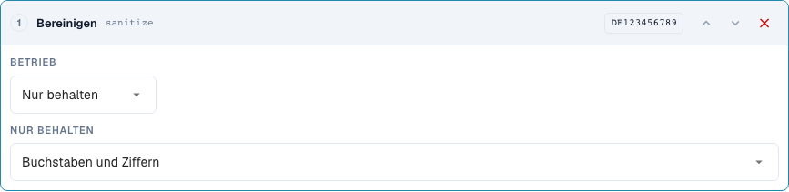
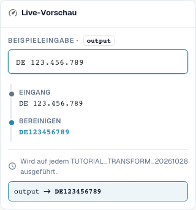

# Text bereinigen: Schreibweise, Trimmen und Zeichen

[Zurück zum vollständigen Praxisüberblick](praxisueberblick.md)

Kopffeld · Ziel Ergebnis · Schritte einzeln testen: case, trim, sanitize.

## Vorgehen im Editor

1. Den vorgesehenen Dokumenttyp öffnen und den Geltungsbereich wählen.
2. Ziel und gegebenenfalls eine getrennte Quelle einstellen.
3. Die unten beschriebenen Schritte in der passenden Reihenfolge konfigurieren.
4. Eingabe und Gegenfall in der Vorschau prüfen und mit dem Servertest vergleichen.
5. Eine gespeicherte Regel erneut öffnen; die Dokumentwirkung mit einem isolierten Beleg prüfen.

<figure><figcaption>
Konfiguration der Schritte. Originalaufnahme der deutschen Oberfläche. Die Vorschau verändert keine gespeicherten Dokumente.
</figcaption></figure>

<figure><figcaption>
Live-Vorschau mit Schulungswert. Originalaufnahme der deutschen Oberfläche. Die Vorschau verändert keine gespeicherten Dokumente.
</figcaption></figure>

## 1. Schreibweise

Großschreibung vereinheitlicht beispielsweise eine Rechnungsnummer. Kleinschreibung kann einen technischen Vergleichsschlüssel vereinheitlichen. Title Case und die Großschreibung des ersten Zeichens verändern auch den Rest des Wortes. Aus einer vollständig groß geschriebenen Firmenabkürzung kann deshalb eine andere Schreibweise werden. Für Eigennamen und rechtlich relevante Bezeichnungen verwende ich diese Varianten nur mit einer klaren fachlichen Vorgabe. Ich prüfe alle vier Modi an derselben Beispieleingabe und vergleiche die Ausgabe.

## 2. Trimmen

Trimmen entfernt Zeichen am Rand. Beide Seiten entfernt äußere Leerzeichen, aber kein Leerzeichen mitten in einer Nummer. Links mit dem Zeichen Null entfernt alle führenden Nullen. Ein Wert, der nur aus Nullen besteht, wird dadurch leer. Rechts arbeitet entsprechend am Ende. Das Feld Zeichen ist eine Menge einzelner Zeichen und kein vollständiges Präfix. Ein festes Artikelpräfix entferne ich deshalb mit Affix. Auffüllen und Abschneiden behandeln wir in der nächsten Folge.

## 3. Zeichen bereinigen

Beim Bereinigen kann ich nur Buchstaben und Ziffern, nur Buchstaben, nur Ziffern oder zusätzlich Leerzeichen behalten. Eine deutsche Steuerkennung mit Leerzeichen und Punkten wird so zu einem zusammenhängenden Schlüssel. Bei einer Artikelnummer können Bindestriche allerdings fachlich wichtig sein. Das Entfernen solcher Zeichen muss zur Schreibweise im Zielsystem passen. Die alternative Zeichenentfernung arbeitet mit einer regulären Zeichenklasse. Ein Bindestrich benötigt darin besondere Aufmerksamkeit. Für mein Beispiel prüfe ich deshalb den tatsächlichen Serverwert zusätzlich zur Vorschau. Bereits bereinigte Werte und leere Eingaben gehören in jeden Test.

## Geprüfte Beispiele und Gegenfälle

Diese Werte wurden serverseitig als trockener Test geprüft. Ein solcher Test verändert keine gespeicherten Dokumente.

| Fall | Eingabe | Serverergebnis |
| --- | --- | --- |
| case-upper | `inv-4711` | `INV-4711` |
| case-upper | `INV-4711` | `INV-4711` |
| case-lower | `INFO@BEISPIEL.DE` | `info@beispiel.de` |
| case-title | `acme gmbh` | `Acme Gmbh` |
| case-capitalize | `aCME GMBH` | `Acme gmbh` |
| trim | `  4711  ` | `4711` |
| trim | `47 11` | `47 11` |
| trim-zero | `004711` | `4711` |
| trim-zero | `000` | `` |
| sanitize | `DE 123.456.789` | `DE123456789` |
| sanitize-alpha | `DE-123` | `DE` |
| sanitize-numeric | `DE-123` | `123` |
| sanitize-space | `ACME GmbH!` | `ACME GmbH` |
| sanitize-strip | `ab-12/3.` | `ab123` |

## Abnahme

Prüfen Sie einen passenden Fall, einen Gegenfall, einen leeren Wert und ein bereits verarbeitetes Ergebnis. Wiederholen Sie den Dokument-Speichervorgang. Prüfen Sie PO-Abgleich und ERP-Empfang zusätzlich, wenn sie zum fachlichen Ziel gehören.
