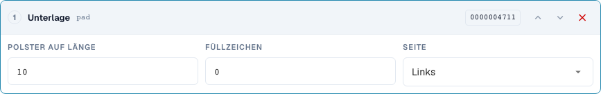
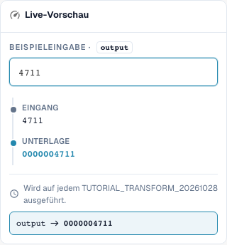

# Nummern formen: Auffüllen, Kürzen, Präfix und Suffix

[Zurück zum vollständigen Praxisüberblick](praxisueberblick.md)

Kopffeld · pad: Länge 10, Zeichen 0, links; truncate: Länge 10; affix: exakte Präfix-/Suffixoperation.

## Vorgehen im Editor

1. Für die Nummer **Auffüllen** wählen; der aktuelle deutsche Editor nennt diesen Schritt „Unterlage“. Mindestlänge 10, Füllzeichen `0`, Seite links setzen. `4711` muss `0000004711` ergeben.
2. Mit einer bereits elfstelligen Eingabe gegenprüfen: Auffüllen darf nichts abschneiden. Für Ergänzungen rechts separat Länge 6, Zeichen `_` und Eingabe `ABC` testen.
3. In einer eigenen Regel **Kürzen** mit Maximallänge 10 einstellen. `ABCDEFGHIJKL` wird `ABCDEFGHIJ`, `ABC` bleibt erhalten. Prüfen, ob unterschiedliche Eingaben dadurch dieselbe Kennung ergeben könnten.
4. **Affix** mit Präfix hinzufügen `INV-` testen. Anschließend `INV-4711` als Eingabe prüfen: Das exakte vorhandene Präfix darf nicht erneut ergänzt werden.
5. Die anderen Affix-Varianten getrennt konfigurieren: Suffix hinzufügen `-DE`, Präfix entfernen `Art.-Nr. ` und Suffix entfernen ` EUR`. Beim Entfernen auch einen nicht passenden Rand und abweichende Großschreibung testen.
6. Die Ausgabe erneut als Eingabe verwenden. Besonders beim Entfernen mehrfach vorhandener Affixe kann ein zweiter Durchlauf weiter verändern.

<figure><figcaption>
Konfiguration der Schritte. Originalaufnahme der deutschen Oberfläche. Die Vorschau verändert keine gespeicherten Dokumente. Der Editor nennt Auffüllen derzeit „Unterlage“; gemeint ist die Ergänzung auf eine Mindestlänge.
</figcaption></figure>

<figure><figcaption>
Live-Vorschau mit Schulungswert. Originalaufnahme der deutschen Oberfläche. Die Vorschau verändert keine gespeicherten Dokumente.
</figcaption></figure>

## 1. Länge

Auffüllen ergänzt links oder rechts ein einzelnes Füllzeichen bis zur Mindestlänge. Mit zehn Stellen und Null links wird aus einer vierstelligen Nummer eine zehnstellige Kennung. Eine bereits längere Nummer bleibt länger. Auffüllen ist also keine Längenprüfung. Kürzen behält dagegen nur die ersten Zeichen bis zur gewählten Höchstlänge. Diese Information geht verloren. Vor einem ERP-Einsatz prüfe ich, ob verschiedene Nummern nach dem Kürzen identisch werden könnten. Kurze Werte bleiben unverändert.

## 2. Präfix und Suffix

Affix bietet vier Varianten: Präfix hinzufügen, Suffix hinzufügen, Präfix entfernen und Suffix entfernen. Ein hinzugefügtes Präfix wird nicht noch einmal ergänzt, wenn der Wert bereits genau damit beginnt. Das gilt entsprechend für ein Suffix. Entfernen prüft dagegen genau den Anfang oder das Ende. Eine abweichende Großschreibung wird nicht automatisch gleichgesetzt. Steht der Text mitten im Wert, bleibt er erhalten. Für beliebige Fundstellen verwende ich Suchen und Ersetzen.

## 3. Erneute Anwendung

Auch eine einfache Pipeline braucht einen Wiederholungstest. Entferne ich ein Präfix von einem doppelt vorangestellten Präfix, bleibt nach dem ersten Durchlauf noch eines übrig. Beim nächsten Durchlauf würde auch dieses verschwinden. Deshalb prüfe ich die gesamte Regel und nicht nur jeden Schritt einzeln. Die typische Rechnungsnummernpipeline lautet: Trimmen, Großschreibung, Präfix ergänzen. Ich teste eine rohe Nummer, eine schon fertige Nummer und einen abweichenden Lieferanten. Die Bedingung sorgt dafür, dass nur der vereinbarte Fall geändert wird.

## Geprüfte Beispiele und Gegenfälle

Diese Werte wurden serverseitig als trockener Test geprüft. Ein solcher Test verändert keine gespeicherten Dokumente.

| Fall | Eingabe | Serverergebnis |
| --- | --- | --- |
| pad | `4711` | `0000004711` |
| pad | `12345678901` | `12345678901` |
| pad-right | `ABC` | `ABC___` |
| truncate | `ABCDEFGHIJKL` | `ABCDEFGHIJ` |
| truncate | `ABC` | `ABC` |
| prefix-add | `4711` | `INV-4711` |
| prefix-add | `INV-4711` | `INV-4711` |
| suffix-add | `4711` | `4711-DE` |
| suffix-add | `4711-DE` | `4711-DE` |
| prefix-strip | `Art.-Nr. 4711` | `4711` |
| prefix-strip | `ART.-NR. 4711` | `ART.-NR. 4711` |
| prefix-strip | `Art.-Nr. Art.-Nr. 4711` | `Art.-Nr. 4711` |
| suffix-strip | `123 EUR` | `123` |
| suffix-strip | `123 EUR netto` | `123 EUR netto` |

## Abnahme

Prüfen Sie einen passenden Fall, einen Gegenfall, einen leeren Wert und ein bereits verarbeitetes Ergebnis. Wiederholen Sie den Dokument-Speichervorgang. Prüfen Sie PO-Abgleich und ERP-Empfang zusätzlich, wenn sie zum fachlichen Ziel gehören.
