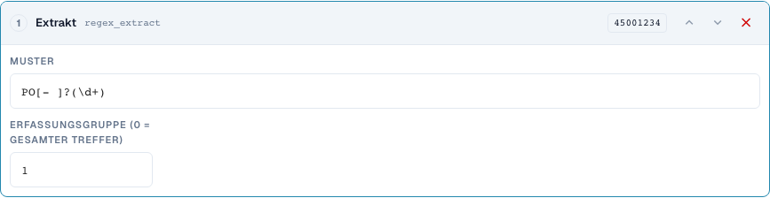
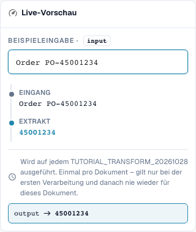

# Teilstücke und Muster: Ausschneiden, Extrahieren, Ersetzen

[Zurück zum vollständigen Praxisüberblick](praxisueberblick.md)

Kopffeld · Quelle header.input · Ziel output · regex_extract: PO[- ]?(\d+), Gruppe 1. Quelle und Ziel bleiben getrennt.

## Vorgehen im Editor

1. Für alle drei Schritte ein Ziel wie `output` und eine **getrennte Originalquelle** wie `header.input` wählen. Auch „Nur einmal pro Dokument“ erlaubt keine Selbstquelle.
2. Für **Teilstück** zunächst Start 0 und Länge 4 einstellen: `2026-10-28` ergibt `2026`. Danach Start 3 und Ende 7 mit `DE-4711-X` prüfen; das Ende zählt nicht mit.
3. Als eigene Variante Start −4 ohne Länge/Ende testen: `INV-4711` ergibt `4711`. Eine kürzere Eingabe ist ein notwendiger Gegenfall.
4. Für **Extrahieren** Muster `PO[- ]?(\d+)` und Erfassungsgruppe 1 verwenden. `Order PO-45001234` ergibt `45001234`; `Invoice 4711` ergibt leer. Gruppe 0 liefert dagegen den gesamten Treffer.
5. Für **Suchen und Ersetzen** Muster `\s+`, Ersatz ein Leerzeichen und Anzahl 0 konfigurieren. `ACME    GmbH` muss `ACME GmbH` ergeben. Danach Muster `-`, Ersatz `/`, Anzahl 1 mit `AB-CD-EF` prüfen: Nur der erste Bindestrich wird ersetzt.
6. Die konkreten Muster auch serverseitig testen. Ein erfolgreiches Browsermuster allein belegt bei komplexen Ausdrücken keine identische Serververarbeitung.

<figure><figcaption>
Konfiguration der Schritte. Originalaufnahme der deutschen Oberfläche. Die Vorschau verändert keine gespeicherten Dokumente.
</figcaption></figure>

<figure><figcaption>
Live-Vorschau mit Schulungswert. Originalaufnahme der deutschen Oberfläche. Die Vorschau verändert keine gespeicherten Dokumente.
</figcaption></figure>

## 1. Teilstück

Ein Teilstück wird über Start und Länge oder über Start und Ende festgelegt. Der erste Index ist Null. Das Ende gehört nicht mehr zum Ergebnis. Ein negativer Start zählt vom rechten Rand. Für die letzten vier Zeichen verwende ich einen Start von minus vier und kein Ende. Ich wähle eine andere Quelle als das Ziel. So liest jeder Durchlauf wieder den Originaltext. Der Server lehnt diese Schritte auf dem eigenen Zielfeld ab, weil der Wert sonst bei erneutem Verarbeiten immer weiter verändert werden könnte. Nur einmal ausführen ersetzt diese getrennte Quelle hier nicht.

## 2. Extrahieren

Extrahieren sucht den ersten Treffer eines regulären Ausdrucks. Mein Muster erkennt die Buchstaben P und O, optional einen Bindestrich oder ein Leerzeichen und danach Ziffern. Gruppe eins liefert nur die Ziffern, Gruppe null den vollständigen Treffer. Ohne Treffer kommt eine leere Zeichenfolge zurück. Ich setze daher eine passende Bedingung oder prüfe bewusst, ob ein leerer Zielwert in diesem Fall gewollt ist. Mehrere Bestellnummern in einem Text werden nicht automatisch zu mehreren Ergebnissen.

## 3. Ersetzen

Suchen und Ersetzen bearbeitet Treffer eines Musters. Mit einer Anzahl von Null werden alle Treffer ersetzt. Eins verändert nur den ersten Treffer. Mehrfache Leerzeichen kann ich durch ein einzelnes Leerzeichen ersetzen. Auch hier verwende ich eine separate Originalquelle. Die Vorschau im Browser und die Verarbeitung auf dem Server können bei anspruchsvollen regulären Ausdrücken unterschiedliche Regeln verwenden. Deshalb teste ich einfache Muster zuerst und vergleiche anschließend den tatsächlichen Serverwert. Ein passender Fall, kein Treffer und mehrere Treffer bilden meine Mindestprüfung.

## Geprüfte Beispiele und Gegenfälle

Diese Werte wurden serverseitig als trockener Test geprüft. Ein solcher Test verändert keine gespeicherten Dokumente.

| Fall | Eingabe | Serverergebnis |
| --- | --- | --- |
| substring | `2026-10-28` | `2026` |
| substring | `AB` | `AB` |
| substring-end | `DE-4711-X` | `4711` |
| substring-negative | `INV-4711` | `4711` |
| regex-extract | `Order PO-45001234` | `45001234` |
| regex-extract | `Invoice 4711` | `` |
| regex-replace | `ACME    GmbH` | `ACME GmbH` |
| regex-count | `AB-CD-EF` | `AB/CD-EF` |

## Abnahme

Prüfen Sie einen passenden Fall, einen Gegenfall, einen leeren Wert und ein bereits verarbeitetes Ergebnis. Wiederholen Sie den Dokument-Speichervorgang. Prüfen Sie PO-Abgleich und ERP-Empfang zusätzlich, wenn sie zum fachlichen Ziel gehören.
