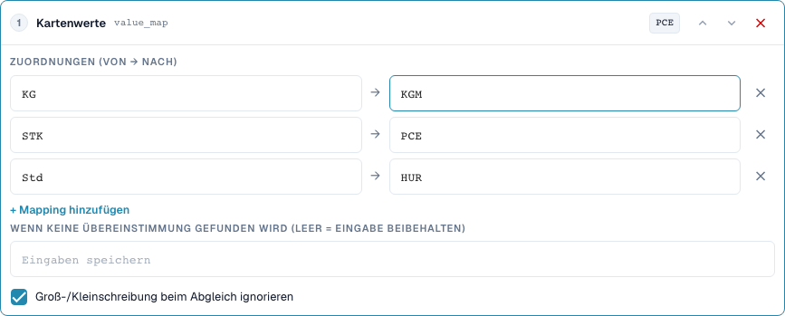
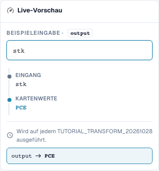

# Wertzuordnungen und Regeln pro Tabellenzeile

[Zurück zum vollständigen Praxisüberblick](praxisueberblick.md)

Tabellenspalte UNIT · Trimmen → value_map: STK→PCE, KG→KGM, Std→HUR · Großschreibung ignorieren.

## Vorgehen im Editor

1. Geltungsbereich **Tabellenspalte**, Tabelle `INVOICE_TABLE` und Zielspalte `UNIT` auswählen. Hier wird jede Tabellenzeile einzeln verarbeitet.
2. **Trimmen** vor **Werte zuordnen** setzen. Paare `STK→PCE`, `KG→KGM` und `Std→HUR` erfassen und Groß-/Kleinschreibung ignorieren aktivieren.
3. Das Feld für den Ersatz ohne Treffer leer lassen, damit unbekannte Codes erhalten bleiben. `stk` muss `PCE` ergeben, `BOX` muss `BOX` bleiben.
4. Eine Vorschau mit passender Zeilenbedingung und mit nicht passender Bedingung prüfen. Die Bedingung darf die anderen Zeilen nicht ungewollt erfassen.
5. Für eine echte Mehrzeilenprobe Ausgangswerte `STK`, `STK`, `BOX` vorbereiten. Im geprüften Servertest entsteht `PCE`, `PCE`, `BOX`; Menge und Preis bleiben fachlich gesondert zu prüfen.
6. Jeden Zielcode erneut als Eingabe prüfen. Ein pauschaler Ersatz wie `C62` und verkettete Zuordnungen können unbekannte Werte verdecken oder bei späteren Durchläufen weiter verändern.

<figure><figcaption>
Konfiguration der Schritte. Originalaufnahme der deutschen Oberfläche. Die Vorschau verändert keine gespeicherten Dokumente.
</figcaption></figure>

<figure><figcaption>
Live-Vorschau mit Schulungswert. Originalaufnahme der deutschen Oberfläche. Die Vorschau verändert keine gespeicherten Dokumente.
</figcaption></figure>

## 1. Wertepaare

Eine Wertzuordnung übersetzt ganze Eingabewerte. Mein Beispiel ordnet Stück dem Code P C E, Kilogramm dem Code K G M und Stunden dem Code H U R zu. Ich trage die tatsächlichen Lieferantencodes und die erwarteten Zielcodes als Paare ein. Mit ignorierter Großschreibung wird auch ein klein geschriebener Code erkannt. Das entfernt noch keine Leerzeichen. Deshalb setze ich einen Trimmschritt vor die Zuordnung. Einen unbekannten Code teste ich ausdrücklich.

## 2. Ohne Treffer

Ein leeres Feld für den Wert ohne Treffer bedeutet: Eingabe behalten. Es bedeutet nicht: Eingabe löschen. Ein fest eingetragener Ersatzwert ersetzt dagegen jeden unbekannten Code. Das kann Fehler verdecken. Bei fachlich unterschiedlichen Einheiten würde ich keinen pauschalen Ersatzcode vergeben. Eine Zuordnung ist auch nicht automatisch in jeder Kombination wiederholungsfest. Wenn die Ausgabe eines Paares gleichzeitig die Eingabe eines anderen Paares ist, kann ein späterer Durchlauf weiter zuordnen. Ich teste deshalb auch jeden Zielcode als neue Eingabe.

## 3. Pro Tabellenzeile

Für Tabellen wähle ich die konkrete Tabelle und die Zielspalte. Die Pipeline läuft dann für jede Zeile. Eine Bedingung kann den Einheitencode der aktuellen Zeile mit einem Lieferantenmerkmal aus dem Kopf verbinden. Im Beispiel werden zwei passende Zeilen geändert, während ein unbekannter Einheitencode erhalten bleibt. Das verändert keine Mengen oder Preise durch eine Einheitenumrechnung. Eine Zeichenfolge umzubenennen ist keine mathematische Umrechnung. Den tatsächlichen Bestellabgleich und einen Export prüfe ich getrennt von der Transformation.

## Geprüfte Beispiele und Gegenfälle

Diese Werte wurden serverseitig als trockener Test geprüft. Ein solcher Test verändert keine gespeicherten Dokumente.

| Fall | Eingabe | Serverergebnis |
| --- | --- | --- |
| map | `stk` | `PCE` |
| map | `PCE` | `PCE` |
| map | `BOX` | `BOX` |
| map-fallback | `BOX` | `C62` |
| item-pipeline | `Art.-Nr. ab-12/3` | `AB123` |

## Abnahme

Prüfen Sie einen passenden Fall, einen Gegenfall, einen leeren Wert und ein bereits verarbeitetes Ergebnis. Wiederholen Sie den Dokument-Speichervorgang. Prüfen Sie PO-Abgleich und ERP-Empfang zusätzlich, wenn sie zum fachlichen Ziel gehören.
